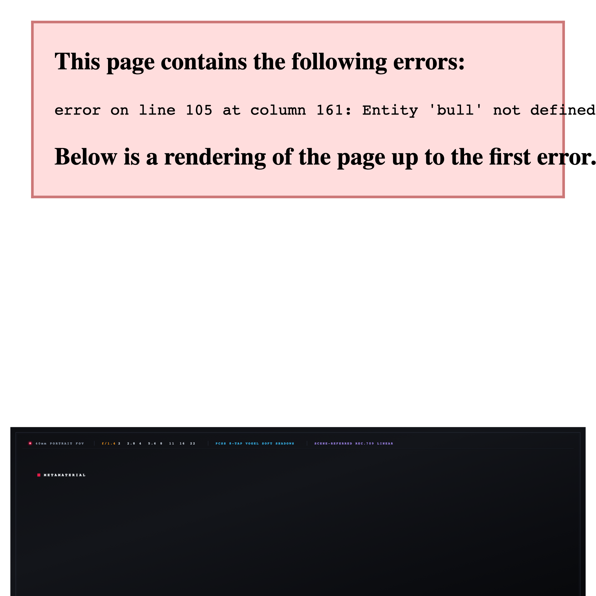
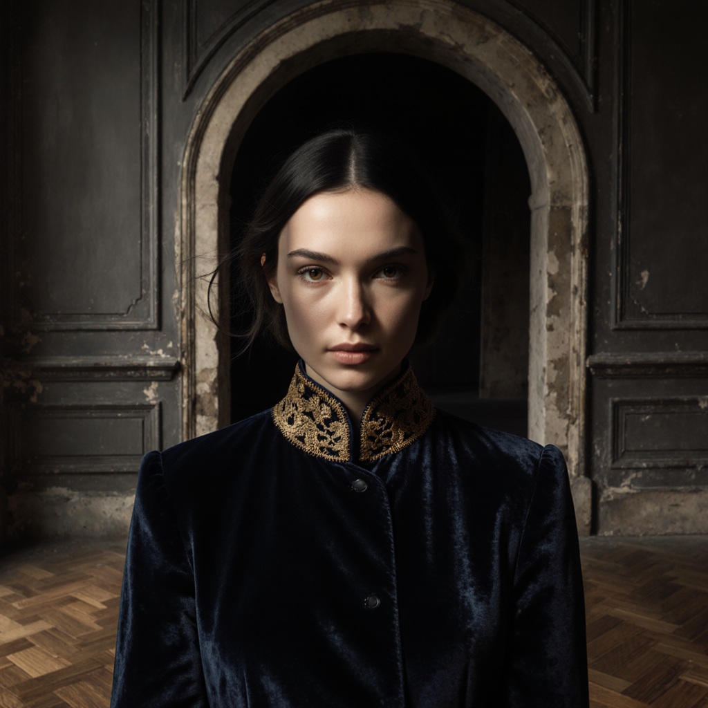
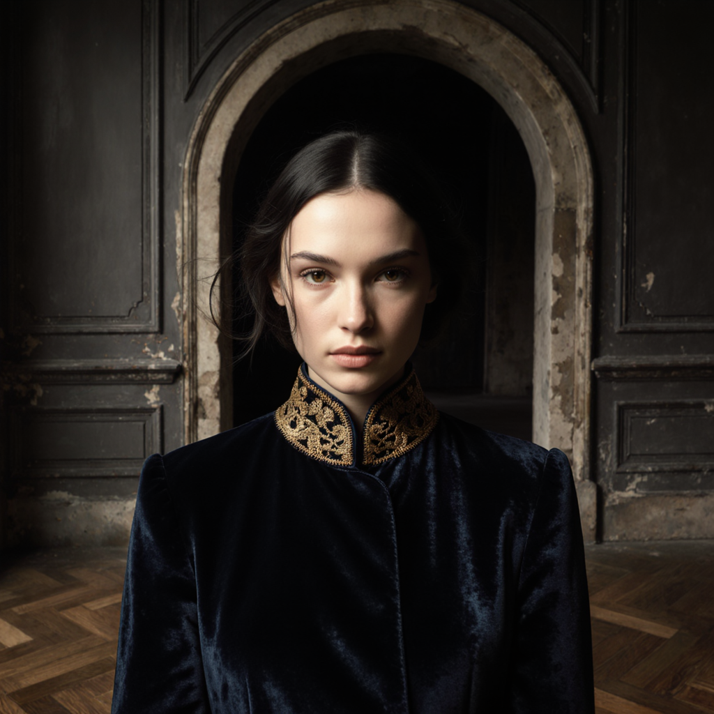
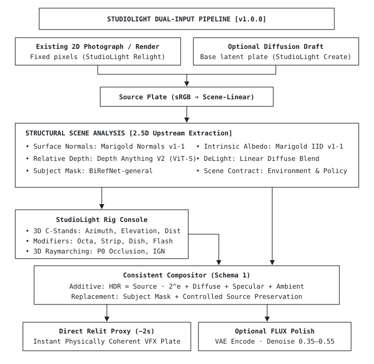
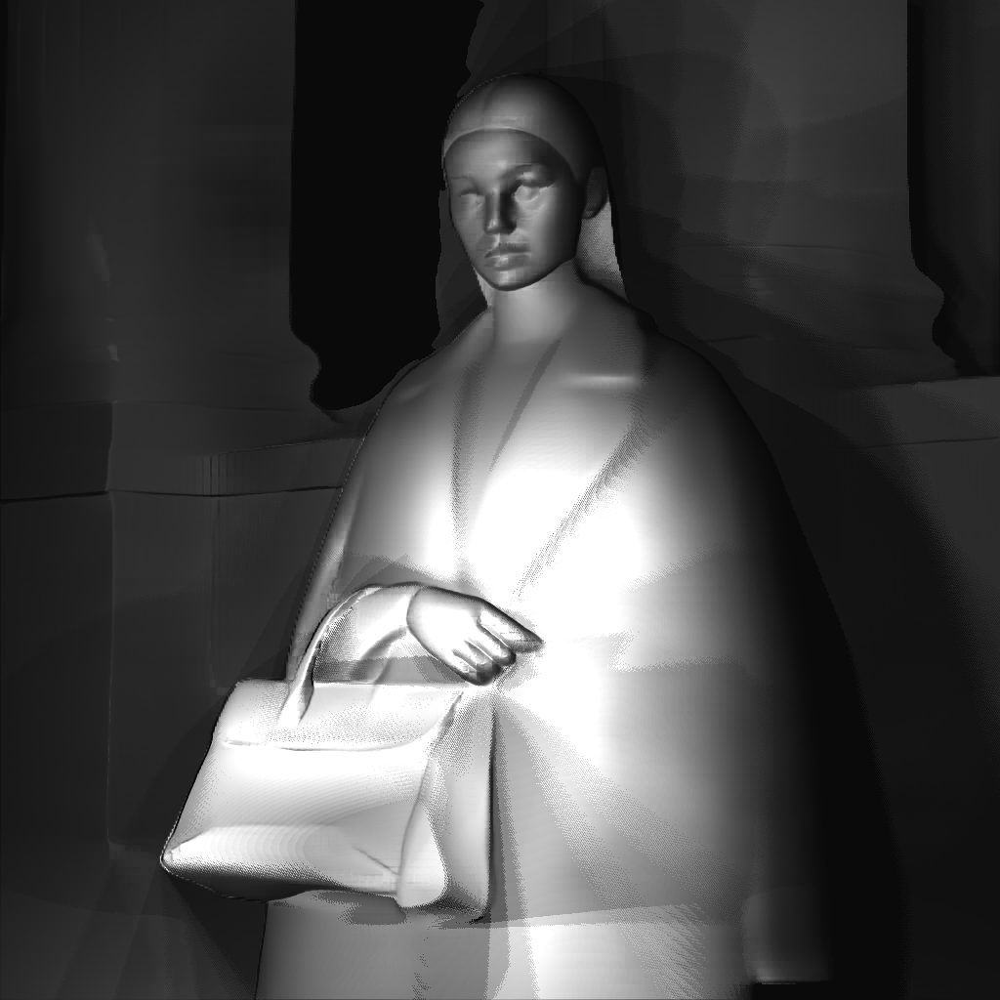
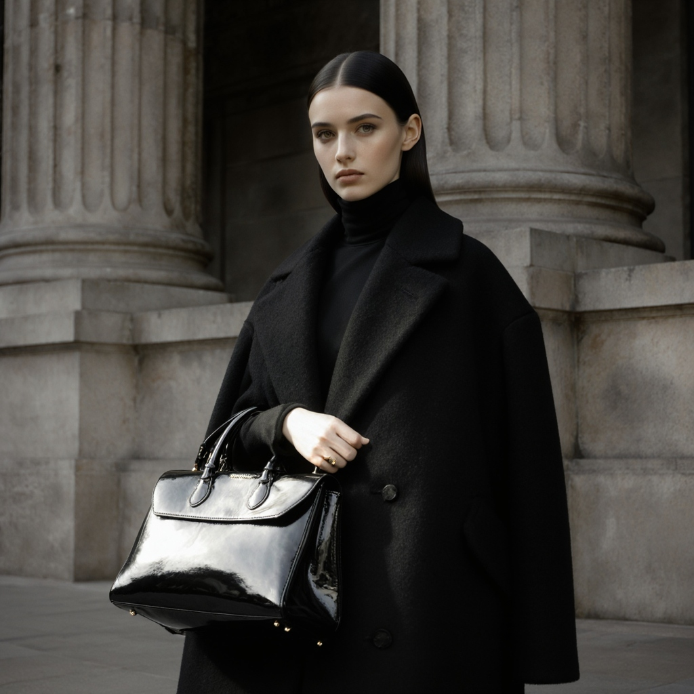
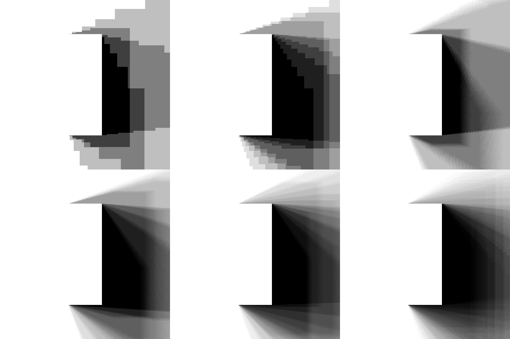
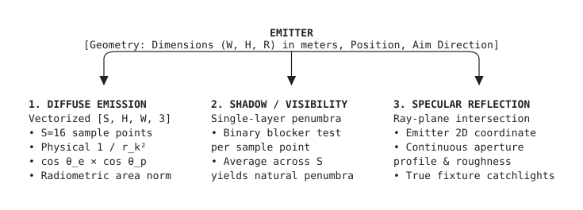
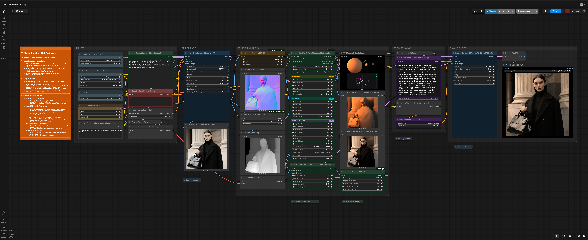

<div align="center">



<br>
<br>

**Stop prompt gambling. Design the light.**

Camera-space key, fill, and rim lights, photographic modifiers, and Kelvin control for FLUX in ComfyUI.

<p align="center">
  
  
  
  
  
  
  
</p>

<br>

<sub>
<a href="#same-subject-same-prompt-different-light">SHOWCASE</a> &nbsp;·&nbsp;
<a href="#the-problem-prompt-lottery-vs-spatial-control">THE PROBLEM</a> &nbsp;·&nbsp;
<a href="#what-makes-studiolight-different">DIFFERENTIATION</a> &nbsp;·&nbsp;
<a href="#how-it-works">PIPELINE</a> &nbsp;·&nbsp;
<a href="#from-camera-space-lighting-pass-to-final-flux-render">THE PROOF</a> &nbsp;·&nbsp;
<a href="#3d-camera-space-shadow-raymarching">3D SHADOWS</a> &nbsp;·&nbsp;
<a href="#optical-modifiers--sampled-area-emitters">AREA EMITTERS</a> &nbsp;·&nbsp;
<a href="#core-production-suite">CORE SUITE</a> &nbsp;·&nbsp;
<a href="#installation">INSTALL</a> &nbsp;·&nbsp;
<a href="#master-workflow">WORKFLOW</a> &nbsp;·&nbsp;
<a href="#known-limitations--engineering-scope">LIMITATIONS</a> &nbsp;·&nbsp;
<a href="#roadmap">ROADMAP</a>
</sub>

</div>

<br>

---

## Same Subject. Same Prompt. Different Light.

https://github.com/user-attachments/assets/f82d96d9-08ac-4dfb-8f1a-a65432f33a32

<br>

> **Identical Base Prompt and locked Seed: `777777`** | *FLUX.1 Krea Dev*

<table>
  <thead>
    <tr>
      <th width="33.33%" align="center">High-Fashion Beauty</th>
      <th width="33.33%" align="center">Direct On-Camera Flash</th>
      <th width="33.33%" align="center">Golden Hour Window</th>
    </tr>
  </thead>
  <tbody>
    <tr>
      <td align="center"></td>
      <td align="center"></td>
      <td align="center"></td>
    </tr>
    <tr></tr>
    <tr>
      <td align="center">
        <!-- Caption 1 -->
      </td>
      <td align="center">
        <!-- Caption 2 -->
      </td>
      <td align="center">
        <!-- Caption 3 -->
      </td>
    </tr>
  </tbody>
</table>

---

## The Problem: Prompt Lottery vs. Spatial Control

Text prompts cannot reliably execute 3D spatial vectors. Requesting a `"dramatic blue rim light on the left"` often triggers severe prompt bleed: facial features shift, clothing changes cut, and colors wash across the entire frame.

<table>
  <thead>
    <tr>
      <th width="50%" align="left">Prompt-Based Lighting (Text Only)</th>
      <th width="50%" align="left">StudioLight Spatial Control (VFX Engine)</th>
    </tr>
  </thead>
  <tbody>
    <tr>
      <td align="left"><b>Subject Mutation:</b> Prompting for light changes anatomy, styling, and background geometry.</td>
      <td align="left"><b>Geometry Guidance:</b> Primary scene anatomy, forms, and composition crystallize in Pass 1; Pass 2 applies illumination and textures over that structure.</td>
    </tr>
    <tr></tr>
    <tr>
      <td align="left"><b>Chromatic Bleed:</b> Color tokens tint skin, hair, and clothing indiscriminately.</td>
      <td align="left"><b>Directional Lobe Isolation in Plate:</b> Rim and key colors remain confined to illuminated surfaces (N · L &gt; 0) in the lighting plate, steering Pass 2 synthesis.</td>
    </tr>
    <tr></tr>
    <tr>
      <td align="left"><b>Uncalibrated Falloff:</b> Lights fail to observe inverse-square distance or scene depth.</td>
      <td align="left"><b>Geometric Inverse-Square Falloff:</b> Models (r<sub>ref</sub> / r)² distance falloff, normalized to studio reference stand distance (r<sub>ref</sub> = 1.8m).</td>
    </tr>
    <tr></tr>
    <tr>
      <td align="left"><b>Pre-baked Specular Artifacts:</b> High-gloss words bake blown-out white patches into early draft latents.</td>
      <td align="left"><b>Albedo Decoupling:</b> Renders clean draft plates with reduced baked highlights; specular kicks align with fixture placement.</td>
    </tr>
  </tbody>
</table>

---

## What Makes StudioLight Different

ComfyUI-StudioLight integrates image-derived camera-space geometry, screen-space shadow raymarching, and sampled photographic area emitters into a controllable lighting workflow for generative image synthesis.

### Defining Capabilities:
* **Depth-Based Camera-Space Shadowing:** Reconstructs camera-space surface positions from image-derived depth and configured studio scale ($40^\circ$ FOV), evaluating visibility along projected 3D light rays rather than flat screen-space offsets.
* **Geometric Area-Emitter Sampling:** Models photographic studio modifier apertures (Octabox 1.4m, Stripbox 0.3×1.2m, Beauty Dish 55cm) through Quasi-Monte Carlo Hammersley sampling. Contact-hardening penumbras emerge naturally from sample integration without an artificial PCSS blur pass.
* **Integrated Photometric Lighting:** Combines directional diffuse shading, Blinn-Phong specular microfacets, distance-dependent $(r_{\text{ref}}/r)^2$ falloff, and shadow visibility within a unified PyTorch pipeline.
* **Diffusion-Integrated Results:** Uses the computed lighting plate as explicit physical guidance for Pass 2 FLUX.1 Krea Dev latent synthesis, marrying spatial lighting control with generative material synthesis.

> [!NOTE]
> **Scope & Engineering Limits:** StudioLight performs screen-space raymarching over an estimated single-view geometry field (Depth Anything V2 + DSINE calibrated to studio scale). Pretrained monocular depth models estimate relative depth, which StudioLight anchors to virtual camera space (defaulting the subject plane to $Z = -2.0\text{m}$). It is designed for fast, controllable image relighting—not unrestricted path tracing over a complete multi-view 3D scene.

### Context & Adjacent Prior Art

StudioLight builds on established computer-graphics principles and exists alongside valuable ComfyUI lighting tools:

<table>
  <thead>
    <tr>
      <th width="24%" align="left">Approach&nbsp;/&nbsp;Tool</th>
      <th width="36%" align="left">Documented Technique</th>
      <th width="40%" align="left">StudioLight Distinction</th>
    </tr>
  </thead>
  <tbody>
    <tr>
      <td align="left"><b>Learned Relighting</b><br>(<a href="https://github.com/lllyasviel/ic-light">IC-Light</a>)</td>
      <td align="left">Text-conditioned and background-conditioned diffusion relighting models.</td>
      <td align="left">Provides explicit physical studio fixture parameters (stand distance in meters, elevation/azimuth in degrees, blackbody Kelvin, physical modifier geometry).</td>
    </tr>
    <tr></tr>
    <tr>
      <td align="left"><b>Point-Light &amp; Pass Relighting</b><br>(<a href="https://github.com/FXTD-Studios/radiance">FXTD Radiance</a>)</td>
      <td align="left">Comprehensive VFX toolset featuring scene-linear math, camera-space point lights, and normal-based shading passes.</td>
      <td align="left">Provides an integrated geometric area-emitter shadow raymarcher and single-view depth reconstruction directly within the lighting rig node.</td>
    </tr>
    <tr></tr>
    <tr>
      <td align="left"><b>Screen-Space Mask Lighting</b><br>(<a href="https://github.com/EnragedAntelope/comfyui-relight">ComfyUI-ReLight</a>)</td>
      <td align="left">Vectorized 2D screen-space raymarching over subject masks.</td>
      <td align="left">Extends raymarching into 3D camera space with depth-buffer occlusion testing and sampled area-emitter apertures.</td>
    </tr>
  </tbody>
</table>

---

## How It Works

StudioLight splits generation into a **two-stage geometry and relighting pipeline**:

<br>
<div align="center">
  
</div>
<br>

1. **Geometry Crystallization (Steps 0–10):** Pass 1 generates an unlit albedo draft to define scene forms, anatomy, and clothing weave without baked directional shadows.
2. **Camera-Space 3D Projection:** Extracts surface normals (DSINE) and estimated depth (Depth Anything V2), back-projecting the 2D draft into virtual camera-space ($40^\circ$ portrait FOV calibrated to studio scale).
3. **Photometric Deferred Shading:** Computes diffuse irradiance, Blinn-Phong specular lobes, and 3D camera-space shadow raymarching from virtual C-stands.
4. **Stochastic Polish (Pass 2):** Composites the lit plate in linear Rec.709 space, preps tones in the `SIShadowHighlight` darkroom, and feeds it to Pass 2 (`denoise 0.25 – 0.85+`) to synthesize subsurface skin scattering and photorealistic catchlights.

---

## From Camera-Space Lighting Pass to Final FLUX Render

> **Identical Camera Intrinsics ($40^\circ$ Portrait FOV) & Studio Rig Coordinates.**  
> Left: Deferred lighting pass preview (computed in float32 PyTorch raymarcher). Right: Final FLUX.1 Krea Dev latent synthesis.

<table>
  <thead>
    <tr>
      <th width="50%" align="center">1. Deferred 3D Shading Pass (PyTorch Raymarcher)</th>
      <th width="50%" align="center">2. Final FLUX Synthesis (Generative Diffusion Interpretation)</th>
    </tr>
  </thead>
  <tbody>
    <tr>
      <td align="center"></td>
      <td align="center"></td>
    </tr>
    <tr></tr>
    <tr>
      <td align="left">
        <b>Deterministic Physical Lighting Guidance:</b><br>
        • Canonical 3D camera-space raymarching through estimated depth field<br>
        • Optical contact-hardening under knuckles and coat collar<br>
        • Diverging physical penumbra cast across 2m background chasm
      </td>
      <td align="left">
        <b>Generative Material Synthesis:</b><br>
        • High-contrast dielectric specular catchlights on patent leather<br>
        • Preserves dark black wool texture without crushed blacks or self-shadow acne<br>
        • Fluted neoclassical stone grain and ambient occlusion interpretation
      </td>
    </tr>
  </tbody>
</table>

---

## 3D Camera-Space Shadow Raymarching

StudioLight replaces flat screen-space offsets with **canonical 3D camera-space raymarching through reconstructed depth fields**:

```
P_receiver ──► P_receiver + t · (P_light - P_receiver) ──► Perspective Projection ──► Bilinear Depth Lookup ──► P0 Occlusion Gate
```

* **P0 Front-of-Ray Occlusion Gate ($D_{\text{scene}} \le D_{\text{ray}} - \epsilon$):** Evaluates depth strictly in front of the ray sample, suppressing false shadows and receiver self-shadow acne on curved faces in automated tests while handling camera-side key lights and rear rim kickers symmetrically.
* **Long-Distance Depth Projection:** Evaluated across expanding depth gaps (tested up to $24\text{m}$ in calibrated test geometry) without artificial screen-space search clamping, allowing foreground subjects to cast shadows onto distant architectural backgrounds.
* **Single-Layer Physical Penumbra:** Soft shadows emerge naturally from multi-sample Quasi-Monte Carlo integration across the physical aperture face (Octabox 1.40m, Stripbox 0.30×1.20m, Beauty Dish 55cm) with **Interleaved Gradient Noise (IGN)** sub-step dither to smooth discrete step transitions—zero artificial PCSS post-blur required.

<div align="center">

<br>
<sub>Slit Aperture Penumbra Stress Test (Row 1: S=4 no dither, S=8 no dither, S=4 dither. Row 2: S=8 dither [Balanced Default], S=16 dither [High-End], S=64 Quasi-Monte Carlo Ground Truth).</sub>
</div>

### NVIDIA RTX 3090 Performance Benchmarks

*Measured via `tools/run_hardcore_stress_tests.py` on an NVIDIA GeForce RTX 3090 (PyTorch 2.13, CUDA 12.6, 5 warm runs averaged with `torch.cuda.synchronize()`):*

<table>
  <thead>
    <tr>
      <th align="left">Resolution</th>
      <th align="left">Preset</th>
      <th align="center">Samples&nbsp;(S)</th>
      <th align="center">Steps</th>
      <th align="center">Pass&nbsp;Latency (RTX&nbsp;3090)</th>
      <th align="center">Peak&nbsp;VRAM</th>
      <th align="center">Ray-Sample Steps&nbsp;/&nbsp;sec</th>
    </tr>
  </thead>
  <tbody>
    <tr>
      <td align="left">512&nbsp;×&nbsp;512</td>
      <td align="left">Fast Preview</td>
      <td align="center">4</td>
      <td align="center">12</td>
      <td align="center">12.0 ms</td>
      <td align="center">113 MB</td>
      <td align="center">1,047 M/s</td>
    </tr>
    <tr></tr>
    <tr>
      <td align="left"></td>
      <td align="left">Balanced (Default)</td>
      <td align="center">8</td>
      <td align="center">16</td>
      <td align="center">29.6 ms</td>
      <td align="center">118 MB</td>
      <td align="center">1,135 M/s</td>
    </tr>
    <tr></tr>
    <tr>
      <td align="left">1024&nbsp;×&nbsp;1024</td>
      <td align="left">Fast Preview</td>
      <td align="center">4</td>
      <td align="center">12</td>
      <td align="center">32.0 ms</td>
      <td align="center">450 MB</td>
      <td align="center">1,571 M/s</td>
    </tr>
    <tr></tr>
    <tr>
      <td align="left"></td>
      <td align="left">Balanced (Default)</td>
      <td align="center">8</td>
      <td align="center">16</td>
      <td align="center">83.0 ms</td>
      <td align="center">469 MB</td>
      <td align="center">1,617 M/s</td>
    </tr>
    <tr></tr>
    <tr>
      <td align="left"></td>
      <td align="left">High-End Quality</td>
      <td align="center">16</td>
      <td align="center">24</td>
      <td align="center">245.3 ms</td>
      <td align="center">469 MB</td>
      <td align="center">1,642 M/s</td>
    </tr>
    <tr></tr>
    <tr>
      <td align="left">2048&nbsp;×&nbsp;2048 (4.2&nbsp;MP)</td>
      <td align="left">Balanced (Default)</td>
      <td align="center">8</td>
      <td align="center">16</td>
      <td align="center">311.5 ms</td>
      <td align="center">1.87 GB</td>
      <td align="center">1,724 M/s</td>
    </tr>
  </tbody>
</table>

> [!NOTE]
> * **Pass Latency:** Complete shadow visibility pass execution time.
> * **Ray-Sample Steps / sec:** Calculated as $(W \times H \times S \times \text{steps}) / \text{latency}$. For example, $1,617\text{ M/s}$ represents $1.62\times 10^9$ discrete ray-sample evaluations per second. Complete pass latency is $29.6\text{ ms}$ ($512^2$) and $83.0\text{ ms}$ ($1024^2$).
> * Benchmarks can be directly verified locally by running `python tools/run_hardcore_stress_tests.py`.

> [!TIP]
> For the complete mathematical formulation, low-discrepancy sampling derivations, and shader implementation:
> * [Mathematical Derivation & Architecture: 3D Camera-Space Shadow Raymarching](docs/ARCHITECTURE_3D_CAMERA_SPACE_SHADOWS.md)
> * [Architecture Plan: StudioLight Geometric Area Emitters](docs/ARCHITECTURE_PHYSICAL_AREA_EMITTERS.md)
> * [Engine Walkthrough & Benchmarks](docs/ENGINE_WALKTHROUGH_AREA_EMITTERS.md)

---

## Optical Modifiers & Sampled Area Emitters

StudioLight implements a **geometrically sampled studio area-emitter architecture**. Every studio modifier is modeled as a defined 3D virtual emitter with geometric dimensions ($W, H, R$), angular beam distributions, single-layer penumbra visibility, and an analytical aperture reflection in reflection space:

<br>
<div align="center">
  
</div>
<br>

<table>
  <thead>
    <tr>
      <th width="18%" align="left">Modifier</th>
      <th width="20%" align="center">Aperture<br>Dimensions</th>
      <th width="14%" align="center">Beam&nbsp;Angle<br>(&theta;<sub>beam</sub>)</th>
      <th width="26%" align="left">Optical Approximation</th>
      <th width="22%" align="left">Catchlight Profile</th>
    </tr>
  </thead>
  <tbody>
    <tr>
      <td align="left"><b>Direct On-Camera Flash</b></td>
      <td align="center">0.08m&nbsp;×&nbsp;0.05m</td>
      <td align="center">70°</td>
      <td align="left">Near-point strobe emitter</td>
      <td align="left">Crisp micro-pinpoint</td>
    </tr>
    <tr></tr>
    <tr>
      <td align="left"><b>Hard Snoot</b></td>
      <td align="center">R&nbsp;=&nbsp;0.05m<br>(10cm)</td>
      <td align="center">18°</td>
      <td align="left">Collimated beam cone</td>
      <td align="left">Tight circular isolation</td>
    </tr>
    <tr></tr>
    <tr>
      <td align="left"><b>Fresnel Spotlight</b></td>
      <td align="center">R&nbsp;=&nbsp;0.15m<br>(30cm)</td>
      <td align="center">35°</td>
      <td align="left">Optical lens edge cutoff</td>
      <td align="left">Compact stepped lens disc</td>
    </tr>
    <tr></tr>
    <tr>
      <td align="left"><b>Stripbox</b></td>
      <td align="center">0.30m&nbsp;×&nbsp;1.20m</td>
      <td align="center">65°</td>
      <td align="left">1:4 Asymmetric rectangular emitter</td>
      <td align="left">Elongated vertical catchlight bar</td>
    </tr>
    <tr></tr>
    <tr>
      <td align="left"><b>Beauty Dish (Silver)</b></td>
      <td align="center">R&nbsp;=&nbsp;0.275m<br>(55cm)</td>
      <td align="center">85°</td>
      <td align="left">Parabolic dish + center deflector (36% radius ratio, 12% center transmission)</td>
      <td align="left">Sculpted cheekbones, donut catchlight ring</td>
    </tr>
    <tr></tr>
    <tr>
      <td align="left"><b>Octabox (Soft)</b></td>
      <td align="center">R&nbsp;=&nbsp;0.70m<br>(140cm)</td>
      <td align="center">130°</td>
      <td align="left">Broad Lambertian octagonal emitter</td>
      <td align="left">Large wrap disc, soft continuous penumbra</td>
    </tr>
  </tbody>
</table>

> [!NOTE]
> All studio modifiers represent photographic approximations and virtual emitter geometries calibrated for photographic lighting control, rather than full laboratory optical simulations.

---

## Core Production Suite

<table>
  <thead>
    <tr>
      <th width="28%" align="left">Node</th>
      <th width="72%" align="left">Role &amp; Engineering Architecture</th>
    </tr>
  </thead>
  <tbody>
    <tr>
      <td align="left"><b><code>StudioLightRig</code></b><br><sub>3-Point Lighting Console</sub></td>
      <td align="left">Master photographic lighting console with 3D camera-space C-stand coordinates (azimuth, elevation, distance in meters), <b>3-Zone 3D Light Pointer (<code>Upper</code> / <code>Center</code> / <code>Lower</code>)</b> with curvature-guided face auto-aim, depth relief compression (<code>depth_relief_scale</code>), physical modifier apertures (Octabox, Stripbox, Beauty Dish, Fresnel, Snoot, Flash), blackbody Kelvin temperature (2000K–10000K), and 3D shadow raymarching. Outputs the diffuse relighting map, isolated specular pass, dual-sphere VFX probe + live Aim Target Radar HUD, and synchronized lighting prompt.</td>
    </tr>
    <tr></tr>
    <tr>
      <td align="left"><b><code>StudioPhotometricComposite</code></b><br><sub>Linear Rec.709 Compositor</sub></td>
      <td align="left">Scene-linear photometric shading engine (<code>sRGB → Linear Rec.709 → sRGB</code>). Integrates the diffuse irradiance plate and isolated specular lobe (<code>specular_kick</code>) over the Pass 1 albedo draft, applying chromatic midtone bleed (<code>chroma_bleed</code>) and rational filmic shoulder tonemapping (<code>filmic_white_point</code>) to prevent hard highlight clipping.</td>
    </tr>
    <tr></tr>
    <tr>
      <td align="left"><b><code>SIShadowHighlight</code></b><br><sub>Latent Preparation Darkroom</sub></td>
      <td align="left">Pre-diffusion tonal darkroom using bilateral Hermite cubic splines (<code>3t² − 2t³</code>) to independently recover deep shadows and compress specular highlights with zero midtone bleed, paired with bounded sigmoidal midtone contrast before Pass 2 VAE encoding.</td>
    </tr>
    <tr></tr>
    <tr>
      <td align="left"><b><code>StudioPromptSanitizer</code></b><br><sub>Pass 1 Albedo Decoupler</sub></td>
      <td align="left">Prompt-splitting utility that automatically strips directional lighting, rim-light, and high-gloss specular tokens from the Pass 1 draft prompt (appending a flat shadowless albedo carrier suffix) while routing the full unedited master prompt to Pass 2.</td>
    </tr>
  </tbody>
</table>

---

## Empirical Discoveries & Working Rules

* **Rule 1: Pass 1 Functions Best as a Flat Albedo Carrier:** Prompting Pass 1 with directional sun bakes hard contours into base geometry. Use an albedo carrier suffix in Pass 1 (`", flat diffuse ambient lighting, shadowless, albedo"`) to give StudioLight clean geometric control.
* **Rule 2: Matte Fabrics Require Dedicated Specular Isolation:** Dark wool has albedo near 0.02. High specular kicks cause grazing Fresnel spikes, turning black wool into metallic foil. Wire `specular_pass` directly into `StudioPhotometricComposite`, keep `specular_kick` at `0.30–0.50`, and set `chroma_bleed = 0.00` on dark garments.
* **Rule 3: Radiometric Distance Falloff Replaces Artificial Depth Tapers:** Legacy screen-space shaders often clamp distant geometry (`d_norm < 0.20`) to suppress noise, which accidentally destroys shadows on distant walls. StudioLight evaluates unconstrained physical $(r_{\text{ref}}/r)^2$ radiometric falloff and directional beam profiles ($\cos\theta > 0$), allowing foreground subjects to naturally cast geometric shadows across architectural depth gaps.
* **Rule 4: Calibrated Normal Boost (`normal_boost = 1.35`) Prevents Grazing-Angle Terminator Seams:** Under steep grazing key lights (e.g. $75^\circ$ elevation Fresnel/Snoot), over-amplifying DSINE normal maps (`normal_boost >= 2.5`) sharpens the $\mathbf{N}\cdot\mathbf{L}=0$ terminator and cavity AO gradient faster than Pass 2 diffusion (`denoise = 0.48`) can blend, creating hard forehead seams or dark eye-socket dots. Keeping `normal_boost` at the calibrated **`1.35`** default preserves 3D facial sculpting while eliminating grazing-angle terminator artifacts.
* **Rule 5: Pass 2 Denoise Governs Illumination Integration & Creative Freedom:**
  * `0.35 – 0.45` (Feature Lock & Subtle Fill): Preserves exact identity, original micro-textures, and fine facial features with a gentle lighting wash.
  * `0.50 – 0.65` (Balanced Relighting): Default zone for studio lighting integration—synthesizes skin subsurface scattering, specular eye catchlights, and realistic fabric wraps while anchoring geometry.
  * `0.70 – 0.85+` (Dramatic Transformation & Deep Re-Shading): Allows diffusion full creative freedom to completely re-illuminate complex scenes, repaint albedo, and create intense chiaroscuro contrast. Adjust according to creative intent.

---

## Installation

### 1. Manual Installation (Recommended)
```bash
cd ComfyUI/custom_nodes
git clone https://github.com/maciejtajber/ComfyUI-StudioLight.git
pip install -r ComfyUI-StudioLight/requirements.txt
```
*(ComfyUI Manager registry listing is currently pending submission).*

### Hardware & VRAM Requirements
* **GPU Memory:** Tested on 24 GB VRAM GPUs (NVIDIA RTX 3090 / A40). For FLUX.1 [dev] paired with full geometry preprocessors (DSINE + Depth Anything V2), 16–24 GB VRAM is recommended (or $\ge 12\text{ GB}$ with fp8 quantized weights). The StudioLight lighting shader itself is lightweight, allocating only $\sim 469\text{ MB}$ at $1024^2$ resolution.
* **Master Workflow:** Open [`workflows/StudioLight_Master.json`](workflows/StudioLight_Master.json) for the complete 2-stage studio relighting pipeline.

### Dependencies & Models
* **Preprocessors:** Install `comfyui_controlnet_aux` for `DSINE-NormalMapPreprocessor` and `DepthAnythingV2Preprocessor`.
* **Models:** Standard `flux1-dev.safetensors` (or `flux1-krea-dev.safetensors`), CLIP text encoders, and VAE.
* **Licensing Note:** FLUX.1 [dev] weights are released under Black Forest Labs' Non-Commercial License. Verify licensing terms for commercial deployments.

### Automated Test Suite
Verify math, photometric color spaces, and shader engines (runs standalone without ComfyUI):
```bash
python test_studiolight.py
```

---

## Master Workflow

> **Production Architecture:** Complete 2-Stage FLUX.1 Krea Dev pipeline with prompt decoupling, 3D camera-space shadow raymarching, photometric compositing, and live VFX sphere probes.

<a href="assets/studiolight_master_workflow.png" target="_blank">
  
</a>

<sub>*Click the workflow canvas above to inspect in full 8800×3600 resolution.*</sub>

<br>
<br>

* **Ready-to-Run Workflow:** Download [`workflows/StudioLight_Master.json`](workflows/StudioLight_Master.json) and drag it directly into ComfyUI.
* **Pipeline Breakdown:**
  * **Stage 1 — Base Subject & Geometry:** Base latent generation with prompt sanitization, followed by surface normal extraction (`DSINE`) and metric depth estimation (`Depth Anything V2`).
  * **Stage 2 — Photometric Shader Engine:** Camera-space area-emitter raymarching (`StudioLightRig` & `StudioLightShaderEngine`), rendering key, fill, and rim lights with physical inverse-square falloff, Kelvin color temperatures, and contact-hardening penumbras.
  * **Stage 3 — Stochastic Diffusion Fusion:** 32-bit photometric relighting plates composited back into the latent stream for a targeted diffusion pass, locking identity while altering light vectors.

---

## Known Limitations & Engineering Scope

* **Pre-Baked Specular Highlights on High-Gloss Objects:** When the Pass 1 prompt contains high-gloss tokens (e.g. patent leather, chrome, wet surfaces), diffusion models often bake white specular patches directly into the base albedo. While `StudioPromptSanitizer` mitigates this by replacing high-specular terms with neutral/matte descriptions in Pass 1, deeply baked albedo highlights cannot be completely removed by screen-space shading alone without dedicated inpainting.
* **Relative Depth Scaling:** Operates on estimated monocular depth (Depth Anything V2), normalized and calibrated to a studio coordinate frame ($Z=-2.0\text{m}$). It does not represent physical millimeter-level LiDAR ground truth.
* **Single-View Frustum Bounds:** Screen-space raymarching is constrained to surfaces visible in the 2.5D camera buffer; occluded geometries behind foreground objects cannot cast shadows.
* **Pass 2 Latent Interpretation:** StudioLight produces deterministic photometric guidance plates; Pass 2 FLUX latent diffusion interprets these plates generatively. Higher denoise levels ($\ge 0.70$) give diffusion greater creative freedom to repaint albedo and atmosphere, whereas lower values ($0.35–0.55$) strictly anchor identity, fine details, and plate geometry.
* **Model Weight Licensing:** FLUX.1 [dev] weights are provided under Black Forest Labs' Non-Commercial License. Verify licensing requirements for commercial deployments.

---

## Technical Documentation Index

<table>
  <thead>
    <tr>
      <th width="48%" align="left">Document</th>
      <th width="52%" align="left">Purpose</th>
    </tr>
  </thead>
  <tbody>
    <tr>
      <td align="left"><a href="docs/ARCHITECTURE_3D_CAMERA_SPACE_SHADOWS.md"><code>ARCHITECTURE_3D_CAMERA_SPACE_SHADOWS.md</code></a></td>
      <td align="left">Canonical raymarching formulation, P0 occlusion gate, IGN dither derivation, stress benchmarks</td>
    </tr>
    <tr></tr>
    <tr>
      <td align="left"><a href="docs/ARCHITECTURE_PHYSICAL_AREA_EMITTERS.md"><code>ARCHITECTURE_PHYSICAL_AREA_EMITTERS.md</code></a></td>
      <td align="left">Geometric area apertures, 2D Hammersley sampling, radiometric normalization</td>
    </tr>
    <tr></tr>
    <tr>
      <td align="left"><a href="docs/ENGINE_WALKTHROUGH_AREA_EMITTERS.md"><code>ENGINE_WALKTHROUGH_AREA_EMITTERS.md</code></a></td>
      <td align="left">Vectorized PyTorch shader implementation, memory chunking, profiling</td>
    </tr>
    <tr></tr>
    <tr>
      <td align="left"><a href="docs/DISCOVERY_3D_CAMERA_SPACE_SHADOW_RAYMARCHING.md"><code>DISCOVERY_3D_CAMERA_SPACE_SHADOW_RAYMARCHING.md</code></a></td>
      <td align="left">Empirical discovery notes: 2D screen-space limits vs 3D camera-space</td>
    </tr>
  </tbody>
</table>

---

## Roadmap

### Upcoming Milestones 🎯
* [ ] **Custom 3D Aim Pointer (`X, Y, Z`):** Interactive 3D target locator (`Custom` mode alongside `Upper`, `Center`, `Lower`) allowing manual placement of the camera-space aim point in meters (`target_pos` is already supported in the underlying `shader_engine.py` raymarcher).
* [ ] **Independent Per-Lamp Aim Pointer (`Key`, `Fill`, `Rim`):** Decoupled aim targets for each individual C-stand so `Key`, `Fill`, and `Rim` can independently target different subject zones (e.g., `Key` aimed at `Upper` face while `Rim` or `Fill` targets `Center` torso or custom coordinates).
* [ ] **Temporal & Video Diffusion Integration:** Model-agnostic integration piping 32-bit linear photometric relighting plates into video diffusion attention streams and spatio-temporal latents (Wan 2.1, LTX-Video, Hunyuan).
* [ ] **Temporal Light Vector Keyframing:** Continuous interpolation of light coordinates, intensity, and Kelvin temperatures across video frame sequences for smooth cinematic sweeps.
* [ ] **Expanded Model Architectures (Krea 2 & Beyond):** Conditioning adapters and native CFG response dynamics for newly released foundation models.
* [ ] **Universal 2D Image Relighting (Img2Img):** Standalone relighting pipeline accepting existing 2D photographs or renders via intrinsic albedo estimation and depth/normal extraction.
* [ ] **`StudioModifierTuner` Companion Node:** Dedicated utility node enabling continuous slider control over physical aperture diameter (0.01m – 3.00m), asymmetric modifier aspect ratios (stripbox width vs. length), and internal baffle diffusion softness.
* [ ] **Native 3D Stage & Asset Ingestion:** Integrated lightweight Three.js/WebGL canvas supporting `.glb` / `.obj` positioning, camera alignment, and interactive light gizmos inside ComfyUI.
* [ ] **Live Interactive Radar Overhaul:** Enhanced top-down radar console with multi-light distance ring manipulation and interactive beam-cone angles.
* [ ] **Material-Aware Specular Routing:** Automatic dielectric vs. metallic reflectance handling to prevent edge solarization across high-contrast fabric combinations.
* [ ] **Reference Pose-to-Lighting Matching:** Extract incident light directions from reference studio photographs and auto-populate the 3-point console coordinates.

---

### Active Research & Exploration (R&D) 🔬
* **Continuous Latent Trajectory Injection (Method B):** Non-destructive Euler ODE delta injection ($\Delta x = (x_0' - x_0) \cdot \text{strength}$) at flow step $\sigma_{10} = 0.863338$, exploring adaptive noise scaling to achieve material re-synthesis without stochastic restarts.

---

## License & Credits

* **Code & Shaders:** MIT License. Created by [Maciej Tajber](https://github.com/maciejtajber) // **METAMATERIAL** Applied VFX Systems.
