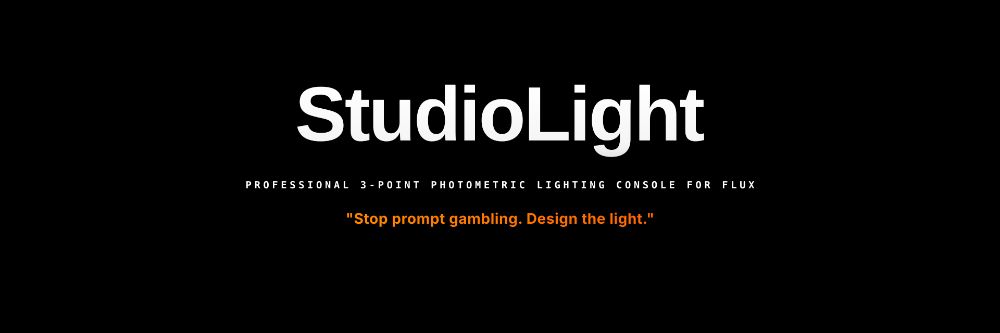
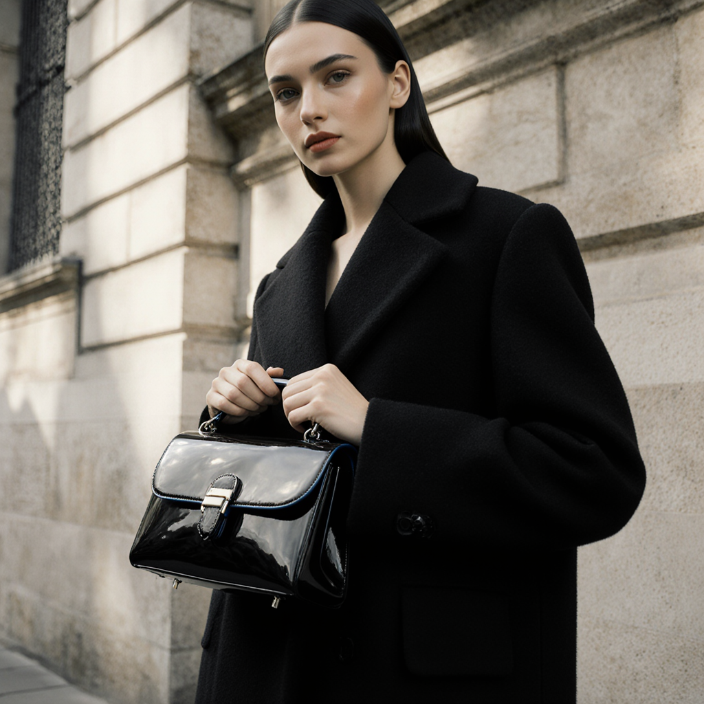
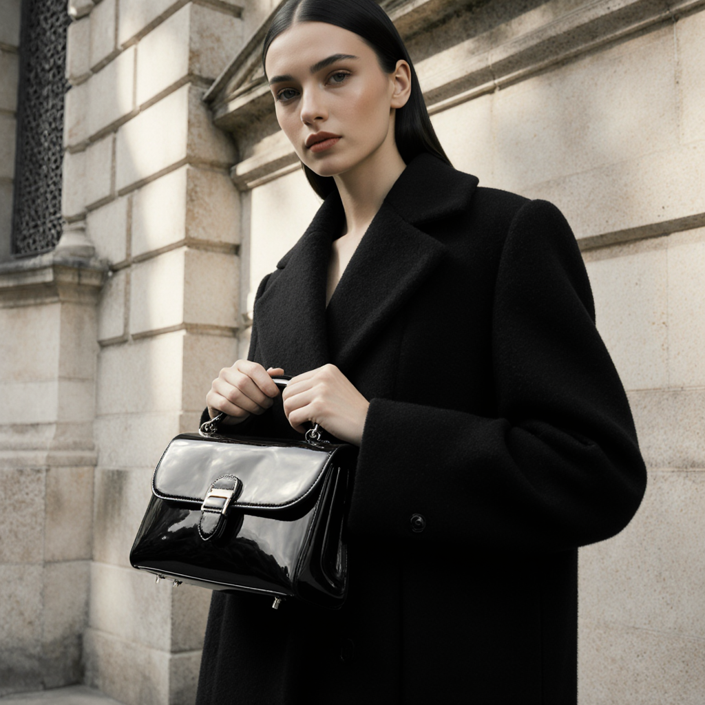
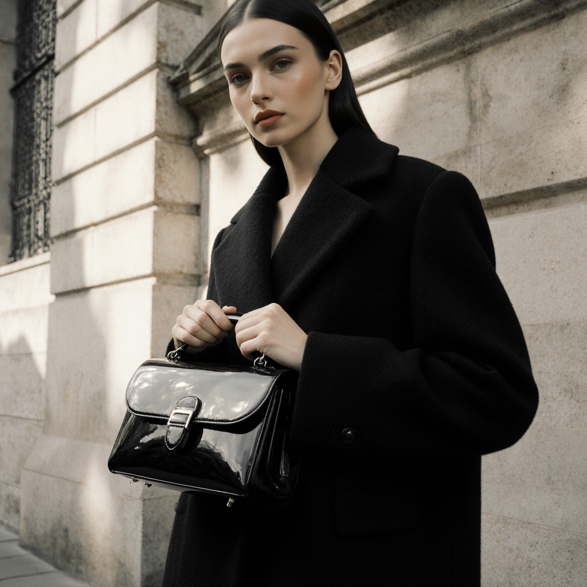
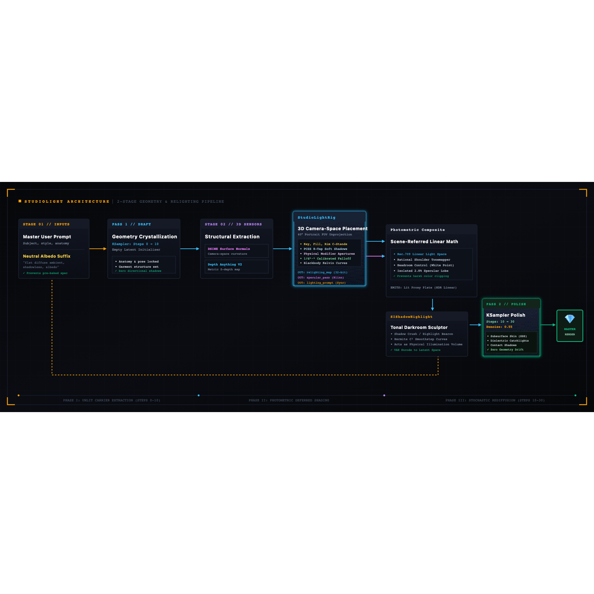
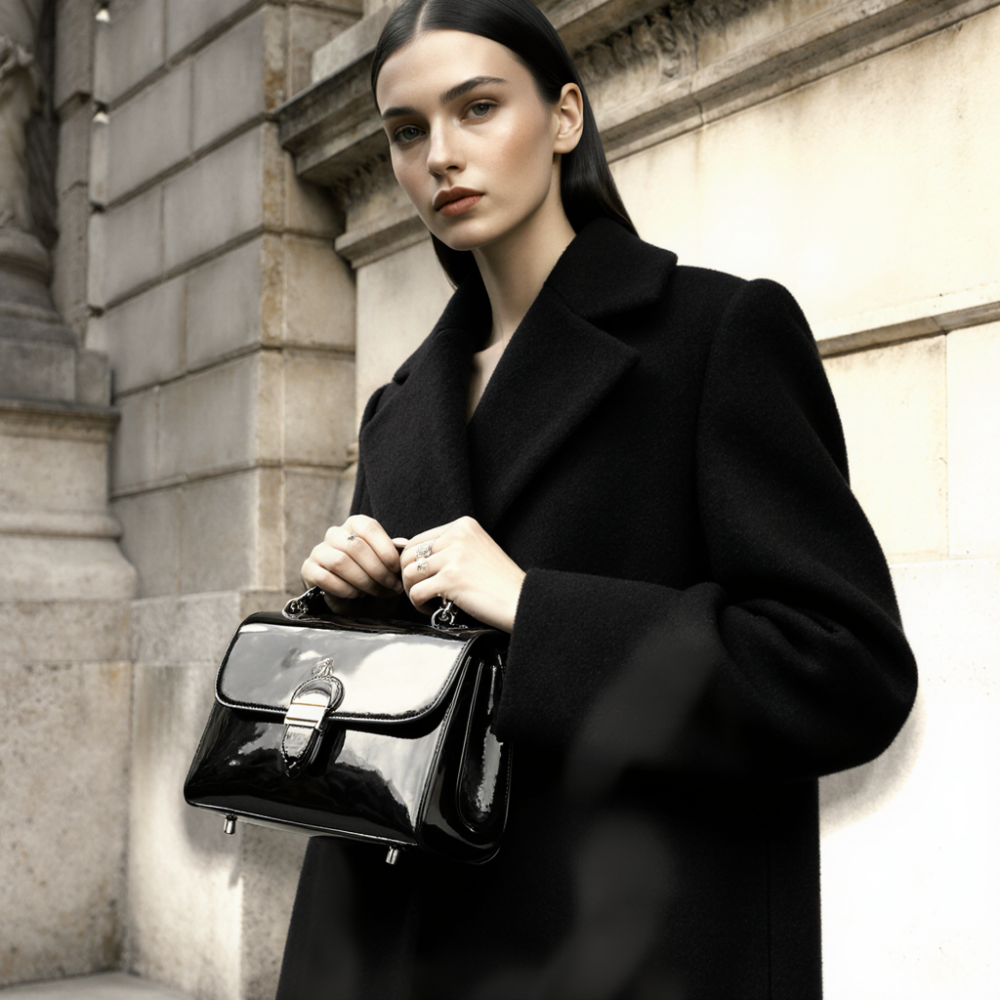

<div align="center">

<!-- HERO BANNER (CAMERA-GRADE HASSELBLAD & ZEISS AESTHETIC) -->


# StudioLight
### Professional 3-Point Photometric Lighting Console for FLUX
**by METAMATERIAL**

<p align="center">
  <b>Stop prompt gambling. Design the light.</b><br>
  Interactive 3D camera-space lighting control, physical modifier apertures, blackbody Kelvin calibration, and scene-referred linear photometric compositing for generative diffusion.
</p>

<!-- STATUS & SPEC BADGES -->
<p align="center">
  <a href="https://github.com/maciejtajber/ComfyUI-StudioLight/releases"></a>
  <a href="https://github.com/maciejtajber/ComfyUI-StudioLight"></a>
  <a href="https://black-forest-labs.com"></a>
  <a href="LICENSE"></a>
  <a href="#automated-test-suite"></a>
</p>

<!-- GITHUB ANCHOR NAVIGATION -->
<p align="center">
  <a href="#quick-demo"><b>Demo</b></a> •
  <a href="#same-subject-same-prompt-different-light"><b>Visual Proof</b></a> •
  <a href="#the-problem-prompt-lottery-vs-spatial-control"><b>The Problem</b></a> •
  <a href="#how-it-works"><b>Architecture</b></a> •
  <a href="#the-virtual-studio"><b>The Studio</b></a> •
  <a href="#showcase-gallery"><b>Showcase</b></a> •
  <a href="#-core-nodes-deep-manual"><b>Nodes Manual</b></a> •
  <a href="#installation"><b>Installation</b></a> •
  <a href="#production-recipes-by-scenario"><b>Workflows</b></a>
</p>

---

</div>

## Quick Demo

https://github.com/user-attachments/assets/YOUR-VIDEO-ID.mp4

---

## Same Subject. Same Prompt. Different Light.

> **Locked Seed:** `424242` | *Identical Base Prompt, Geometry, and Seed across FLUX.1 Krea Dev*

<table>
  <thead>
    <tr>
      <th width="33.33%" align="center">Hard Key (Fresnel)</th>
      <th width="33.33%" align="center">Sculpted (Beauty Dish)</th>
      <th width="33.33%" align="center">Soft Wrap (Octabox)</th>
    </tr>
  </thead>
  <tbody>
    <tr>
      <td align="center"></td>
      <td align="center"></td>
      <td align="center"></td>
    </tr>
    <tr>
      <td align="center">
        <b>Fresnel Spotlight (Hard Key)</b><br>
        Key: +30° Azimuth / +25° Elevation<br>
        Crisp penumbra, sharp dielectric glints
      </td>
      <td align="center">
        <b>Beauty Dish (Silver 55cm)</b><br>
        Key: +30° Azimuth / +25° Elevation<br>
        Carved cheekbones, crisp eye catchlights
      </td>
      <td align="center">
        <b>Diffused Octabox (140cm)</b><br>
        Key: +30° Azimuth / +25° Elevation<br>
        Soft continuous penumbra, creamy coat wrap
      </td>
    </tr>
  </tbody>
</table>

---

## The Problem: Prompt Lottery vs. Spatial Control

Text prompts cannot reliably execute 3D spatial vectors. Requesting a `"dramatic blue rim light on the left"` often triggers severe prompt bleed: facial features shift, clothing changes cut, and colors wash across the entire frame.

| Prompt-Based Lighting (Text Only) | StudioLight Spatial Control (VFX Engine) |
| :--- | :--- |
| **Subject Mutation:** Prompting for light changes anatomy, styling, and background geometry. | **Geometry Preservation:** Structure crystallizes in Pass 1; lighting is steered independently in Pass 2. |
| **Chromatic Bleed:** Color tokens tint skin, hair, and clothing indiscriminately. | **Directional Lobe Isolation:** Rim and key colors remain confined to illuminated surfaces ($N \cdot L > 0$). |
| **Uncalibrated Falloff:** Lights fail to observe inverse-square distance or scene depth. | **Calibrated Falloff Approximation:** Models $1/d^{1.6}$ studio attenuation and modifier beam coning. |
| **Pre-baked Specular Artifacts:** High-gloss words bake blown-out white patches into early draft latents. | **Albedo Decoupling:** Renders clean, shadowless draft plates; specular highlights ignite only where fixtures strike. |

---

## How It Works

StudioLight splits generation into a **two-stage geometry and relighting pipeline**:

<div align="center">
  <picture>
    <source srcset="assets/pipeline.svg" type="image/svg+xml">
    
  </picture>
</div>

```text
┌────────────────────────────────────────────────────────────────────────────────────────┐
│                              STUDIOLIGHT RELIGHTING PIPELINE                           │
└────────────────────────────────────────────────────────────────────────────────────────┘

 [ Master User Prompt ]
          │
          ├──► [ Neutral Albedo Suffix ] ──► [ Pass 1 Draft (Steps 0-10) ]
          │                                                │
          │                                                ▼
          │                                  [ 3D Structural Extraction ]
          │                                  • DSINE Surface Normals
          │                                  • Depth Anything V2 Metric Z
          │                                                │
          │                                                ▼
          │                                       [ StudioLightRig ]
          │                                  • 3D Camera-Space Placement
          │                                  • PCSS Area Soft Shadows
          │                                  • Physical Modifier Apertures
          │                                                │
          │                                ┌───────────────┴───────────────┐
          │                                ▼                               ▼
          │                        (relighting_map)                 (specular_pass)
          │                                │                               │
          │                                └───────────────┬───────────────┘
          │                                                │
          │                                                ▼
          │                                  [ Photometric Composite ]
          │                                  • Linear Rec.709 Space
          │                                  • Rational Shoulder Tonemapper
          │                                                │
          │                                                ▼
          │                                      [ SIShadowHighlight ]
          │                                  • Tonal Darkroom Sculpting
          │                                  • Highlight Beaconing
          ▼                                                ▼
 [ Synchronized Prompt ] ─────────────────────► [ Pass 2 KSampler (Steps 10-30) ]
                                                (Stochastic Integration | Denoise: 0.55)
                                                           │
                                                           ▼
                                                 FINAL MASTER RENDER
```

1. **Geometry Crystallization (Steps 0–10):** Pass 1 generates an unlit albedo draft to define scene forms, anatomy, and clothing weave without baked directional shadows.
2. **Metric 3D Projection:** Extracts surface normals (DSINE) and metric depth (Depth Anything V2), back-projecting the 2D draft into virtual camera-space ($40^\circ$ portrait FOV).
3. **Photometric Deferred Shading:** Computes diffuse irradiance, Blinn-Phong specular lobes (tight 2.8% pixel area), and Screen-Space PCSS soft shadows from virtual C-stands.
4. **Stochastic Polish (Steps 10–30):** Composites the lit plate in linear Rec.709 space, preps tones in the `SIShadowHighlight` darkroom, and feeds it to Pass 2 (denoise: `0.55 – 0.60`) to synthesize subsurface skin scattering and photorealistic catchlights.

---

## The Virtual Studio

### 3-Point Light Control
* **Key, Fill, and Rim Fixtures:** Independent Azimuth ($-180^\circ$ to $+180^\circ$), Elevation ($-30^\circ$ to $+90^\circ$), Stand Distance ($0.5\text{m}$ to $10.0\text{m}$), and Intensity ($0.0$ to $3.0$).
* **Blackbody Kelvin Curves:** Dial continuous color temperatures from warm tungsten ($2000\text{K}$) to cool skylight ($10000\text{K}$).
* **Interactive Studio Lighting Console:** Visual top-down camera-space controls on the node canvas for rapid fixture positioning.
* **Dual-Sphere VFX Probes:** Real-time 18% Grey Ball + Mirror Chrome Ball preview cards rendered in `0.03s`.

### Optical Modifiers & Physical Apertures
Shadow softness and highlight shapes are driven by virtual modifier diameters via Screen-Space PCSS:

| Modifier | Virtual Aperture | Optical Profile | Typical Application |
| :--- | :---: | :--- | :--- |
| **Direct On-Camera Flash** | **0.04m** | Un-diffused speedlight tube | Razor-sharp contact shadows, raw 90s editorial |
| **Hard Snoot** | **0.10m** | Narrow conical restriction | Isolated high-contrast beam, zero ambient spill |
| **Fresnel Spotlight** | **0.20m** | Collimated stepped lens | Sculpted edges, classic cinematic chiaroscuro |
| **Stripbox** | **0.30m** | Asymmetric baffled softbox | Controlled directional wrap, edge silhouette separation |
| **Beauty Dish (Silver)** | **0.55m** | Parabolic reflector with deflector | Defined bone structure carving, high-fashion portraiture |
| **Octabox (Soft)** | **1.40m** | Diffused 5-foot umbrella | Broad, creamy penumbra, natural catalog fill |

---

## Showcase Gallery

Calibrated production renders executed on FLUX Krea Dev using Method A:

| Raw 90s Direct Flash (5500K) | Cinematic Fresnel Spotlight (5500K) |
| :---: | :---: |
|  |  |
| **Direct On-Camera Flash**<br>Key: 0° Azimuth / +5° Elevation (5500K)<br>Sharp contact drop shadow, punchy patent leather spec | **Fresnel Chiaroscuro**<br>Key: +30° Azimuth / +25° Elevation (5500K)<br>Collimated stepped beam, natural stone falloff |

| High-Fashion Beauty Dish (5500K) | Diffused Studio Octabox (5500K) |
| :---: | :---: |
|  |  |
| **Beauty Dish (Silver 55cm)**<br>Key: +30° Azimuth / +25° Elevation<br>Carved cheekbone hollows, crisp eye catchlights | **Diffused Octabox (140cm)**<br>Key: +30° Azimuth / +25° Elevation<br>Soft, continuous penumbra, creamy coat wrap |

---

## The Core Production Suite (Deep Technical Manual)

### 1. `StudioLightRig` (`nodes/studio_light.py`)
The master 3-point photographic lighting console:
* **Interactive Lighting Console**: Visual top-down camera-space controls on the node canvas with click-and-drag angle adjustment.
* **3-Point Studio Control**: Independent Azimuth ($-180^\circ$ to $+180^\circ$), Elevation ($-30^\circ$ to $+90^\circ$), Stand Distance ($0.5\text{m}$ to $10.0\text{m}$), and Intensity ($0.0$ to $3.0$) for Key, Fill, and Rim lights.
* **Photographic Modifiers**: Octabox (150cm soft wrap), Silver Beauty Dish, Fresnel Spotlight, Hard Snoot, Stripbox, and Direct On-Camera Flash.
* **Blackbody-Inspired Kelvin**: Blackbody-inspired Kelvin-to-RGB conversion with linear-light Rec.709 compositing ($2000\text{K} - 10000\text{K}$).
* **Dual-Sphere VFX Preview**: Real-time 18% Grey Ball + Mirror Chrome Ball preview card rendered in 0.03s.
* **Curated Studio Presets**: `Rembrandt Classic`, `High-Fashion Beauty`, `Direct On-Camera Flash`, `Cinematic Film Noir`, and `Golden Hour Window`.
* **4 Dedicated Outputs**: Exposes `relighting_map` (32-bit deferred plate), `specular_pass` (isolated Blinn-Phong lobes), `probe_preview`, and synchronized `lighting_prompt`.
* **Coordinate Parity Toggles**: `invert_normals_x` (DSINE / OpenGL parity), `invert_normals_y`, and `invert_depth` (near=white vs near=black polarity).

### 2. `StudioPhotometricComposite` (`nodes/photometric_composite.py`)
The linear physics engine translating 3D spatial vectors into physical photons:
* **Zero Double-Floor Architecture:** Calculates diffuse illumination in true linear space without washed-out grey shadow floors.
* **Rational Shoulder Tonemapping:** Compresses specular spikes into display headroom smoothly, preserving texture without hard digital clipping or solarized white halos.
* **Lobe-Accurate Specular Integration (`specular_pass` $\to$ `specular_map`):** Confines dielectric catchlights exclusively to genuine specular microfacets (eyes, lips, patent leather), leaving matte wool untouched.
* **Blackbody Kelvin Midtone Bleed:** Controls how color temperature transfers into surface albedo via `chroma_bleed` without polluting deep shadows.

#### Core Shader Controls:
* **`lighting_strength` (`1.00 – 1.20`):** Master irradiance multiplier.
* **`ambient_floor` (`0.05 – 0.08`):** Minimum shadow illuminance floor. Prevents unlit surface cavities from collapsing to pitch black.
* **`specular_kick` (`0.40 – 0.50`):** Dielectric catchlight amplitude. Calibrated for mixed scenes (skin + leather + wool).
* **`chroma_bleed` (`0.35 – 0.45`):** Kelvin warmth midtone transfer. Default `0.45` delivers balanced portrait saturation.
* **`filmic_white_point` (`2.5 – 3.5`):** Dynamic range compression ceiling. `2.5` creates soft highlight roll-off; `3.5` maintains crisp specular punch.

### 3. `SIShadowHighlight` (`nodes/si_shadow_highlight.py`)
The digital darkroom lathe adapting physical plates for latent diffusion:
* **Adaptive Shadow Conditioning (`shadow_amount`):** Negative values (`-0.15` to `-0.25`) pull shadows into dense inky blacks; positive values gently recover deep crevices under dark lapels.
* **Specular Beaconing (`highlight_amount: 0.15`):** Applies a targeted micro-boost strictly across specular microfacets, directing FLUX attention to synthesize sharp catchlights in the pupils.
* **Bilateral Tonal Width Isolation:** Calibrated at `0.50` to lock adjustments strictly to extreme luminance ends, leaving skin midtones untouched.
* **Perceptual Midtone S-Curve (`midtone_contrast`):** Tunes perceptual contrast slope without shifting the white point.

### 4. `StudioPromptSanitizer` (`nodes/prompt_sanitizer.py`)
Automatic albedo decoupling engine: strips high-gloss and specular words from Pass 1 while delivering the full prompt to Pass 2, preventing pre-baked white solarization blobs in early latents.

---

## Empirical Discoveries & Working Rules

* **Rule 1: Pass 1 Functions Best as a Flat Albedo Carrier:** Prompting Pass 1 with directional sun bakes hard contours into base geometry. Use an albedo carrier suffix in Pass 1 (`", flat diffuse ambient lighting, shadowless, albedo"`) to give StudioLight clean geometric control.
* **Rule 2: Matte Fabrics Require Dedicated Specular Isolation:** Dark wool has albedo near 0.02. High specular kicks cause grazing Fresnel spikes, turning black wool into metallic foil. Wire `specular_pass` directly into `StudioPhotometricComposite`, keep `specular_kick` at `0.30–0.50`, and set `chroma_bleed = 0.00` on dark garments.
* **Rule 3: Rear Lights Benefit from Forward Beam Coning & Distance Tapers:** Point lights placed behind subjects leak onto background architecture. StudioLight models forward modifier beam cones ($\cos\theta > 0$) and a Hermite distance taper ($d_{\text{norm}} < 0.20$) to eliminate edge halos on background walls.
* **Rule 4: Pass 2 Denoise Governs Illumination Integration:**
  * `0.35 – 0.45` (Feature Lock): Soft catalog fill.
  * `0.50 – 0.75` (Calibrated Range): Working zone for dramatic lighting. Synthesizes skin subsurface scattering, eye catchlights, and leather wrap while preserving likeness.
  * `0.75+` (Hallucination Boundary): May hallucinate physical softbox fixtures in the frame. Keep denoise $\le 0.75$.

---

## Production Recipes by Scenario

| Setup / Scenario | `specular_kick` | `chroma_bleed` | `filmic_white_point` | Pass 2 Denoise | Recommended Key Modifier |
| :--- | :---: | :---: | :---: | :---: | :--- |
| **High-Fashion Beauty (Skin & Soft Fill)** | `0.40 – 0.50` | `0.40 – 0.45` | `3.5` | `0.50 – 0.55` | `Beauty Dish (Silver)` or `Octabox` |
| **Commercial Catalog (Mixed Fabrics & Leather)** | `0.40 – 0.50` | `0.35` | `3.5` | `0.55 – 0.60` | `Beauty Dish` or `Stripbox` |
| **Dark Tailored Apparel (Matte Wool / Velvet)** | `0.00 – 0.20` | `0.00` | `2.5` | `0.55 – 0.60` | `Octabox (Soft)` |
| **Cinematic Film Noir (High Chiaroscuro)** | `0.50 – 0.60` | `0.50` | `2.0 – 2.5` | `0.60 – 0.65` | `Fresnel Spotlight` or `Hard Snoot` |
| **Isolated Metallic / Chrome Props (Macro)** | `1.00 – 1.50` | `0.10` | `5.0 – 6.0` | `0.60 – 0.65` | `Direct Flash` or `Hard Snoot` |

---

## Installation

### 1. ComfyUI Manager (Recommended)
Search for `ComfyUI-StudioLight` in the ComfyUI Manager and install.

### 2. Manual Installation
```bash
cd ComfyUI/custom_nodes
git clone https://github.com/maciejtajber/ComfyUI-StudioLight.git
pip install -r ComfyUI-StudioLight/requirements.txt
```

### Dependencies & Models
* **Preprocessors:** Install `comfyui_controlnet_aux` for `DSINE-NormalMapPreprocessor` and `DepthAnythingV2Preprocessor`.
* **Models:** Standard `flux1-dev.safetensors` (or `flux1-krea-dev.safetensors`), CLIP text encoders, and VAE.

<h3 id="-automated-test-suite"> Automated Test Suite</h3>

Verify math, photometric color spaces, and shader engines (runs standalone without ComfyUI):
```bash
python test_studiolight.py
```

---

<h2 id="-workflows"> Master Workflows</h2>

* `workflows/StudioLight_MethodA_Calibrated.json`: Complete production workflow with organized functional zones, live preview cards, and prompt synchronization.
* `workflows/StudioLight_Production.json`: Streamlined production layout for fast iterations.

---

## License

MIT License. Created by [Maciej Tajber](https://github.com/maciejtajber) // **METAMATERIAL** Applied VFX Systems.
