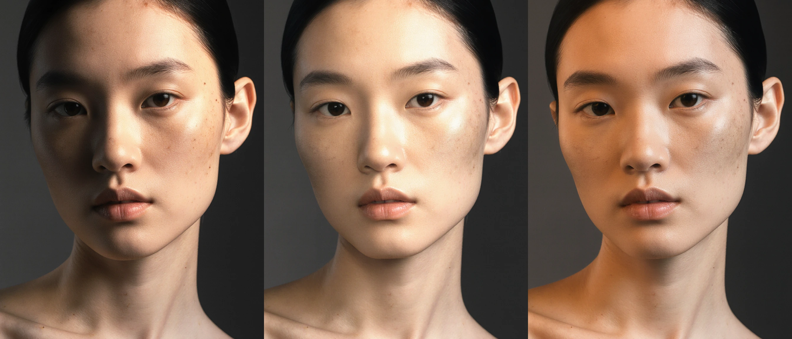

<div align="center">


<br>

# StudioLight — Design the Light.

**Camera-space key, fill, and rim lights, photographic modifiers, and Kelvin color control over estimated 2.5D scene geometry for existing photographs, renders, and generative drafts in ComfyUI.**

<p align="center">
  
  
  
  
  
  
  
</p>

<br>

<sub>
<a href="#1-same-subject-same-prompt-different-light">1. SHOWCASE</a> &nbsp;·&nbsp;
<a href="#2-one-image-multiple-lighting-decisions">2. DECISIONS</a> &nbsp;·&nbsp;
<a href="#3-the-photographers-console-physical-c-stands">3. RIG CONSOLE</a> &nbsp;·&nbsp;
<a href="#4-analyze-once-adjust-preview-the-2-second-loop">4. FAST PREVIEW</a> &nbsp;·&nbsp;
<a href="#5-add-to-the-scene--or-relight-the-subject">5. RELIGHTING MODES</a> &nbsp;·&nbsp;
<a href="#6-quick-start--workflows">6. QUICK START</a> &nbsp;·&nbsp;
<a href="#7-the-engineering-behind-the-image">7. ENGINEERING</a> &nbsp;·&nbsp;
<a href="#8-status-honest-limitations--roadmap">8. ROADMAP</a> &nbsp;·&nbsp;
<a href="#9-license-third-party-models--credits">9. LICENSES</a>
</sub>

</div>

<br>

---

## 1. Same Subject. Same Prompt. Different Light.

Stop prompt gambling. StudioLight brings three-dimensional studio lighting control directly into ComfyUI.

Instead of typing descriptive lighting words and hoping the diffusion model interprets your intent, you position virtual **Key, Fill, and Rim** fixtures on C-stands in estimated 3D camera space, select photographic modifiers, and dial color temperatures using Planckian locus Kelvin approximations.

https://github.com/user-attachments/assets/d78a75ba-4405-492c-aa67-ba472267fc73

---

## 2. One Image, Multiple Lighting Decisions

Changing a lighting prompt in standard text-to-image workflows often alters the entire scene—facial features shift, wardrobe cut changes, and background geometry drifts.

StudioLight computes new illumination from a **fixed source image** using estimated surface normals, relative depth, and intrinsic albedo, then optionally refines surface micro-textures with FLUX.1:

<div align="center">
  <a href="assets/studiolight_portrait_triptych.webp">
    
  </a>
  <br>
  <sub><b>Left:</b> Hard Side Key (45° Camera-Left · Fresnel Spot · Deep Chiaroscuro) &nbsp;·&nbsp; <b>Center:</b> High-Fashion Beauty (Overhead Beauty Dish + Soft Fill · Dewy Specular Wrap) &nbsp;·&nbsp; <b>Right:</b> Warm Golden Hour (75° Raking Octabox 3200K + Cool Ambient Fill). Relit with StudioLight and refined with FLUX.1 Krea Dev.</sub>
</div>

### Prompt-Based Lighting vs. StudioLight Spatial Control

| Dimension | Prompt-Based Lighting (Text Only) | StudioLight Spatial Control (2.5D Rig + Optional Refinement) |
| :--- | :--- | :--- |
| **Subject Consistency** | Editing lighting tokens in a text prompt frequently alters facial structure, pose, and wardrobe. | Computes lighting directly over a fixed 2D photograph or frozen draft plate; deterministic proxy preserves pixel geometry 1:1, while low-denoise Pass 2 refinement retains subject structure. |
| **Color Containment** | Color words ("warm orange light", "blue rim") often tint skin tones, hair, and background globally. | Key, fill, and rim color temperatures are evaluated per surface normal ($\mathbf{N} \cdot \mathbf{L} > 0$) and shadow visibility. |
| **Distance & Falloff** | Text prompts cannot specify stand distance in meters or aperture beam angles. | Evaluates inverse-square distance attenuation $(r_{\text{ref}} / r)^2$, polygonal modifier apertures, and depth-based ambient heuristics. |
| **Iteration Speed** | Requires running a full diffusion pass every time you test a new light angle. | Once scene geometry is cached, adjusting C-stands and previewing the direct composite takes **~2 seconds** before running optional FLUX refinement. |

---

## 3. The Photographer’s Console (Physical C-Stands)

StudioLight equips you with a 3-point gaffer console controlling **Key, Fill, and Rim** fixtures in assumed 3D camera space:

* **3D C-Stand Coordinates:** Set spherical coordinates—**Azimuth** ($-180^\circ$ to $+180^\circ$), **Elevation** ($-90^\circ$ to $+90^\circ$), and **Distance** in assumed scene meters ($r_{\text{ref}} = 1.8\text{m}$).
* **3-Zone 3D Aim Pointer:** Direct fixtures at the subject's **Upper** (face/head), **Center** (torso/product), or **Lower** zones with automatic curvature-guided target resolution.
* **Kelvin Color Control:** Dial color temperatures from warm candlelight (**2000K**) to cool daylight (**10000K**) using Tanner Helland’s Planckian locus approximation.
* **Live VFX Probes & Studio Radar:** Real-time 3D dual spheres (**18% Neutral Grey + Mirror Chrome**) and a top-down 2D studio radar provide immediate visual telemetry of light vectors, fixture angles, and catchlight shapes.

<div align="center">
  <a href="assets/studiolight_probe_and_render.webp">
    
  </a>
  <br>
  <sub><b>Camera-Space Lighting Rig:</b> Eight lighting setups, each pairing the live 18% grey/mirror chrome probes and top-down studio radar with the corresponding FLUX.1 Krea-refined output (cached shader preview updates in ~2s; FLUX Pass 2 refinement adds generative material polish).</sub>
</div>

### Geometric Area-Emitter Modifiers

Each modifier is modeled as a 3D virtual emitter with oriented tangent-space frames, uniform aperture sampling ($W, H, R$), cosine-weighted emission, and analytical catchlight reflection profiles:

<div align="center">
  
</div>

| Modifier | Aperture Geometry | Beam Angle (FWHM) | Emission Behavior | Catchlight Profile |
| :--- | :--- | :--- | :--- | :--- |
| **Direct On-Camera Flash** | $0.08 \times 0.05\text{m}$ | $70^\circ$ | Near-axial camera strobe emitter | Crisp micro-pinpoint |
| **Hard Snoot** | $R = 0.05\text{m}$ | $18^\circ$ | Tightly collimated beam cone | Tight circular spot |
| **Fresnel Spotlight** | $R = 0.15\text{m}$ | $35^\circ$ | Focused beam with smooth edge roll-off | Concentric disc |
| **Stripbox** | $0.30 \times 1.20\text{m}$ | $65^\circ$ | $1:4$ asymmetric rectangular diffuser | Elongated vertical slit |
| **Beauty Dish (Silver)** | $R = 0.275\text{m}$ | $85^\circ$ | Deflected annular reflector profile | Sculpted ring catchlight |
| **Octabox (Soft)** | $R = 0.70\text{m}$ | $130^\circ$ | Broad 8-sided polygonal area diffuser | Soft octagonal wrap |

---

## 4. Analyze Once. Adjust. Preview. (The Fast Preview Loop)

StudioLight decouples upstream scene analysis from interactive lighting adjustments:

1. **Analyze Once:** On the first run for a given plate, ComfyUI extracts surface normals (Marigold), relative depth (Depth Anything V2), subject mask (BiRefNet), and intrinsic albedo (Marigold IID).
2. **Adjust & Preview (~2s Warm Loop):** With upstream maps cached by ComfyUI, moving C-stands, swapping modifiers, or shifting Kelvin temperatures re-evaluates only the StudioLight shader and compositor—updating the **Direct Lit Proxy** preview (`Node 19`) in approximately 2 seconds on an RTX 3090.
3. **Optional Diffusion Refinement:** Use the direct proxy directly, or pass it into the downstream FLUX KSampler (`Node 25`) for final skin and fabric micro-texture synthesis.

<details>
<summary><b>RTX 3090 Shadow-Pass Microbenchmarks (Click to expand)</b></summary>
<br>

The table below reports isolated 3D camera-space shadow-raymarching pass latency and tensor memory overhead measured on an NVIDIA RTX 3090 (24 GB VRAM) across resolution and sample tiers (excludes upstream model inference and optional FLUX diffusion):

| Resolution | Configuration Tier | Area Samples ($S$) | Ray Steps ($N$) | Shadow-Pass Latency | Peak Tensor Allocation | Ray Throughput |
| :--- | :--- | :--- | :--- | :--- | :--- | :--- |
| `512 × 512` | Fast Preview | 4 | 12 | 12.0 ms | 113 MB | 1,047 M rays/s |
| `512 × 512` | Balanced (Default) | 8 | 16 | 29.6 ms | 118 MB | 1,135 M rays/s |
| `1024 × 1024` | Fast Preview | 4 | 12 | 32.0 ms | 450 MB | 1,571 M rays/s |
| `1024 × 1024` | Balanced (Default) | 8 | 16 | 83.0 ms | 469 MB | 1,617 M rays/s |
| `1024 × 1024` | High-End Quality | 16 | 24 | 245.3 ms | 469 MB | 1,642 M rays/s |
| `2048 × 2048` | Balanced (Default) | 8 | 16 | 311.5 ms | 1.87 GB | 1,724 M rays/s |

</details>

---

## 5. Add to the Scene — Or Relight the Subject

`StudioLightConsistentComposite` implements two explicit scene-linear compositing modes alongside depth-based background heuristics:

| Scene Heuristic / Control | Behavior in Compositor |
| :--- | :--- |
| **Nocturnal & Low-Key Preservation** | Retains original dark background floors in additive mode so studio strobes do not lift night scenes into washed-out grey fog. |
| **Far-Background Depth Protection** | Uses normalized depth and scene-contract gates (`Open`, `Enclosed`, `Mixed`, `Auto`) to suppress artificial strobe spill on distant horizons and skies. |
| **Optional Enclosed Room Bounce** | When `Enclosed` is active, adds a bounded, power-linear ambient fill heuristic to approximate interior wall bounce. |
| **Subject Mask Isolation** | Uses BiRefNet foreground segmentation to separate subject relighting from background retention. |

| Fresnel Spotlight Left (-85°) | Fresnel Spotlight Right (+85°) |
| :---: | :---: |
| [](assets/showcase_night_fresnel_left.webp) | [](assets/showcase_night_fresnel_right.webp) |
| <sub><b>Hard Side-Key (Camera-Left):</b> `az=-85°`, `int=1.5`. Directional grazing illumination across the left cheek and lapel with FLUX Pass 2 refinement.</sub> | <sub><b>Hard Side-Key (Camera-Right):</b> `az=+85°`, `int=1.5`. Symmetrical spatial steering illuminating the opposite cheek and shoulder.</sub> |
| **Angled Fresnel Key (+75°)** | **Soft Studio Octabox (-60°)** |
| [](assets/showcase_night_fresnel_75.webp) | [](assets/showcase_night_octabox_soft.webp) |
| <sub><b>Focused Spotlight:</b> `az=+75°`, `int=1.5`, `amb=0.01`. Tighter beam sculpting the right cheek while preserving the nocturnal street mood.</sub> | <sub><b>Soft Octagonal Diffuser:</b> `az=-60°`, `int=1.3`, `amb=0.04`. Broad octagonal area wrap across the wool coat and background architecture.</sub> |

### Mode A: `Add studio light` (Default)
$$\text{HDR} = \text{Source} \cdot 2^{\text{exposure}} + \text{Diffuse} + \text{Specular} + \text{Ambient}$$
* **Preserves Existing Scene Radiance:** Keeps the linear source image as an underlying base layer. Existing practical lamps, neon signs, skies, and environmental reflections remain intact while new studio key/fill/rim light is added on top.

### Mode B: `Replace subject light` (Explicit Portrait Relighting)
$$S_{\text{retained}} = \text{Source} \cdot 2^{\text{exposure}} \cdot \left((1 - M) + p \cdot M\right)$$
* **Targeted Subject Relighting:** Uses the estimated foreground mask ($M$) to attenuate old lighting on the subject and rebuild illumination over the estimated de-lighted diffuse base.
* **Controlled Source Preservation ($p$):** Dial `source_preservation` ($0.0$ to $1.0$) to blend between pure estimated albedo ($0.0$) and the original subject appearance ($1.0$).

> [!WARNING]
> **Troubleshooting Persistent Shadows (Chin, Neck & Crevices):**
> * **Why original shadows stay in `Add studio light`:** Additive mode preserves the original plate underneath. If the input image already has a dark shadow baked under the chin or cheek, additive light adds to it rather than erasing the base layer.
> * **How to replace heavy existing shadows:** Switch `operation` on `StudioLightConsistentComposite` to **`Replace subject light`** and set **`source_preservation` to `0.00 – 0.05`**. This removes the original subject base contribution and reconstructs subject shading from the estimated Marigold albedo.
> * **3D Chin Occlusion:** High key elevations ($>30^\circ$) cause the depth-reconstructed chin to cast a raymarched shadow onto the neck. To open up the throat, add a low fill light (`fill_elevation: -10° to 0°`), lower key elevation ($10^\circ\text{–}15^\circ$), or reduce `ao_anchoring` to `0.20 – 0.30`.

---

## 6. Quick Start & Workflows

### 1. Installation
Clone the repository into your `ComfyUI/custom_nodes` directory and install the Python dependencies into **ComfyUI's Python environment**:

```bash
cd ComfyUI/custom_nodes
git clone https://github.com/maciejtajber/ComfyUI-StudioLight.git
pip install -r ComfyUI-StudioLight/requirements.txt
```
*(PyTorch `torch>=2.0.0` is provided by your host ComfyUI installation and is intentionally omitted from `requirements.txt` so your local CUDA / ROCm / Apple Silicon MPS build is never overwritten).*

### 2. Required Custom Nodes & Models
* **Bundled in StudioLight (Auto-Downloaded on First Run):**
  * **Surface Normals (`StudioLightMarigoldNormals`):** Automatically downloads [`prs-eth/marigold-normals-v1-1`](https://huggingface.co/prs-eth/marigold-normals-v1-1) into `ComfyUI/models/studiolight/huggingface/`.
  * **Intrinsic Albedo (`StudioLightMarigoldDeLight`):** Automatically downloads [`prs-eth/marigold-iid-lighting-v1-1`](https://huggingface.co/prs-eth/marigold-iid-lighting-v1-1) into `ComfyUI/models/studiolight/huggingface/` when `allow_download` is enabled (default `True`).
* **External ComfyUI Preprocessor Nodes:**
  * **Relative Depth:** Install [`comfyui_controlnet_aux`](https://github.com/Fannovel16/comfyui_controlnet_aux) for `DepthAnythingV2Preprocessor` (both workflows default to `depth_anything_v2_vits.pth`).
  * **Subject Masking:** Install [`comfyui-rmbg`](https://github.com/1038lab/ComfyUI-RMBG) for `BiRefNet-general` foreground segmentation.
* **Optional Pass 2 Diffusion Checkpoints:**
  * `flux1-krea-dev_fp8_scaled.safetensors` or `flux1-dev.safetensors` (`models/unet/`), `clip_l.safetensors` + `t5xxl_fp16.safetensors` (`models/clip/`), and `ae.safetensors` (`models/vae/`).

### 3. Automated Verification Suite
```bash
PYTHONPATH=. python3 -m unittest discover -s tests -v
```
*(97 / 97 automated unit, photometric contract, and workflow verification tests passing).*

### 4. Official Production Workflows (`workflows/`)

The repository ships with **two official production workflows**:

| Workflow File | Primary Use Case | Pipeline Stages |
| :--- | :--- | :--- |
| **`workflows/StudioLight_Create.json`** | **Text-to-Image + 3D Relighting** | Scene Contract ➔ Pass 1 Neutral FLUX Draft ➔ Marigold Normals / IID Albedo / Depth / BiRefNet Mask ➔ 3D StudioLight Rig ➔ Direct Lit Proxy Preview (`Node 19`) ➔ Pass 2 FLUX Refinement (`Node 25`, `denoise=0.50`). |
| **`workflows/StudioLight_Relight.json`** | **Fixed-Image Relighting** | `LoadImage` (`Node 105`) ➔ Marigold Normals / IID Albedo / Depth / BiRefNet Mask ➔ 3D StudioLight Rig ➔ Direct Lit Proxy Preview (`Node 19`) ➔ Optional Pass 2 FLUX Refinement (`Node 25`, `denoise=0.50`). |

#### StudioLight Create (`workflows/StudioLight_Create.json`)
End-to-end generative studio featuring decoupled semantic prompt architecture (`StudioLightSceneContract`), 3D C-stands, area shadow raymarching, inspectable direct proxy preview, and Pass 2 FLUX Krea Dev synthesis.

<div align="center">
  <a href="assets/workflow_studiolight_create.webp">
    
  </a>
  <br>
  <sub><b>StudioLight Create Canvas (5120×2280):</b> Scene Contract ➔ Pass 1 Draft ➔ 2.5D Geometry &amp; Albedo Extraction ➔ StudioLight Rig ➔ Consistent Compositor ➔ Pass 2 FLUX Polish. <i>(Click image to inspect in full 5K resolution)</i>.</sub>
</div>

<br>

#### StudioLight Relight (`workflows/StudioLight_Relight.json`)
Fixed-image relighting pipeline for existing photographs or renders. Extracts surface geometry and intrinsic albedo once, previews the deterministic relit proxy (`Node 19`, ~2s warm re-evaluation when adjusting lights with cached upstream maps), and feeds an active Pass 2 FLUX KSampler (`Node 25`, `denoise=0.50`) for final material polish (mute/bypass the Pass 2 group if you want only the deterministic proxy output without loading FLUX checkpoints).

<div align="center">
  <a href="assets/workflow_studiolight_relight.webp">
    
  </a>
  <br>
  <sub><b>StudioLight Relight Canvas (5120×2280):</b> Fixed-image ingestion (`LoadImage`) ➔ 2.5D Geometry &amp; Albedo Extraction ➔ Direct Lit Proxy Preview (`Node 19`) + Pass 2 FLUX Refinement (`Node 25`). <i>(Click image to inspect in full 5K resolution)</i>.</sub>
</div>

---

## 7. The Engineering Behind the Image

### Dual-Input Pipeline Architecture

<div align="center">
  
</div>

### 9-Stage Technical Layer Dissection

<div align="center">
  <a href="assets/studiolight_master_00002_process_clean.webp">
    
  </a>
  <br>
  <sub><b>Nine-Stage Technical Layer Dissection (3072×3072):</b> <b>Row 1:</b> Source Plate ➔ Estimated Depth Map ➔ 3D Surface Normals. <b>Row 2:</b> Intrinsic Albedo ➔ Extracted Shading ➔ Foreground Subject Mask. <b>Row 3:</b> 3D Relighting Field ➔ Direct Lit Proxy (~2s) ➔ Final FLUX Synthesis. <i>(Click image to inspect in full 3K resolution)</i>.</sub>
</div>

### 3D Camera-Space Shadow Raymarching
* **P0 Front-of-Ray Occlusion Gate ($D_{\text{scene}} \le D_{\text{ray}} - \epsilon$):** Evaluates depth strictly in front of the ray sample, paired with a $0.45\text{m}$ finite-thickness boundary and bilateral depth-guided filtering to reduce false behind-ray occlusions and self-shadow acne.
* **Interleaved Gradient Noise (IGN) Dither:** Smooths discrete raymarching step transitions across depth gaps without spatial blur passes.

<div align="center">
  
  <br>
  <sub>Slit Aperture Penumbra Stress Test (Row 1: S=4 no dither, S=8 no dither, S=4 dither. Row 2: S=8 dither [Balanced Default], S=16 dither [High-End], S=64 Reference).</sub>
</div>

### Shipped Node Inventory

| Node Class | Display Name in ComfyUI | Core Responsibility |
| :--- | :--- | :--- |
| `StudioLightRig` | **StudioLight Rig (3-Point Photographic Console)** | 3-point C-stand console computing area diffuse, analytical specular, 3D raymarched shadows, and live grey/chrome probe + radar telemetry. |
| `StudioLightConsistentComposite` | **StudioLight · Consistent Relighting** | Scene-linear compositor executing `Add studio light` and `Replace subject light` modes, driving the direct proxy preview and diagnostic contact sheet. |
| `StudioLightMarigoldNormals` | **StudioLight Marigold Normals** | Bundled adapter for `prs-eth/marigold-normals-v1-1` outputting unit normals in `marigold_native` or `dsine_compatible` coordinates. |
| `StudioLightMarigoldDeLight` | **StudioLight De-Light — Marigold (Experimental)** | Bundled adapter for `prs-eth/marigold-iid-lighting-v1-1` decomposing an sRGB plate into linear intrinsic albedo, shading, and residual maps. |
| `StudioLightDeLightStrength` | **StudioLight · DeLight Strength** | Blends original source appearance with estimated Marigold albedo in scene-linear space before relighting. |
| `StudioLightSubjectBackgroundBase` | **StudioLight · Subject / Background Base** | Integrates `BiRefNet-general` foreground masks with optional edge feathering for subject isolation. |
| `StudioLightSceneContract` | **StudioLight · Scene Contract** | Parses master prompts and configures `Open` / `Enclosed` / `Mixed` environment rules and Pass 2 refinement conditioning. |

### Practical Production Rules
1. **Choose Your Relighting Mode First (`Add` vs `Replace`):** Use **`Add studio light`** to project key/rim strobes into an environment while retaining practical lamps and ambient mood. Use **`Replace subject light`** (with `source_preservation: 0.00 – 0.05`) when you need to suppress harsh existing shadows on a portrait subject and relight from estimated albedo.
2. **Inspect the Direct Proxy First (`Node 19`):** Verify light angles and shadow placement in the deterministic proxy before evaluating Pass 2 diffusion.
3. **Keep Analytical Specular Low on Matte Fabrics (`0.0 – 0.05`):** Analytical `specular_strength` defaults to `0.0`. Values $\ge 0.10$ can add synthetic sheen onto dark matte textiles (wool, velvet). Keeping it at `0.0 – 0.05` leaves matte fabrics clean while FLUX Pass 2 synthesizes material sheen from the directional diffuse field. Increase above `0.10` for wet skin, polished metal, or patent leather.

---

## 8. Status, Honest Limitations & Roadmap

### Honest Engineering Boundaries
* **Single-View 2.5D Geometry:** Depth and surface normals are estimated from a single 2D image using an assumed camera frustum and scene scale. Geometry hidden behind the subject cannot cast shadows.
* **Estimated Intrinsic Albedo:** Single-image de-lighting via Marigold IID reduces baked shadows and highlights, but extreme specular glare or deep cast shadows can leave subtle residual tones in the estimated albedo.
* **Uniform Specular Roughness (V1):** Analytical specular evaluates a global modifier reflection profile without per-pixel roughness maps; compositor `specular_strength` defaults to `0.0`.
* **First-Run Model Download & Inference Cost:** The ~2s warm preview loop applies after upstream geometry and albedo maps are cached in memory. First-time execution downloads the Marigold checkpoints and runs upstream extraction passes.
* **Diffusion Refinement Trade-Offs:** The direct compositor proxy is 100% deterministic. When optional FLUX Pass 2 refinement is enabled (`denoise 0.35–0.55`), diffusion enhances skin and fabric realism but can introduce subtle micro-detail variations.

### Capability Status & Research Horizon

| Capability / Milestone | Status | Architectural Scope |
| :--- | :--- | :--- |
| **Fixed-Image 2.5D Relighting** | **Included in v1.0.0** | Relight existing 2D photographs and renders via `StudioLight_Relight.json`. |
| **Draft-to-Relight Generative Studio** | **Included in v1.0.0** | Two-pass decoupled generation & relighting via `StudioLight_Create.json`. |
| **Additive & Subject-Replacement Modes** | **Included in v1.0.0** | Scene-linear compositor with practical retention and `source_preservation` control. |
| **Bundled Marigold Normals & IID Albedo** | **Included in v1.0.0** | Native float adapters with automatic first-run Hugging Face caching. |
| **Material-Aware PBR Roughness Maps** | Research Horizon | Per-pixel roughness/metallic segmentation for spatially varying microfacet specular. |
| **Temporal Video Light Keyframing** | Research Horizon | Temporally consistent depth/normal filtering and C-stand interpolation for video models. |

---

## 9. License, Third-Party Models & Credits

### 1. StudioLight Repository Code & Assets
* **Original Code & Shaders:** Released under the **[MIT License](LICENSE)**. Copyright © 2026 **Maciej Tajber** // **METAMATERIAL** Applied VFX Systems.
* **Repository Visual Assets & Documentation:** Example renders, diagrams, and documentation in `assets/` and `docs/` are Copyright © 2026 Maciej Tajber and may be redistributed as part of unmodified forks of this repository; please obtain permission before reusing showcase portraits in commercial advertising.

### 2. Third-Party Models & External Dependencies
StudioLight does **not** bundle or redistribute third-party model weights in this Git repository. Pretrained checkpoints are downloaded directly from their official upstream hosts on first use and remain governed by their respective licenses:

| Component / Checkpoint | Upstream Source | Code License | Model Weights License | Role in StudioLight |
| :--- | :--- | :--- | :--- | :--- |
| **Marigold Normals v1-1** | [`prs-eth/marigold-normals-v1-1`](https://huggingface.co/prs-eth/marigold-normals-v1-1) | Apache-2.0 | **CreativeML Open RAIL++-M** | Surface normal estimation (`StudioLightMarigoldNormals`) |
| **Marigold IID Lighting v1-1** | [`prs-eth/marigold-iid-lighting-v1-1`](https://huggingface.co/prs-eth/marigold-iid-lighting-v1-1) | Apache-2.0 | **CreativeML Open RAIL++-M** | Intrinsic albedo & shading decomposition (`StudioLightMarigoldDeLight`) |
| **Depth Anything V2 Small (`ViT-S`)** | [`depth-anything/Depth-Anything-V2-Small`](https://huggingface.co/depth-anything/Depth-Anything-V2-Small) | MIT | **Apache-2.0** *(Note: Base/Large `ViT-B`/`ViT-L` weights are CC-BY-NC 4.0)* | Relative depth estimation via [`comfyui_controlnet_aux`](https://github.com/Fannovel16/comfyui_controlnet_aux) |
| **BiRefNet (`BiRefNet-general`)** | [`ZhengPeng7/BiRefNet`](https://huggingface.co/ZhengPeng7/BiRefNet) | MIT | **MIT** | Foreground subject segmentation via [`comfyui-rmbg`](https://github.com/1038lab/ComfyUI-RMBG) |
| **FLUX.1 [dev] / FLUX.1 Krea [dev]** | [`black-forest-labs/FLUX.1-dev`](https://huggingface.co/black-forest-labs/FLUX.1-dev) · [`KreaAI/flux1-krea-dev-fp8-scaled`](https://huggingface.co/KreaAI/flux1-krea-dev-fp8-scaled) | Apache-2.0 | **[FLUX.1-dev Non-Commercial License](https://huggingface.co/black-forest-labs/FLUX.1-dev/blob/main/LICENSE.md)** *(Model weights are non-commercial; BFL license permits commercial use of generated outputs subject to its terms)* | Optional Pass 1 draft generation & Pass 2 material refinement |
| **Planckian Kelvin Approximation** | Tanner Helland color temperature algorithm | Public Domain / MIT attribution | N/A (Analytical math) | Kelvin-to-RGB chromaticity conversion in [`nodes/color_utils.py`](nodes/color_utils.py) |
