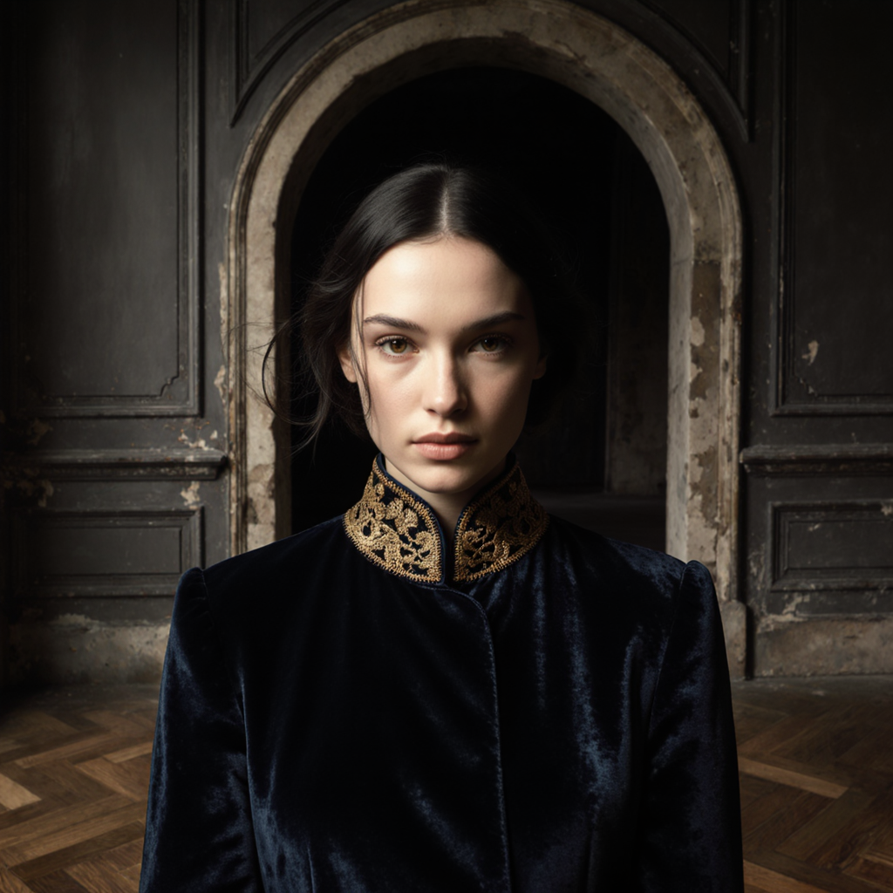
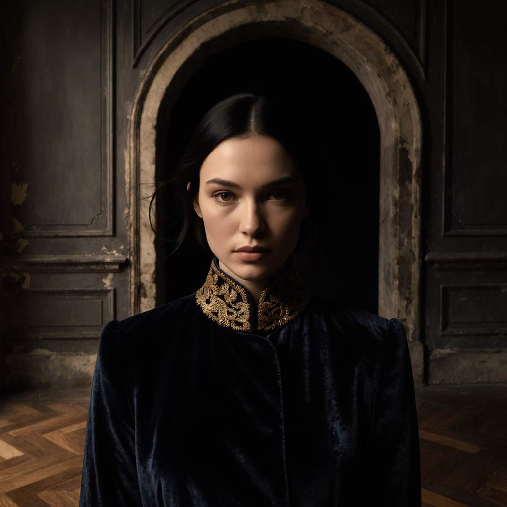
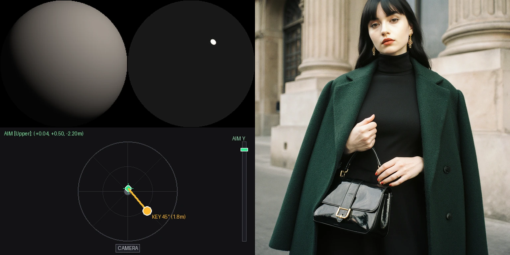
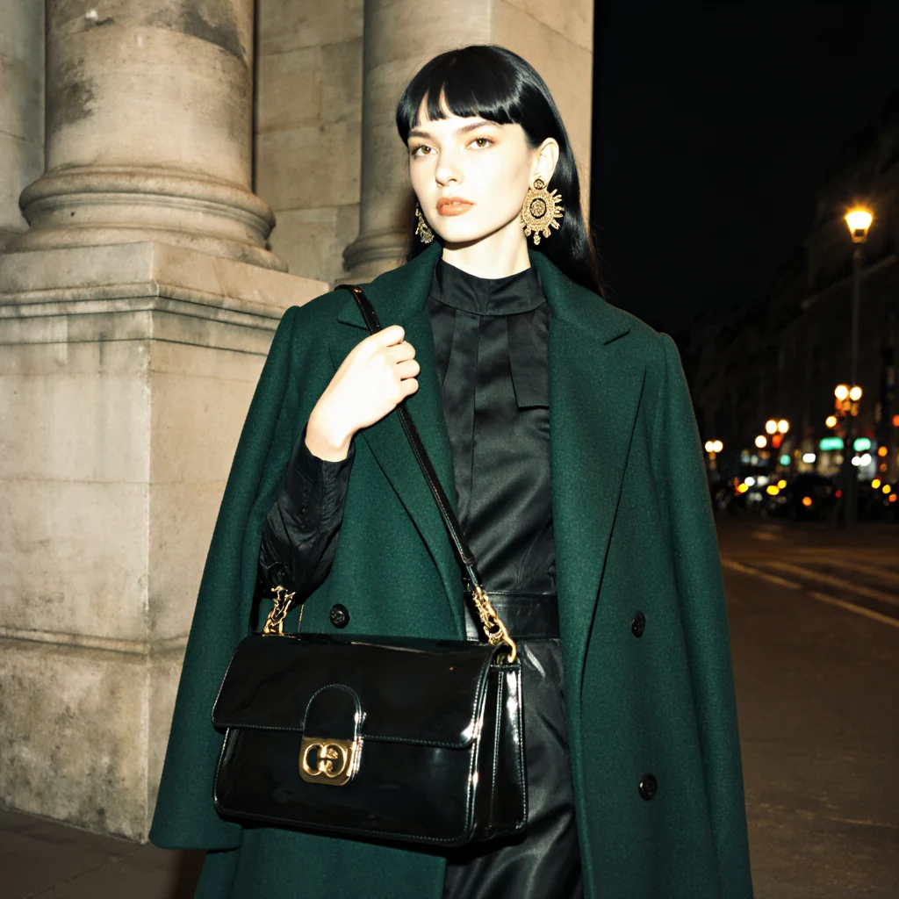
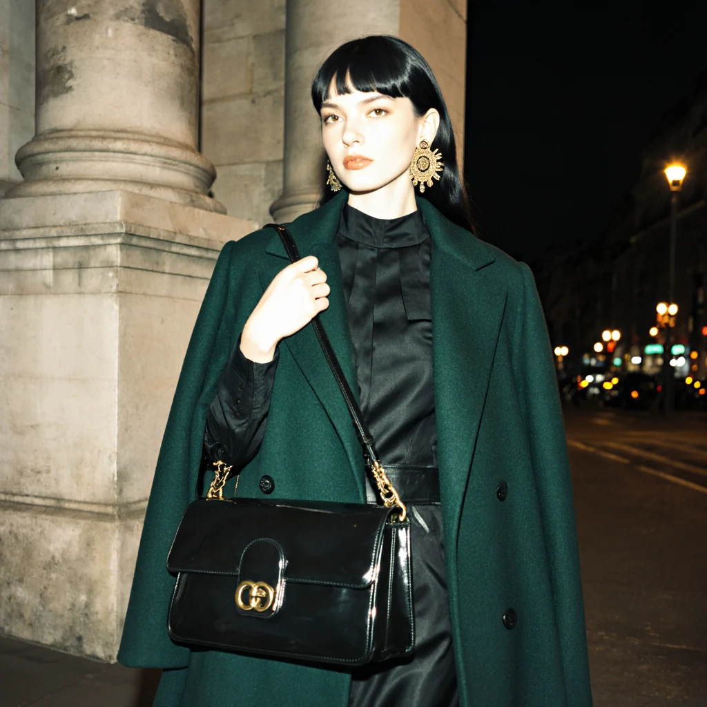
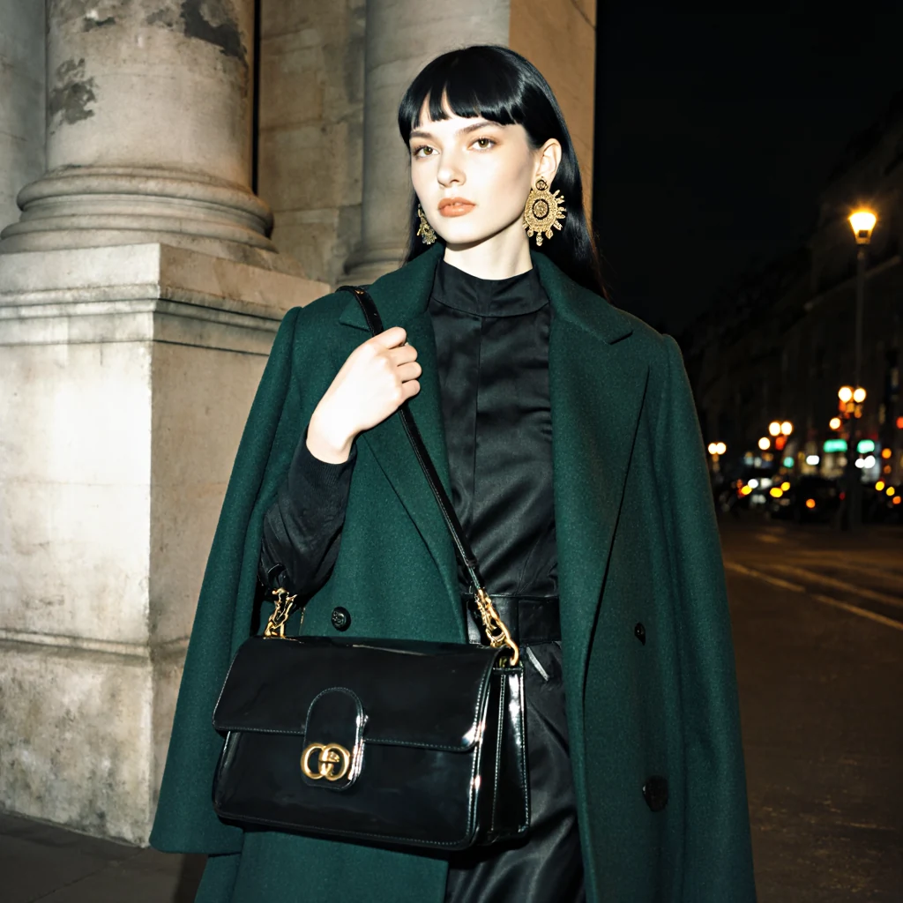
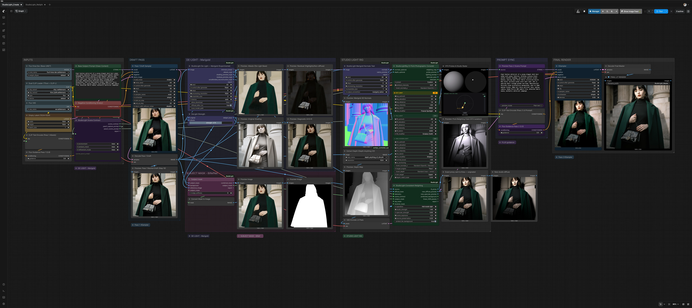
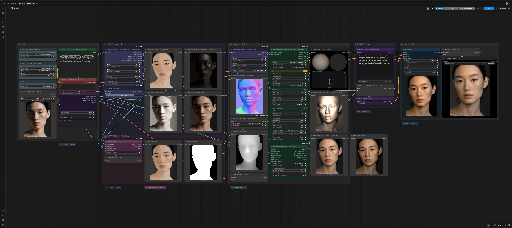
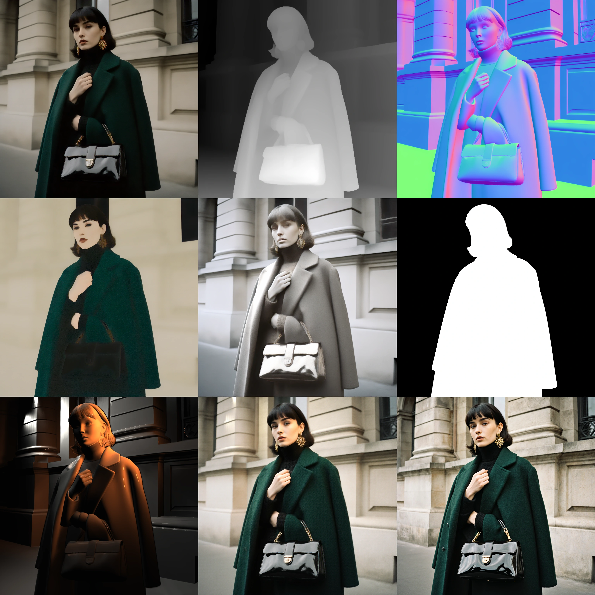

<div align="center">


<br>
<br>

# StudioLight — Design the Light.

**Camera-space key, fill, and rim lights, photographic modifiers, and Kelvin control for existing photographs, finished renders, and generative drafts in ComfyUI.**

<p align="center">
  
  
  
  
  
  
  
</p>

<br>

<sub>
<a href="#same-subject-same-prompt-different-light">1. SHOWCASE</a> &nbsp;·&nbsp;
<a href="#one-image-multiple-lighting-decisions">2. DECISIONS</a> &nbsp;·&nbsp;
<a href="#the-photographers-console-physical-c-stands">3. RIG CONSOLE</a> &nbsp;·&nbsp;
<a href="#analyze-once-adjust-preview-the-2-second-loop">4. 2-SEC LOOP</a> &nbsp;·&nbsp;
<a href="#add-to-the-scene--or-relight-the-subject">5. DUAL CONTRACT</a> &nbsp;·&nbsp;
<a href="#quick-start--workflows">6. QUICK START</a> &nbsp;·&nbsp;
<a href="#the-engineering-behind-the-image">7. ENGINEERING</a> &nbsp;·&nbsp;
<a href="#status-honest-limitations--roadmap">8. ROADMAP</a>
</sub>

</div>

<br>

---

## Same Subject. Same Prompt. Different Light.

Stop prompt gambling. StudioLight brings real, three-dimensional studio lighting control directly into ComfyUI. 

Instead of typing descriptive text and hoping the diffusion model understands your intent, you position physical lights on C-stands in 3D camera space, choose real photographic modifiers, and shape the shot with calibrated blackbody color temperatures.

https://github.com/user-attachments/assets/f82d96d9-08ac-4dfb-8f1a-a65432f33a32

<p align="center"><sub><b>Identical Base Prompt and locked Seed: 777777</b> | FLUX.1 Krea Dev</sub></p>

---

## 2. One Image, Multiple Lighting Decisions

The core creative problem in generative AI is that changing a lighting prompt mutates the entire scene—facial features shift, clothes change cut, and geometry warps. 

StudioLight locks the image and relights the **exact same source plate** with physical precision:

| High-Fashion Beauty | Direct On-Camera Flash | Golden Hour Window |
| :---: | :---: | :---: |
|  |  |  |
| <sub>Beauty Dish (5500K) + Soft Fill.<br>Sculpted cheekbones, circular catchlight.</sub> | <sub>On-Camera Flash (6500K).<br>Pinpoint glare, hard contact drop shadows.</sub> | <sub>Warm Area Light (3200K) + Sky Fill.<br>Atmospheric wrap, sunset chiaroscuro glow.</sub> |

### Prompt Lottery vs. Spatial Control

```text
┌───────────────────────────────────┬────────────────────────────────────────────────────────┐
│ PROMPT LOTTERY (TEXT ONLY)        │ STUDIOLIGHT SPATIAL CONTROL (VFX ENGINE)               │
├───────────────────────────────────┼────────────────────────────────────────────────────────┤
│ • Subject Mutation                │ • Pure Lighting Isolation                              │
│   Prompting light changes facial  │   Relights fixed 2D photographs or frozen drafts       │
│   anatomy, clothing, and shapes.  │   without altering subject geometry or identity.       │
│                                   │                                                        │
│ • Chromatic Bleed                 │ • Directional Lobe Isolation                           │
│   Color words tint skin, hair,    │   Key, fill, and rim colors remain strictly            │
│   and entire background.          │   confined to illuminated surfaces (N · L > 0).        │
│                                   │                                                        │
│ • Uncalibrated Falloff            │ • Inverse-Square & Enclosure Bounce                    │
│   Lights ignore depth & context,  │   Models true (r_ref / r)² falloff with enclosure-     │
│   treating scene as a flat plane. │   aware ambient bounce & nocturnal black-level anchor. │
│                                   │                                                        │
│ • Diffusion Bottleneck            │ • Instant ~2s Feedback Loop                            │
│   Requires 30–50 full diffusion   │   Shader computes an inspectable physical lighting     │
│   steps to test moving a light.   │   proxy in ~2 seconds without waiting for diffusion.   │
└───────────────────────────────────┴────────────────────────────────────────────────────────┘
```

---

## 3. The Photographer’s Console (Physical C-Stands)

StudioLight equips you with a professional photographer's gaffer console. You control three independent physical lights—**Key, Fill, and Rim**—in assumed 3D camera space:

* **3D C-Stand Coordinates:** Set true spherical coordinates—**Azimuth** (\(-180^\circ\) to \(+180^\circ\)), **Elevation** (\(-90^\circ\) to \(+90^\circ\)), and **Distance** in meters.
* **3-Zone 3D Aim Pointer:** Direct lights at the subject's **Upper** (face), **Center** (torso), or **Lower** zones with automatic curvature-guided aiming.
* **Blackbody Kelvin Control:** Seamlessly dial color temperatures from warm candlelight (**2000K**) to overcast daylight (**10000K**) using photographic Planckian locus chromaticity.
* **Live VFX Probes & Studio Radar:** Real-time 3D dual spheres (**18% Neutral Grey + Mirror Chrome**) and a top-down studio radar give instant visual telemetry of light vectors, fixture angles, and catchlight shapes.

<div align="center">
  
  <br>
  <sub><b>Interactive Camera-Space Lighting Rig:</b> Real-time 3D VFX spheres &amp; top-down studio radar driving generative relighting across 6 distinct setups.</sub>
</div>

### Physically Motivated Modifier Apertures

Each modifier is modeled as a 3D virtual emitter with oriented tangent-space frames, uniform aperture sampling ($W, H, R$), cosine-weighted emission, and analytical catchlight reflections:

<div align="center">
  
</div>

```text
┌───────────────────────┬──────────────┬────────────┬─────────────────────────────┬──────────────────────────┐
│ MODIFIER              │ APERTURE     │ BEAM ANGLE │ OPTICAL BEHAVIOR            │ CATCHLIGHT PROFILE       │
├───────────────────────┼──────────────┼────────────┼─────────────────────────────┼──────────────────────────┤
│ Direct Flash          │ 0.08 × 0.05m │ 70°        │ Near-point strobe emitter   │ Crisp micro-pinpoint     │
│ Hard Snoot            │ R = 0.05m    │ 18°        │ Collimated beam cone        │ Tight circular spotlight │
│ Fresnel Spotlight     │ R = 0.15m    │ 35°        │ Optical lens edge cutoff    │ Stepped concentric disc  │
│ Stripbox              │ 0.30 × 1.20m │ 65°        │ 1:4 Asymmetric rectangle    │ Elongated vertical slit  │
│ Beauty Dish (Silver)  │ R = 0.275m   │ 85°        │ Parabolic dish + deflector  │ Sculpted donut ring      │
│ Octabox (Soft)        │ R = 0.70m    │ 130°       │ Broad Lambertian octagon    │ Soft continuous wrap     │
└───────────────────────┴──────────────┴────────────┴─────────────────────────────┴──────────────────────────┘
```

---

## 4. Analyze Once. Adjust. Preview. (The 2-Second Loop)

The central workflow breakthrough of StudioLight is separating scene geometry analysis from lighting adjustments:

1. **Analyze Once:** When you load an image, StudioLight extracts its surface orientation, relative depth, and intrinsic albedo.
2. **Adjust & Preview in ~2 Seconds:** With geometry cached, you move C-stands, swap modifiers, and tweak Kelvin temperatures. The shader computes the complete 3D relit proxy in **approximately 2 seconds** on an NVIDIA RTX 3090.
3. **Zero Diffusion Bottleneck:** You explore multiple lighting setups in seconds without running heavy KSampler passes. When you find the perfect light, you optionally pass the proxy to FLUX for final material synthesis.

### RTX 3090 Performance Benchmarks (Shader Parameter Study)

```text
┌─────────────┬────────────────────┬─────────┬───────┬──────────────┬───────────┬───────────────┐
│ RESOLUTION  │ CONFIGURATION TIER │ SAMPLES │ STEPS │ PASS LATENCY │ PEAK VRAM │ THROUGHPUT    │
├─────────────┼────────────────────┼─────────┼───────┼──────────────┼───────────┼───────────────┤
│ 512 × 512   │ Fast Preview       │ 4       │ 12    │ 12.0 ms      │ 113 MB    │ 1,047 M/s     │
│ 512 × 512   │ Balanced (Default) │ 8       │ 16    │ 29.6 ms      │ 118 MB    │ 1,135 M/s     │
│ 1024 × 1024 │ Fast Preview       │ 4       │ 12    │ 32.0 ms      │ 450 MB    │ 1,571 M/s     │
│ 1024 × 1024 │ Balanced (Default) │ 8       │ 16    │ 83.0 ms      │ 469 MB    │ 1,617 M/s     │
│ 1024 × 1024 │ High-End Quality   │ 16      │ 24    │ 245.3 ms     │ 469 MB    │ 1,642 M/s     │
│ 2048 × 2048 │ Balanced (Default) │ 8       │ 16    │ 311.5 ms     │ 1.87 GB   │ 1,724 M/s     │
└─────────────┴────────────────────┴─────────┴───────┴──────────────┴───────────┴───────────────┘
```

---

## 5. Add to the Scene — Or Relight the Subject

StudioLight features an explicit **Schema 1 Compositing Contract**, allowing you to choose how the new light integrates with the existing image:

```text
┌────────────────────────────────────────────────────────────────────────────────────────┐
│                        BATTLE-TESTED SCENE & AMBIENT INTELLIGENCE                      │
├───────────────────────┬────────────────────────────────────────────────────────────────┤
│ NIGHT & NOCTURNAL     │ 60th-percentile background luminance metering anchors dark     │
│ (Clubs, Caves, Noir)  │ floors so studio strobes don't wash out scenes into grey fog.  │
├───────────────────────┼────────────────────────────────────────────────────────────────┤
│ OPEN SKY & EXTERIOR   │ Multi-factor gate (depth + brightness + saturation) protects   │
│ (Daylight, Horizons)  │ daylight horizons and clouds from artificial strobe spill.     │
├───────────────────────┼────────────────────────────────────────────────────────────────┤
│ ENCLOSED INTERIOR     │ Models ambient boundary bounce for rooms, studios, and stages, │
│ (Rooms, Soundstages)  │ supplementing direct key lighting with natural fill.           │
├───────────────────────┼────────────────────────────────────────────────────────────────┤
│ SPATIALLY-VARYING     │ Samples perimeter background colors (e.g. left neon sign,      │
│ CHROMATICITY WRAP     │ right tungsten lamp) to wrap contextual ambient light.         │
└───────────────────────┴────────────────────────────────────────────────────────────────┘
```
<p align="center"><sub><b>Battle-Tested Scene Intelligence:</b> Refined through weeks of pod stress-testing across dark clubs, exterior daylight, enclosed interior sets, and multi-color practicals.</sub></p>

| Sculpted Night Beauty | Direct On-Camera Flash | Raking Fresnel Spotlight |
| :---: | :---: | :---: |
|  |  |  |
| <sub>Beauty Dish (5500K) + Dark Ambient.<br>Sculpted cheekbones, zero background wash.</sub> | <sub>Direct Flash (6500K, az=0°).<br>Pinpoint glare, anchored black floor, no milky fog.</sub> | <sub>Fresnel Spotlight (4800K, az=-85°).<br>Raking chiaroscuro side-key, dramatic architectural relief.</sub> |

### Operation A: Add Studio Light (Default)
$$\text{HDR} = \text{Source} \cdot 2^{\text{exposure}} + \text{Diffuse} + \text{Specular} + \text{Ambient}$$
* **Preserves Native Environment:** The original scene is retained as an independent underlying base layer. Existing practical lamps, candles, neon signs, daylight skies, and ambient reflections survive natively.
* **Zero False Emission Guessing:** Does not guess emitters from bright highlights, preventing skin highlights or light spill from turning into artificial light sources.

### Operation B: Replace Subject Light (Explicit Mode)
$$S_{\text{retained}} = \text{Source} \cdot 2^{\text{exposure}} \cdot \left((1 - M) + p \cdot M\right)$$
* **Targeted Portrait Relighting:** Isolates the subject with a high-precision mask ($M$) and applies new studio illumination over pure albedo.
* **Controlled Source Preservation ($p$):** Dial the `source_preservation` slider ($0.0$ to $1.0$) to choose how much original subject texture and existing reflected illumination to retain.

> [!WARNING]
> **Troubleshooting Persistent Shadow Artifacts (Chin, Neck & Crevices):**
> * **Why shadows stay in "Add Studio Light":** `Add studio light` keeps the original input plate as an immutable base layer. If the input image already has a harsh baked shadow under the chin, collar, or cheek, setting DeLight to 100% will never erase it in this mode because the original dark pixels remain underneath.
> * **The Solution:** If you see stubborn remaining shadows you are unable to remove by rotating light azimuth, switch the operation to `Replace subject light` and set `source_preservation: 0.00 – 0.05`. This completely wipes the original photo's baked shadows from the subject and rebuilds their lighting 100% from clean, de-lighted albedo.
> * **3D Chin Occlusion:** Light elevation $>30^\circ$ causes the physical chin geometry in the depth map to cast a real 3D raymarched shadow down onto the neck. To illuminate the throat, add a clamshell fill from below (`fill_elevation: -10° to 0°`), lower key elevation to eye level ($10^\circ\text{–}15^\circ$), or reduce `ao_anchoring` to `0.20 – 0.30`.

---

## 6. Quick Start & Workflows

### 1. Installation
```bash
cd ComfyUI/custom_nodes
git clone https://github.com/maciejtajber/ComfyUI-StudioLight.git
pip install -r ComfyUI-StudioLight/requirements.txt
```
*(PyTorch `torch>=2.0.0` is treated as a host ComfyUI dependency so your local CUDA / MPS environment is preserved).*

### 2. Analysis Dependencies & Models
* **Normals & Depth:** Install `comfyui_controlnet_aux` for `DSINE` / Marigold Normals and `DepthAnythingV2Preprocessor`.
* **Intrinsic Albedo:** Install `ComfyUI-StudioLight-DeLight` (model: `prs-eth/marigold-iid-lighting-v1-1`).
* **Subject Masking:** Install `comfyui-rmbg` (`BiRefNet-general`).
* **Optional Diffusion Refinement:** `flux1-dev.safetensors` or `flux1-krea-dev.safetensors`.

### 3. Verification Suite
```bash
python3 -m unittest discover -s tests
```
*(68 / 68 automated unit & regression tests passing).*

### 4. Ready-to-Run Workflows

```text
┌────────────────────────────────────────────────────────────────────────────────────────┐
│                              STUDIOLIGHT WORKFLOW TOPOLOGY                             │
├────────────────────────┬───────────────────────────┬───────────────────────────────────┤
│ 1. INGESTION & DEPTH   │ 2. PHYSICAL 3D RIG        │ 3. CONSISTENT COMPOSITOR & OUTPUT │
├────────────────────────┼───────────────────────────┼───────────────────────────────────┤
│ • Fixed Photo / Draft  │ • Key / Fill / Rim Stands │ • Direct Relit Proxy (~2s)        │
│ • Marigold Normals     │ • Octa / Dish / Flash     │ • Pure Additive Mode (Schema 1)   │
│ • Depth Anything V2    │ • Kelvin Blackbody (CCT)  │ • Controlled Subject Replacement  │
│ • Marigold IID Albedo  │ • 3D Shadow Raymarching   │ • (Optional) FLUX Refinement      │
│ • BiRefNet Mask        │ • Full-Surface Telemetry  │   (Denoise 0.35–0.45)             │
└────────────────────────┴───────────────────────────┴───────────────────────────────────┘
```

#### StudioLight Create (`workflows/StudioLight_Create.json`)
Flagship generative studio featuring decoupled prompt architecture, 3D C-stands, area shadow raymarching, and optional FLUX Krea Dev generative refinement.

<div align="center">
  <a href="assets/workflow_studiolight_create.webp">
    
  </a>
  <br>
  <sub><b>StudioLight Create Master Canvas (5K):</b> Prompt Sanitizer ➔ Pass 1 Draft ➔ 3D Geometry ➔ StudioLight Rig ➔ Schema 1 Compositor ➔ Optional Pass 2 FLUX Polish. <i>(Click image to inspect in full 5120×2280 resolution)</i>.</sub>
</div>

<br>

#### StudioLight Relight (`workflows/StudioLight_Relight.json`)
Single-pass fixed-image relighting. Ingests any photograph or render, extracts surface geometry and intrinsic albedo, positions 3D lights, and composites the relit proxy in ~2 seconds without diffusion overhead.

<div align="center">
  <a href="assets/workflow_studiolight_relight.webp">
    
  </a>
  <br>
  <sub><b>StudioLight Relight Canvas (5K):</b> Pure photometric relighting pipeline with zero diffusion latency. <i>(Click image to inspect in full 5120×2280 resolution)</i>.</sub>
</div>

---

## 7. The Engineering Behind the Image

StudioLight represents an extensive engineering effort to bring physically motivated VFX techniques into diffusion pipelines.

### Dual-Input Architecture

<div align="center">
  
</div>

### 9-Stage Technical Layer Dissection

<div align="center">
  <a href="assets/studiolight_master_00002_process_clean.webp">
    
  </a>
  <br>
  <sub><b>Nine-Stage Technical Layer Dissection (3072×3072):</b> Row 1: Source Plate ➔ Estimated Depth Map ➔ 3D Surface Normals. Row 2: Foreground Subject Mask ➔ Intrinsic Albedo ➔ Extracted Shading. Row 3: Pure 3D Relighting Field ➔ Direct Lit Proxy (~2s) ➔ Final FLUX Synthesis. <i>(Click image to inspect in full 3K resolution)</i>.</sub>
</div>

### 3D Camera-Space Shadow Raymarching
* **P0 Front-of-Ray Occlusion Gate ($D_{\text{scene}} \le D_{\text{ray}} - \epsilon$):** Evaluates depth strictly in front of the ray sample, paired with a $0.45\text{m}$ finite-thickness boundary and bilateral depth-guided filtering to eliminate false behind-ray occlusions and self-shadow acne.
* **Interleaved Gradient Noise (IGN) Dither:** Smooths discrete step transitions across expanding depth gaps without artificial blur passes.

<div align="center">
  
  <br>
  <sub>Slit Aperture Penumbra Stress Test (Row 1: S=4 no dither, S=8 no dither, S=4 dither. Row 2: S=8 dither [Balanced Default], S=16 dither [High-End], S=64 Reference).</sub>
</div>

### Core Engine Components (Clean Names)

* **StudioLight Rig:** 3-point C-stand console calculating area diffuse, analytical specular, and 3D shadow raymarching.
* **Consistent Compositor:** Physical layer engine executing Schema 1 Additive and Replacement modes, directly driving the ~2s preview.
* **DeLight Controller:** Blends source appearance with estimated Marigold albedo to eliminate harsh baked-shadow doubling.
* **Subject Mask Isolator:** Automatic BiRefNet foreground segmentation for clean subject isolation.
* **Prompt Sanitizer:** Strips conflicting lighting tokens to eliminate prompt clashing during optional Pass 2 diffusion.
* **Photometric Environment Meter & Sky Gate:** Evaluates 60th-percentile background luminance, estimates spatially-varying ambient chromaticity fields, and gates sky spill using depth, luminance, and saturation thresholds.

### Core Working Rules for Production
1. **Choose Your Relighting Mode First (Erase vs Splash):** Use **Add Studio Light** to splash key/rim strobes across an entire room while preserving practical lamps and ambient mood. Use **Replace Subject Light** (with `source_preservation: 0.00 – 0.05`) whenever you need to completely erase harsh existing shadows (such as baked chin/neck shadows or hard directional sunlight) and rebuild portrait lighting from scratch.
2. **Keep Source Plate & Diffuse Base Independent:** The source carrier preserves environmental background radiance; the DeLight Controller supplies pure diffuse reflectance.
3. **Inspect Upstream Geometry Before Tuning Intensities:** Verify surface normals and relative depth maps before over-amplifying rig power.
4. **Trust the Direct Proxy:** The direct ~2s compositor output is physically coherent. If light vectors or shadows look misplaced in the proxy, generative diffusion will not correct them.
5. **Diffusion is an Optional Material Synthesizer:** Use Pass 2 FLUX Krea Dev at gentle denoise (`0.35 – 0.45`) to add dielectric micro-textures and pore-level skin scattering.
6. **Keep Analytical Specular at Default (`0.0 – 0.05`):** Analytical `specular_strength` defaults to `0.0`. Testing confirms values $\ge 0.10$ can introduce synthetic specular streaks on dark, low-albedo matte textiles (wool, cotton, velvet). Keeping it at `0.0` (or $\le 0.05$) leaves matte fabrics pristine while FLUX Pass 2 naturally synthesizes material-correct micro-sheen from the 3D directional diffuse field ($N \cdot L$). Increase above $0.1$ only when specifically relighting wet surfaces, polished metals, or synthetic gloss.

---

## 8. Status, Honest Limitations & Roadmap

### Honest Engineering Boundaries
* **Single-View 2.5D Frustum:** Geometry and shadow raymarching operate on surfaces visible to the camera. Surfaces completely occluded in the depth map cannot cast shadows.
* **Uniform Specular Roughness (V1):** Analytical specular evaluates a global modifier reflection profile without per-pixel roughness or material classification. Because it can overpower low diffuse albedo on dark fabrics, its compositor contribution defaults to `0.0` (safe range `0.0–0.05`).
* **Estimated Intrinsic Albedo:** Single-image albedo decomposition via Marigold IID is an estimate. Extreme specular glare or deep baked shadows may leave subtle residual tones in challenging plates.
* **Additive Layer Retention:** Additive mode retains existing ambient lighting and practical lamps natively. It does not erase old light sources or rotate existing baked shadows.
* **Diffusion Interpretation:** Higher Pass 2 denoise levels ($\ge 0.60$) give diffusion greater freedom to repaint textures, whereas lower values ($0.35–0.45$) strictly preserve subject identity and proxy lighting vectors.

### Status-Based Capability Roadmap

```text
┌──────────────────────────────────┬──────────────────────┬──────────────────────────────────────────────────┐
│ CAPABILITY / MILESTONE           │ STATUS               │ ARCHITECTURAL SCOPE                              │
├──────────────────────────────────┼──────────────────────┼──────────────────────────────────────────────────┤
│ Fixed-Image 2D Relighting        │ Shipped in V1        │ Relight photographs & renders without diffusion. │
│ Pure Additive Layering Contract  │ Shipped in V1        │ Practical & room-ambient preservation (HDR eq).  │
│ Controlled Subject Replacement   │ Shipped in V1        │ Source preservation slider + BiRefNet isolation. │
│ Intrinsic Albedo Pipeline        │ Shipped in V1        │ Full-surface Marigold IID DeLight modulation.    │
│ Direct Proxy / VAE Parity        │ Shipped in V1        │ Linear HDR parity between preview & VAE in ~2s.  │
│ Optional FLUX Krea Polish        │ Shipped in V1        │ Decoupled Pass 2 micro-texture synthesis.        │
│ Temporal Light Keyframing        │ Next Sprint (Q4)     │ Reproducible C-stand interpolation for video.    │
│ Video Attention Integration      │ Next Sprint (Q4)     │ 32-bit linear photometric plates into Wan / LTX. │
│ Temporal Geometry Deflicker      │ Next Sprint (Q4)     │ Multi-frame depth & normal temporal filtering.   │
│ Material-Aware PBR Roughness     │ Research Horizon     │ Semantic material segmentation + per-pixel       │
│ & Microfacet GGX Shading         │                      │ roughness/metallic maps for artifact-free PBR.   │
│ Multi-View Coherent Rigging      │ Research Horizon     │ Shared 3D camera-space rigs across multi-cam.    │
│ Integrated Three.js Mannequin    │ Explicitly Retired   │ Replaced by 2.5D camera-space depth raymarching. │
└──────────────────────────────────┴──────────────────────┴──────────────────────────────────────────────────┘
```

---

## License & Credits

* **Code & Shaders:** MIT License. Created by **Maciej Tajber** // **METAMATERIAL** Applied VFX Systems.
* **Ecosystem Credits:** Built on the open research of the ComfyUI, Depth Anything V2, Marigold, BiRefNet, and FLUX communities.
