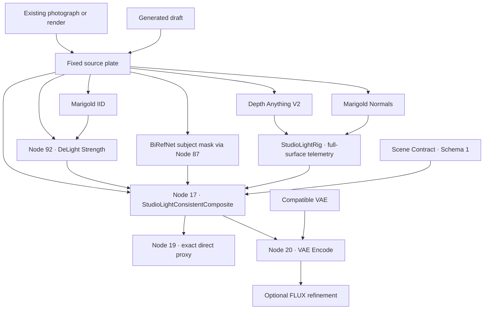

# ComfyUI-StudioLight

**Stop prompt gambling. Design the light.**

Add and shape studio lighting on **existing photographs, finished renders, or generated drafts** inside ComfyUI. Position key, fill, and rim lights, choose photographic modifiers, inspect the direct result, and optionally use FLUX to interpret materials.

**Consistent V1 · Candidate R1**  
Target release: **31 October 2026**

StudioLight combines estimated single-view geometry with a controllable lighting rig and explicit compositing. The source image, estimated diffuse base, and new lighting remain separate, so you can see what each contributes.

> **Release status:** Candidate R1 defines the Consistent V1 pipeline. Repository reconciliation, release packaging, clean-install verification, and final visual acceptance remain release-completion tasks. Implementation checks do not establish universal relighting quality.

[Pipeline](#pipeline) · [Additive and replacement modes](#additive-and-replacement-modes) · [Working rules](#five-working-rules) · [Node suite](#node-suite) · [Installation](#installation) · [Limitations](#limitations) · [Roadmap](#roadmap)

## Start with the image you have

You do not need to generate an image to use StudioLight.

| Starting point | Workflow |
| --- | --- |
| Existing photograph | Load the photograph, estimate its surface properties, and add studio illumination. |
| Finished render | Use the render as the source plate and design additional lighting from the fixed camera view. |
| Generated draft | Generate a composition, freeze the draft, then adjust lighting independently of further generation. |

The direct proxy is a usable output in its own right. FLUX refinement is optional.

StudioLight offers explicit spatial controls where text alone leaves interpretation to a generative model. Its lighting calculations are repeatable for fixed inputs and settings; the quality of the result still depends on estimated geometry, estimated albedo, and the source image.

## Pipeline



Analysis supplies four estimates:

- **Depth Anything V2:** relative depth for camera-space surface reconstruction and visibility.
- **Marigold Normals:** surface orientation for the lighting response.
- **Marigold IID:** intrinsic decomposition, including an estimated diffuse albedo.
- **BiRefNet-general:** subject selection, exposed through Node 87.

The rig calculates lighting across the visible surface. The compositor combines that lighting with the original source according to the selected operation.

### Candidate R1 wiring

The numbered nodes refer to the supplied Consistent V1 workflow, not permanent ComfyUI node identifiers.

| Connection | Purpose |
| --- | --- |
| Original image → Node 17 `source` | Retain the original scene as its own contribution. |
| Node 92 → Node 17 `diffuse_base` | Use the full-image DeLight strength result for diffuse response. |
| Node 87 mask → Node 17 `subject_mask` | Select the subject without treating a mixed subject/background image as albedo. |
| Rig telemetry → Node 17 | Supply separated, full-surface lighting fields. |
| Node 17 output 0 → Node 19 | Preview the exact compositor output. |
| Node 17 output 0 → Node 20 `pixels` | Encode the same image shown by the direct preview. |
| VAE loader Node 3 → Node 20 `vae` | Supply the encoder’s required VAE. |

The legacy grade at Node 18 is bypassed on the main path. The direct preview and VAE input therefore share the same compositor output.

**Direct-proxy iteration is approximately two seconds in the reference workflow after analysis is available.** This is an indicative lighting-iteration time, not a guarantee for every device and not the duration of model downloads, initial analysis, draft generation, or FLUX refinement.

## Additive and replacement modes

Consistent V1 uses an explicit **Schema 1 compositing contract**. Choose the operation before adjusting the lights.

### Additive — default

UI operation: **`Add studio light`**

```text
HDR = S × 2^e + D + P + A
```

| Term | Meaning |
| --- | --- |
| `S` | Original source image converted from sRGB to linear RGB. |
| `e` | `scene_exposure`, applied to the retained source contribution. |
| `D` | New diffuse contribution, using the diffuse base and rig lighting. |
| `P` | New specular contribution from the rig. |
| `A` | New ambient contribution, using the diffuse base and rig ambient field. |

**The existing scene, practical lights, their spill, and reflections remain in the source contribution.** StudioLight does not need to guess which highlights are emitters to retain them.

This also means that original shadows and reflections remain. Additive mode adds illumination; it does not extinguish an existing lamp, rotate a baked shadow, or remove the original light.

At zero scene exposure, with all new direct and ambient contributions disabled, the output preserves the source up to floating-point transfer roundoff. Ambient is a separate contribution: setting direct studio strength to zero does not necessarily disable ambient.

Preservation describes the retained source layer. Added illumination, exposure changes, and display highlight handling can change the final displayed pixels.

### Replacement — explicit subject relighting

UI operation: **`Replace subject light`**

Replacement reduces the original source contribution inside the subject mask and applies new lighting there. The background retains its source contribution, subject to scene exposure.

For subject mask `M` and source preservation `p`:

```text
Retained source = S × 2^e × (1 − M + p × M)

HDR = Retained source + D_subject + P_subject + A_subject
```

The **`source_preservation`** slider ranges from **0.0 to 1.0**:

| Value | Effect inside the subject mask |
| --- | --- |
| `0.0` | Remove the original source contribution and rely on the estimated diffuse base and new lighting. |
| Between `0.0` and `1.0` | Retain part of the original subject appearance. |
| `1.0` | Retain the full original subject appearance alongside the added subject lighting. |

Source preservation retains **old shadows, reflected highlights, practical lights, and spill together**. It does not isolate emission.

At `0.0`, practical lights or their illumination inside the subject mask may disappear. At higher values, unwanted original lighting may remain. This is an explicit tradeoff, not a claim of perfect illumination separation.

Connect and inspect the subject mask before using replacement. Without a subject mask, the compositor falls back to full-frame replacement and reports that behavior.

### Color and data contract

- Source and diffuse-base image inputs are aligned sRGB RGB images in `[0, 1]`.
- Lighting is combined in linear RGB.
- The HDR pass bundle contains relative linear values, not measured radiance.
- Geometry scale is assumed rather than recovered metrically.
- Full-surface lighting arrives through **rig telemetry Schema 2**; this is separate from the **Schema 1 scene/compositing contract**.
- The display proxy applies highlight handling relative to the retained source baseline.
- Source, albedo, normals, depth, and masks must describe the same framing and dimensions.

The new path does not apply hidden global exposure normalization or infer material classes and emitters from pixel brightness.

## Five working rules

### Rule 1: Choose the operation first

Use **Additive** to retain the scene and introduce additional illumination.

Use **Replacement** when you intend to reduce the original subject lighting and accept the limitations of estimated albedo and subject masking.

### Rule 2: Keep the source plate and diffuse base separate

The original image goes to Node 17 `source`.

Node 92 controls the diffuse base:

- **Strength `0.0`:** original appearance.
- **Strength `1.0`:** full Marigold albedo estimate.
- **Intermediate values:** a blend performed in linear RGB.

Lowering DeLight strength deliberately brings original illumination back into the diffuse base. It can also bake that illumination into the new diffuse response.

Node 87 supplies the subject mask in this workflow. Its combined subject/background image is not the Consistent V1 diffuse base.

### Rule 3: Inspect estimates before judging lighting

Check albedo, normals, depth, and the subject mask before moving lights to compensate for artifacts.

Look for shadows or highlights remaining in albedo, incorrect normal orientation, flattened depth, and selection errors around hair, transparent objects, reflective surfaces, or multiple subjects.

A faulty estimate can produce a faulty lighting response even when the rig behaves correctly.

### Rule 4: Evaluate the exact direct proxy

Inspect Node 19 before running refinement.

It displays the same Node 17 image that reaches VAE Encode. Use this approximately two-second iteration loop to assess placement, exposure, shadow direction, and the balance between original and added illumination.

Do not judge the compositor through a separately graded preview.

### Rule 5: Treat diffusion as optional material interpretation

FLUX can interpret the proxy into richer material detail, but it can also change facial features, texture, color, reflections, and lighting.

Compare the refined image against the direct proxy. A successful diffusion result does not prove the underlying geometry is correct, and a diffusion artifact does not necessarily originate in the lighting pass.

## Node suite

| Node | Role in Consistent V1 |
| --- | --- |
| **`StudioLightConsistentComposite`** | Main compositor at Node 17. Separates source appearance from added diffuse, specular, and ambient contributions. Exposes additive and replacement operations, diagnostic previews, HDR passes, and a report. |
| **`StudioLightRig`** | Camera-space key, fill, and rim controls, photographic modifiers, light color, visibility, and full-surface telemetry. |
| **`StudioLightDeLightStrength`** | Node 92. Blends original appearance with estimated albedo to produce the full-image diffuse base. |
| **`StudioLightSubjectBackgroundBase`** | Node 87. Provides the BiRefNet subject mask used by this workflow. Its combined-image output remains available for other workflows. |
| **`StudioLightSceneContract`** | Declares scene intent and supplies Schema 1 metadata. Prompt-derived labels describe intent; they are not pixel segmentation. |
| **`StudioPromptSanitizer`** | Supports prompt preparation for generated drafts. It does not replace image analysis or guarantee an unlit draft. |
| **Marigold DeLight / normals adapters** | Supply intrinsic and normal estimates through the corresponding pretrained models. |

### Compatibility

**`StudioPhotometricComposite`** and **`SIShadowHighlight`** remain available for legacy workflows and comparisons.

They are not the main Consistent V1 compositing path. Older workflows should not be treated as equivalent to Candidate R1 simply because they contain the same lighting rig.

Update the rig, compositor, adapters, and workflow together. Missing full-surface telemetry should be resolved by installing matching components, not by substituting a legacy combined lighting map.

## Installation

Use the **Consistent V1 package and matching workflow**. An older StudioLight installation does not necessarily contain the new compositor, telemetry, or corrected R1 connections.

### Required components

| Component | Requirement |
| --- | --- |
| **ComfyUI** | A working installation and its existing Python/PyTorch environment. |
| **ComfyUI-StudioLight** | Core nodes, frontend assets, presets, and matching Consistent V1 workflow. |
| **`comfyui_controlnet_aux`** | Depth Anything V2 preprocessor and the model selected by the workflow. |
| **Marigold Normals adapter and weights** | `prs-eth/marigold-normals-v1-1`, with the normal convention expected by the rig. |
| **ComfyUI-StudioLight-DeLight** | Marigold IID integration using `prs-eth/marigold-iid-lighting-v1-1`. |
| **`comfyui-rmbg`** | `BiRefNetRMBG` and **BiRefNet-general** for automatic subject detection through Node 87. |
| **Optional FLUX stack** | A compatible FLUX diffusion model, text encoders, and VAE for draft generation or refinement. |

An existing-image, direct-proxy workflow does not require FLUX.

### Install the core package

Place the release’s `ComfyUI-StudioLight` directory under:

```text
ComfyUI/
└── custom_nodes/
    └── ComfyUI-StudioLight/
        ├── __init__.py
        ├── nodes/
        ├── web/
        └── requirements.txt
```

Using the **same Python environment that launches ComfyUI**, install its requirements:

```bash
python -m pip install -r custom_nodes/ComfyUI-StudioLight/requirements.txt
```

The core requirements include NumPy and Pillow. PyTorch comes from the host ComfyUI environment; the core requirements intentionally do not replace it.

### Install analysis dependencies

Install `comfyui_controlnet_aux` and `comfyui-rmbg`, including their package requirements and the weights selected by the workflow.

Install the supplied `ComfyUI-StudioLight-DeLight` package and its Marigold dependencies:

```bash
python -m pip install -r custom_nodes/ComfyUI-StudioLight-DeLight/requirements-marigold.txt
```

The companion dependency set includes Diffusers, Transformers, Accelerate, and Safetensors. Use the dependency file shipped with the matching release.

**Enable only one registration of the Marigold DeLight node.** If the release integrates that adapter into the core package, do not also enable a standalone copy registering the same node.

Model weights are separate downloads:

```text
Marigold IID:     prs-eth/marigold-iid-lighting-v1-1
Marigold Normals: prs-eth/marigold-normals-v1-1
Subject mask:    BiRefNet-general
Depth:           Depth Anything V2 checkpoint selected in the workflow
```

For the DeLight adapter, enable `allow_download` for initial setup or provide a complete local Diffusers model directory. Its default model cache is under:

```text
ComfyUI/models/studiolight/huggingface/
```

Prepare the normals checkpoint through the matching adapter’s setup instructions as well; downloading IID weights does not install the normals model.

### Load the workflow

1. Restart ComfyUI after installing the packages.
2. Open the supplied **`StudioLight_Consistent_V1.json`** canvas workflow.
3. Resolve missing nodes and select the installed model files.
4. Choose an existing image or generated draft as the source.
5. Run analysis and inspect its outputs.
6. Confirm the Candidate R1 connections listed above.
7. Evaluate Node 19 before enabling optional refinement.

The candidate also includes API workflows for automation and fixed-source proxy evaluation. API prompt JSON and canvas workflow JSON serve different purposes.

## Diagnostics and troubleshooting

| Symptom | Check |
| --- | --- |
| Existing shadows remain | Expected in additive mode. Replacement reduces the source contribution but remains limited by albedo estimation. |
| Replacement loses a lamp or illuminated detail | Inspect the subject mask and `source_preservation`; subject-region practicals are not isolated automatically. |
| Background lighting looks inconsistent | Verify Node 92 feeds `diffuse_base`, then inspect depth and receiver protection. |
| Preview differs from the refinement input | Confirm Node 19 and Node 20 both receive Node 17 output 0, bypassing the legacy grade. |
| VAE Encode reports a missing input | Restore the compatible VAE connection to Node 20. |
| Missing full-surface telemetry | Install matching rig and compositor versions. |
| Subject detection fails | Check `comfyui-rmbg`, `BiRefNetRMBG`, and BiRefNet-general weights. |
| “Sky” protection excludes the wrong area | Inspect the protection preview. The automatic mask is a depth-based estimate; override it when needed. |
| Skin or material detail changes after refinement | Compare with the direct proxy to separate diffusion changes from analysis or compositing artifacts. |

The compositor exposes diffuse and specular previews, a protected-background mask, linear HDR passes, and a report. These are inspection tools, not certificates of physical accuracy.

## Limitations

**StudioLight is a fixed-camera, single-view relighting system. It is not universal inverse rendering.**

### Geometry is estimated

Single-view depth cannot recover hidden surfaces, unseen occluders, accurate transparent volumes, or a complete scene behind the camera. Camera-space reconstruction uses assumed scale.

Shadow visibility is evaluated against the available depth representation. It is not equivalent to tracing a complete 3D scene.

### Albedo is estimated

A single image does not uniquely determine reflectance, illumination, and non-diffuse effects.

Marigold can leave lighting in albedo, suppress material variation, or alter fine detail. Its shading and residual estimates have scale ambiguity. A reconstructed preview is not proof of calibrated radiometric recovery.

### Materials and transport are approximate

The rig uses physically motivated lighting calculations and an approximate specular response. It does not recover measured BRDFs, per-pixel roughness, full indirect illumination, or hidden geometry.

Preserving a source reflection does not make that reflection respond correctly to a newly positioned light.

### Practicals are retained as appearance

Additive mode retains practical lights and existing spill through the source image. It does not reconstruct their emitter geometry or simulate new transport from them.

Existing laser beams or haze may survive in the source; new volumetric scattering is not automatically recovered.

### Masks and scene labels are estimates

BiRefNet can misidentify boundaries. Automatic far-background protection uses top-connected far depth in eligible scenes; it is not semantic sky recognition.

Prompt-derived environment and practical-light labels express scene intent, not verified pixel-level facts.

### Performance and refinement vary

Runtime depends on hardware, image size, model loading, analysis settings, and cache state. The approximate two-second direct-proxy loop is not an end-to-end generation benchmark.

Optional diffusion can reinterpret both materials and composition. It cannot guarantee identity or exact lighting preservation.

## Roadmap

### Implemented in Consistent V1

- Separate original source and estimated diffuse-base inputs.
- Default additive composition under Schema 1.
- Explicit subject replacement with `source_preservation`.
- Full-surface rig telemetry.
- Full-image DeLight strength through Node 92.
- Subject-mask routing through Node 87.
- Direct compositor preview matching the VAE input.
- Diagnostic passes, protection preview, and reporting.
- Optional FLUX refinement.

### Release Completion

- Reconcile Candidate R1 sources with the release repository.
- Update workflow builders so regenerated workflows preserve all R1 fixes.
- Package matching nodes, dependencies, workflows, and model setup instructions.
- Verify a clean installation and the exact release artifact.
- Complete visual acceptance on fixed source plates and optional refinement.
- Publish reproducible evidence with hardware, settings, and validation scope.
- Finalize dependency and model attribution notices.

### Next: Temporal & Video

Investigate consistency across frames: stable analysis, coherent masks, reduced flicker, and reproducible lighting controls.

Per-frame relighting alone does not establish temporal consistency.

### Research: Multi-view

Explore stronger geometry and visibility from multiple views, improved material information, and more complete transport.

These are research directions, not current capabilities or scheduled delivery commitments.

### Retired: Three.js stage

The proposed Three.js stage is retired from the active roadmap. Consistent V1 focuses on native ComfyUI controls and the fixed-image lighting workflow.

## License and credits

StudioLight code is released under the [MIT License](LICENSE).

Created by **Maciej Tajber / METAMATERIAL**.

The analysis pipeline relies on the work of the ComfyUI, Depth Anything V2, Marigold, Diffusers, BiRefNet, `comfyui_controlnet_aux`, and `comfyui-rmbg` communities. Optional refinement uses the selected FLUX ecosystem.

Third-party code and model weights retain their own licenses. StudioLight’s MIT license does not relicense those dependencies or weights.