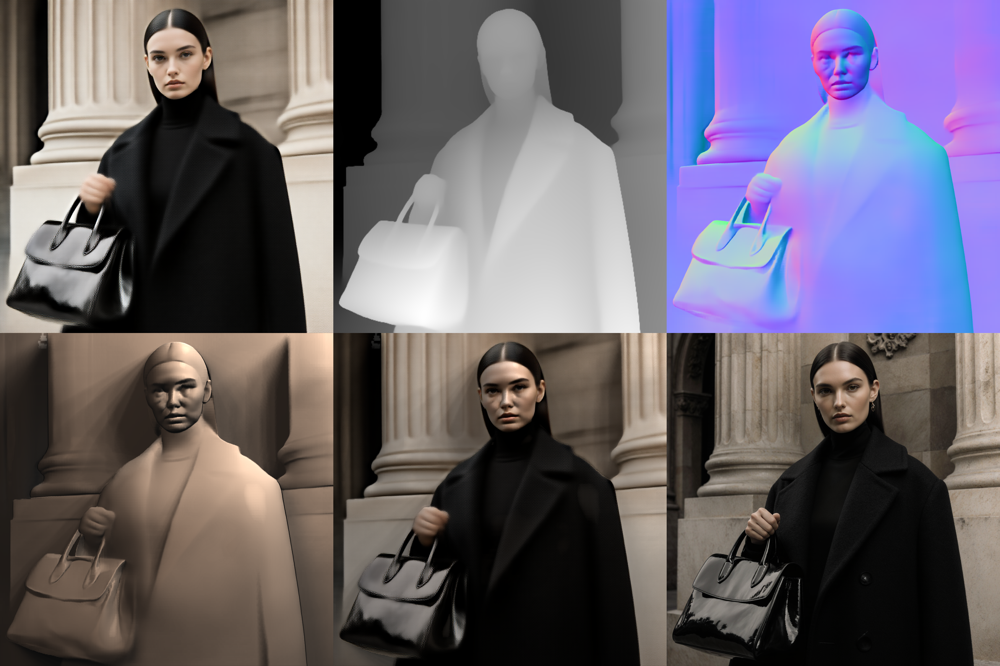

<div align="center">


<br>
<br>

**Stop prompt gambling. Design the light.**

Camera-space key, fill, and rim lights, photographic modifiers, and Kelvin control for existing photographs, finished renders, and generative drafts in ComfyUI.

<p align="center">
  
  
  
  
  
  
  
</p>

<br>

<sub>
<a href="#same-subject-different-studio-light">SHOWCASE</a> &nbsp;·&nbsp;
<a href="#the-problem-prompt-lottery-vs-spatial-control">THE PROBLEM</a> &nbsp;·&nbsp;
<a href="#what-makes-studiolight-different">DIFFERENTIATION</a> &nbsp;·&nbsp;
<a href="#how-it-works-the-dual-input-pipeline">PIPELINE</a> &nbsp;·&nbsp;
<a href="#from-camera-space-lighting-pass-to-final-flux-render">PASS VS. RENDER</a> &nbsp;·&nbsp;
<a href="#3d-camera-space-shadow-raymarching">3D SHADOWS</a> &nbsp;·&nbsp;
<a href="#optical-modifiers--physically-motivated-area-emitters">AREA EMITTERS</a> &nbsp;·&nbsp;
<a href="#core-production-suite">CORE SUITE</a> &nbsp;·&nbsp;
<a href="#installation">INSTALL</a> &nbsp;·&nbsp;
<a href="#master-workflow">WORKFLOW</a> &nbsp;·&nbsp;
<a href="#known-limitations--engineering-scope">LIMITATIONS</a> &nbsp;·&nbsp;
<a href="#roadmap">ROADMAP</a>
</sub>

</div>

<br>

---

## Same Subject. Different Studio Light.

https://github.com/user-attachments/assets/f82d96d9-08ac-4dfb-8f1a-a65432f33a32

<br>

> **Single Fixed Source Plate** | *Pure Physical Relighting in ComfyUI*

<table>
  <thead>
    <tr>
      <th width="33.33%" align="center">High-Fashion Beauty</th>
      <th width="33.33%" align="center">Direct On-Camera Flash</th>
      <th width="33.33%" align="center">Golden Hour Window</th>
    </tr>
  </thead>
  <tbody>
    <tr>
      <td align="center"></td>
      <td align="center"></td>
      <td align="center"></td>
    </tr>
    <tr>
      <td align="center"><sub>Key Beauty Dish (5500K) + Soft Fill. Sculpted cheekbones, circular catchlights, balanced wrap.</sub></td>
      <td align="center"><sub>Hard On-Camera Flash (6500K). Micro-pinpoint glare, sharp contact drop shadows, high contrast.</sub></td>
      <td align="center"><sub>Warm Area Light (3200K) + Cool Sky Fill. Atmospheric side wrap, sunset chiaroscuro glow.</sub></td>
    </tr>
  </tbody>
</table>

---

## The Problem: Prompt Lottery vs. Spatial Control

Text prompts cannot reliably execute 3D spatial vectors. Requesting a `"dramatic blue rim light on the left"` triggers severe prompt bleed: facial features shift, clothing changes cut, and colors wash across the entire frame.

<table>
  <thead>
    <tr>
      <th width="50%" align="left">Prompt-Based Lighting (Text Only)</th>
      <th width="50%" align="left">StudioLight Spatial Control (VFX Engine)</th>
    </tr>
  </thead>
  <tbody>
    <tr>
      <td align="left"><b>Subject Mutation:</b> Prompting for light changes anatomy, facial features, styling, and background geometry.</td>
      <td align="left"><b>Pure Lighting Isolation:</b> Relights fixed 2D photographs or frozen drafts without altering subject geometry or identity.</td>
    </tr>
    <tr></tr>
    <tr>
      <td align="left"><b>Chromatic Bleed:</b> Color words tint skin, hair, and clothing indiscriminately across the whole image.</td>
      <td align="left"><b>Directional Lobe Isolation:</b> Key, fill, and rim colors remain strictly confined to illuminated surfaces (\(\mathbf{N} \cdot \mathbf{L} > 0\)).</td>
    </tr>
    <tr></tr>
    <tr>
      <td align="left"><b>Uncalibrated Falloff:</b> Lights ignore scene depth and distance, treating all surfaces as flat planes.</td>
      <td align="left"><b>Geometric Inverse-Square Falloff:</b> Models true \((r_{\text{ref}} / r)^2\) radiometric distance attenuation calibrated to studio C-stands.</td>
    </tr>
    <tr></tr>
    <tr>
      <td align="left"><b>Diffusion Bottleneck:</b> Requires 30–50 full diffusion steps just to see if a light moved by 10 degrees.</td>
      <td align="left"><b>Instant ~2s Feedback Loop:</b> Shader computes an inspectable physical lighting proxy in ~2 seconds on an RTX 3090.</td>
    </tr>
  </tbody>
</table>

---

## What Makes StudioLight Different

ComfyUI-StudioLight is a **physically motivated, camera-space relighting engine** that combines single-view geometry estimation, sampled photographic area emitters, and an explicit layer compositing contract for both existing images and generative drafts.

### Defining Capabilities:
* **Universal Source Ingestion:** Operates on existing 2D photographs, completed renders, or generative drafts. You do not need to generate an image to use StudioLight.
* **Camera-Space 3D Shadow Raymarching:** Projects camera-space light rays through estimated scene depth, evaluating visibility with front-of-ray occlusion and finite-thickness guards without 2D drop-shadow fakes.
* **Sampled Area-Emitter Apertures:** Models real photographic modifiers (Octabox 1.4m, Stripbox 0.3×1.2m, Beauty Dish 55cm) via Quasi-Monte Carlo integration. Contact-hardening penumbras emerge naturally from aperture geometry.
* **Pure Additive Layering Contract:** Retains the original scene plate and its practical lamps natively as an independent base layer:
  $$\text{HDR} = \text{Source} \cdot 2^{\text{exposure}} + \text{Diffuse} + \text{Specular} + \text{Ambient}$$
  Existing background practicals, room glow, and skylight survive natively without fragile emission guessing.
* **Controlled Subject Replacement:** Switch between native scene addition and targeted subject relighting with an explicit `source_preservation` slider.
* **Two-Stage Generative Freedom:** The physical lighting proxy is a complete, finished output in ~2 seconds. FLUX.1 Krea Dev refinement is strictly an *optional* pass for generative material synthesis and subsurface scattering.

<br>

<div align="center">
  
  <br>
  <sub><b>Interactive Camera-Space Lighting Rig:</b> Real-time 3D VFX spheres (18% Grey + Chrome) &amp; studio radar driving generative relighting across 6 distinct setups.</sub>
</div>

<br>

> [!NOTE]
> **Fidelity Boundaries & Engineering Scope:**
> * **Single-View 2.5D Reconstruction:** Operates on single-view monocular depth and surface normal estimations anchored to camera space. Single-view depth cannot reconstruct occluded geometry behind foreground objects or volumetric smoke.
> * **Approximate Reflectance:** Intrinsic decomposition extracts estimated albedo via Marigold IID. Fine specular responses and micro-catchlights represent photographic approximations, not full multi-bounce path-traced BSDFs.
> * **Diffusion Transfer:** When Pass 2 FLUX refinement is used, denoise (`0.35 – 0.50`) controls how faithfully the model preserves the exact proxy versus reinterpreting skin pores and fabric grain.

### Context & Adjacent Prior Art

<table>
  <thead>
    <tr>
      <th width="24%" align="left">Approach&nbsp;/&nbsp;Tool</th>
      <th width="36%" align="left">Documented Technique</th>
      <th width="40%" align="left">StudioLight Distinction</th>
    </tr>
  </thead>
  <tbody>
    <tr>
      <td align="left"><b>Learned Relighting</b><br>(<a href="https://github.com/lllyasviel/ic-light">IC-Light</a>)</td>
      <td align="left">Text-conditioned and background-conditioned latent diffusion relighting models.</td>
      <td align="left">Provides explicit physical studio fixture parameters (stand distance in meters, elevation/azimuth in degrees, blackbody Kelvin, physical modifier geometry).</td>
    </tr>
    <tr></tr>
    <tr>
      <td align="left"><b>Point-Light &amp; Pass Relighting</b><br>(<a href="https://github.com/FXTD-Studios/radiance">FXTD Radiance</a>)</td>
      <td align="left">Comprehensive VFX toolset featuring scene-linear math, camera-space point lights, and normal-based shading passes.</td>
      <td align="left">Provides integrated geometric area-emitter shadow raymarching, intrinsic albedo recovery, and pure additive practical preservation.</td>
    </tr>
    <tr></tr>
    <tr>
      <td align="left"><b>Screen-Space Mask Lighting</b><br>(<a href="https://github.com/EnragedAntelope/comfyui-relight">ComfyUI-ReLight</a>)</td>
      <td align="left">Vectorized 2D screen-space raymarching over subject masks.</td>
      <td align="left">Extends raymarching into 3D camera space with depth-buffer occlusion testing, area modifier apertures, and instant 2s proxy feedback.</td>
    </tr>
  </tbody>
</table>

---

## How It Works: The Dual-Input Pipeline

StudioLight combines single-view geometry estimation with a physical 3-point lighting console and an explicit layer compositor:

<br>
<div align="center">
  
</div>
<br>

1. **Source Ingestion:** Accepts an existing 2D photograph, finished render, or newly generated draft plate as the source carrier.
2. **Structural Scene Analysis:** Extracts surface orientation via Marigold Normals, relative camera depth via Depth Anything V2, intrinsic diffuse albedo via Marigold IID, and subject selection via BiRefNet.
3. **Photometric Deferred Shading:** Computes area-emitter diffuse irradiance, Blinn-Phong specular lobes, and 3D camera-space shadow raymarching from virtual C-stands.
4. **Physical Layer Composition:** Combines source appearance with newly calculated lighting passes under an explicit additive or subject-replacement contract, outputting an inspectable HDR proxy in ~2 seconds.
5. **Optional Generative Synthesis:** The exact compositor proxy can be encoded into FLUX.1 Krea Dev latents (`denoise 0.35 – 0.50`) to synthesize authentic skin subsurface scattering and fabric micro-reflections.

<br>

<div align="center">
  
  <br>
  <sub><b>Six-Stage Technical Pipeline Dissection:</b> Row 1: Source Plate ➔ Estimated Depth Map ➔ Surface Normals. Row 2: Pure Relighting Field ➔ Lit Proxy Plate (~2s) ➔ Final FLUX Synthesis.</sub>
</div>

<br>

---

## From Camera-Space Lighting Pass to Final FLUX Render

> **Identical Camera Intrinsics ($40^\circ$ Portrait FOV) & Studio Rig Coordinates.**  
> Left: Direct 3D lighting pass preview (computed in float32 PyTorch raymarcher in ~2s). Right: Optional FLUX.1 Krea Dev generative interpretation.

<table>
  <thead>
    <tr>
      <th width="50%" align="center">1. Direct 3D Shading Pass (PyTorch Raymarcher ~2s)</th>
      <th width="50%" align="center">2. Final FLUX Synthesis (Optional Generative Interpretation)</th>
    </tr>
  </thead>
  <tbody>
    <tr>
      <td align="center"></td>
      <td align="center"></td>
    </tr>
    <tr></tr>
    <tr>
      <td align="left">
        <b>Deterministic Camera-Space Lighting Guidance:</b><br>
        • Projected 3D camera-space raymarching through estimated depth field<br>
        • Contact-hardening penumbra under knuckles and coat collar<br>
        • Diverging sampled penumbra cast across 2m background depth gap
      </td>
      <td align="left">
        <b>Generative Material Polish (Pass 2):</b><br>
        • High-contrast dielectric specular catchlights on patent leather<br>
        • Preserves dark black wool texture without crushed blacks or self-shadow acne<br>
        • Fluted neoclassical stone grain and ambient occlusion interpretation
      </td>
    </tr>
  </tbody>
</table>

---

## 3D Camera-Space Shadow Raymarching

StudioLight replaces flat 2D screen-space offsets with **projected 3D camera-space raymarching through reconstructed depth fields**:

```
P_receiver ──► P_receiver + t · (P_light - P_receiver) ──► Perspective Projection ──► Bilinear Depth Lookup ──► P0 Occlusion Gate
```

* **P0 Front-of-Ray Occlusion Gate ($D_{\text{scene}} \le D_{\text{ray}} - \epsilon$):** Evaluates depth strictly in front of the ray sample, paired with a $0.45\text{m}$ finite-thickness boundary and bilateral depth-guided filtering to eliminate false behind-ray occlusions and receiver self-shadow acne.
* **Long-Distance Depth Projection:** Evaluated across expanding depth gaps (validated up to $24\text{m}$ in synthetic geometry, including $2\text{px}$ thin blades in front of $20\text{m}$ depth cliffs) without artificial search clamping.
* **Sampled Area-Emitter Penumbra:** Soft shadows emerge from multi-sample Quasi-Monte Carlo integration across virtual aperture faces with **Interleaved Gradient Noise (IGN)** sub-step dither to smooth discrete step transitions without artificial blur passes.

<div align="center">

<br>
<sub>Slit Aperture Penumbra Stress Test (Row 1: S=4 no dither, S=8 no dither, S=4 dither. Row 2: S=8 dither [Balanced Default], S=16 dither [High-End], S=64 Reference).</sub>
</div>

### NVIDIA RTX 3090 Performance Benchmarks (Shader Parameter Study)

*Measured via `tools/run_hardcore_stress_tests.py` on an NVIDIA GeForce RTX 3090 (PyTorch 2.13, CUDA 12.6, warm runs averaged with `torch.cuda.synchronize()`):*

<table>
  <thead>
    <tr>
      <th align="left">Resolution</th>
      <th align="left">Configuration Tier</th>
      <th align="center">Samples&nbsp;(S)</th>
      <th align="center">Steps</th>
      <th align="center">Pass&nbsp;Latency (RTX&nbsp;3090)</th>
      <th align="center">Peak&nbsp;VRAM</th>
      <th align="center">Ray-Sample Steps&nbsp;/&nbsp;sec</th>
    </tr>
  </thead>
  <tbody>
    <tr>
      <td align="left">512&nbsp;×&nbsp;512</td>
      <td align="left">Fast Preview</td>
      <td align="center">4</td>
      <td align="center">12</td>
      <td align="center">12.0 ms</td>
      <td align="center">113 MB</td>
      <td align="center">1,047 M/s</td>
    </tr>
    <tr></tr>
    <tr>
      <td align="left"></td>
      <td align="left">Balanced (Default)</td>
      <td align="center">8</td>
      <td align="center">16</td>
      <td align="center">29.6 ms</td>
      <td align="center">118 MB</td>
      <td align="center">1,135 M/s</td>
    </tr>
    <tr></tr>
    <tr>
      <td align="left">1024&nbsp;×&nbsp;1024</td>
      <td align="left">Fast Preview</td>
      <td align="center">4</td>
      <td align="center">12</td>
      <td align="center">32.0 ms</td>
      <td align="center">450 MB</td>
      <td align="center">1,571 M/s</td>
    </tr>
    <tr></tr>
    <tr>
      <td align="left"></td>
      <td align="left">Balanced (Default)</td>
      <td align="center">8</td>
      <td align="center">16</td>
      <td align="center">83.0 ms</td>
      <td align="center">469 MB</td>
      <td align="center">1,617 M/s</td>
    </tr>
    <tr></tr>
    <tr>
      <td align="left"></td>
      <td align="left">High-End Quality</td>
      <td align="center">16</td>
      <td align="center">24</td>
      <td align="center">245.3 ms</td>
      <td align="center">469 MB</td>
      <td align="center">1,642 M/s</td>
    </tr>
    <tr></tr>
    <tr>
      <td align="left">2048&nbsp;×&nbsp;2048 (4.2&nbsp;MP)</td>
      <td align="left">Balanced (Default)</td>
      <td align="center">8</td>
      <td align="center">16</td>
      <td align="center">311.5 ms</td>
      <td align="center">1.87 GB</td>
      <td align="center">1,724 M/s</td>
    </tr>
  </tbody>
</table>

> [!NOTE]
> * **Pass Latency:** Complete shadow visibility pass execution time (`torch.cuda.synchronize()`).
> * **Throughput:** Measured inner raymarch step evaluations per second, distinct from full diffusion generation time.

---

## Optical Modifiers & Physically Motivated Area Emitters

Each studio modifier is modeled as a 3D virtual emitter with oriented tangent-space frames, uniform aperture sampling ($W, H, R$), cosine-weighted emission, $(r_{\text{ref}}/r)^2$ distance attenuation, and an analytical aperture footprint in reflection space:

<br>
<div align="center">
  
</div>
<br>

<table>
  <thead>
    <tr>
      <th width="18%" align="left">Modifier</th>
      <th width="20%" align="center">Aperture<br>Dimensions</th>
      <th width="14%" align="center">Beam&nbsp;Angle<br>(&theta;<sub>beam</sub>)</th>
      <th width="26%" align="left">Optical Approximation</th>
      <th width="22%" align="left">Catchlight Profile</th>
    </tr>
  </thead>
  <tbody>
    <tr>
      <td align="left"><b>Direct On-Camera Flash</b></td>
      <td align="center">0.08m&nbsp;×&nbsp;0.05m</td>
      <td align="center">70°</td>
      <td align="left">Near-point strobe emitter</td>
      <td align="left">Crisp micro-pinpoint glare</td>
    </tr>
    <tr></tr>
    <tr>
      <td align="left"><b>Hard Snoot</b></td>
      <td align="center">R&nbsp;=&nbsp;0.05m<br>(10cm)</td>
      <td align="center">18°</td>
      <td align="left">Collimated beam cone</td>
      <td align="left">Tight circular isolation</td>
    </tr>
    <tr></tr>
    <tr>
      <td align="left"><b>Fresnel Spotlight</b></td>
      <td align="center">R&nbsp;=&nbsp;0.15m<br>(30cm)</td>
      <td align="center">35°</td>
      <td align="left">Optical lens edge cutoff</td>
      <td align="left">Compact stepped lens disc</td>
    </tr>
    <tr></tr>
    <tr>
      <td align="left"><b>Stripbox</b></td>
      <td align="center">0.30m&nbsp;×&nbsp;1.20m</td>
      <td align="center">65°</td>
      <td align="left">1:4 Asymmetric rectangular emitter</td>
      <td align="left">Elongated vertical catchlight bar</td>
    </tr>
    <tr></tr>
    <tr>
      <td align="left"><b>Beauty Dish (Silver)</b></td>
      <td align="center">R&nbsp;=&nbsp;0.275m<br>(55cm)</td>
      <td align="center">85°</td>
      <td align="left">Parabolic dish + center deflector (36% radius ratio, 12% transmission)</td>
      <td align="left">Sculpted facial wrap, circular donut ring</td>
    </tr>
    <tr></tr>
    <tr>
      <td align="left"><b>Octabox (Soft)</b></td>
      <td align="center">R&nbsp;=&nbsp;0.70m<br>(140cm)</td>
      <td align="center">130°</td>
      <td align="left">Broad Lambertian octagonal emitter</td>
      <td align="left">Large wrap disc, soft continuous penumbra</td>
    </tr>
  </tbody>
</table>

---

## Core Production Suite

<table>
  <thead>
    <tr>
      <th width="28%" align="left">Engine Component</th>
      <th width="72%" align="left">Role &amp; Architectural Responsibility</th>
    </tr>
  </thead>
  <tbody>
    <tr>
      <td align="left"><b>StudioLight Rig</b><br><sub>3-Point Lighting Console</sub></td>
      <td align="left">Master photographic lighting console with 3D camera-space C-stand coordinates (azimuth, elevation, distance in meters), 3-Zone Light Pointer with face auto-aim, physical modifier apertures (Octabox, Stripbox, Beauty Dish, Fresnel, Snoot, Flash), blackbody Kelvin control (2000K–10000K), and 3D shadow raymarching. Outputs diffuse relighting, isolated specular pass, dual VFX probes, and full-surface telemetry.</td>
    </tr>
    <tr></tr>
    <tr>
      <td align="left"><b>Consistent Compositor</b><br><sub>Physical Layer Engine</sub></td>
      <td align="left">Primary physical layer compositor implementing Schema 1. Supports <b>Pure Additive Mode</b> (preserves 100% of the original plate and ambient practicals natively) and <b>Subject Replacement Mode</b> (controlled subject relighting via <code>source_preservation</code>). Feeds direct preview and VAEEncode with identical linear HDR data.</td>
    </tr>
    <tr></tr>
    <tr>
      <td align="left"><b>DeLight Controller</b><br><sub>Albedo Modulation Engine</sub></td>
      <td align="left">Linearly blends the original source image and Marigold IID estimated albedo to feed the full-surface diffuse reflectance base, eliminating harsh baked-shadow doubling without artificial desaturation.</td>
    </tr>
    <tr></tr>
    <tr>
      <td align="left"><b>Subject Mask Isolator</b><br><sub>Automatic Segmentation</sub></td>
      <td align="left">Supplies clean foreground subject selection via <code>BiRefNet-general</code> for targeted subject replacement operations.</td>
    </tr>
    <tr></tr>
    <tr>
      <td align="left"><b>Prompt Sanitizer</b><br><sub>Semantic Scene Parser</sub></td>
      <td align="left">Decomposes prompts into structured scene intent, stripping directional lighting tokens to eliminate prompt clashing during optional generative diffusion polish.</td>
    </tr>
  </tbody>
</table>

### Five Working Rules for Production

* **Rule 1: Choose Your Relighting Mode First.** Use **Additive Mode** to introduce directional strobes or rim lights while preserving native room glow and existing lamps. Use **Replacement Mode** with `source_preservation` when you need to completely reshape key lighting on a portrait.
* **Rule 2: Keep Source Plate & Diffuse Base Independent.** The source carrier preserves environmental background radiance; the DeLight Controller supplies pure diffuse reflectance. Never collapse them into a single masked hybrid before the compositor.
* **Rule 3: Inspect Upstream Geometry Before Tuning Intensities.** Verify surface normals and relative depth maps. If an edge looks unnatural, adjust the preprocessor scale before over-amplifying rig power.
* **Rule 4: Trust the Direct Proxy.** The direct ~2s compositor output is physically coherent. If light vectors or shadows look misplaced in the proxy, generative diffusion will not correct them—it will only hallucinate over the error.
* **Rule 5: Diffusion is an Optional Material Synthesizer.** Use Pass 2 FLUX Krea Dev at gentle denoise (`0.35 – 0.45`) to add dielectric micro-textures and pore-level skin scattering. It is a material polisher, not a lighting fixer.

---

## Installation & Dependencies

### 1. Installation
```bash
cd ComfyUI/custom_nodes
git clone https://github.com/maciejtajber/ComfyUI-StudioLight.git
pip install -r ComfyUI-StudioLight/requirements.txt
```
*(PyTorch `torch>=2.0.0` is treated as a host-provided ComfyUI dependency so your local CUDA / ROCm / Apple Silicon MPS build is never overwritten).*

### 2. Analysis Dependencies & Models
* **Normals & Depth:** Install `comfyui_controlnet_aux` for `DSINE-NormalMapPreprocessor` / Marigold Normals and `DepthAnythingV2Preprocessor`.
* **Intrinsic Albedo:** Install `ComfyUI-StudioLight-DeLight` (weights: `prs-eth/marigold-iid-lighting-v1-1`).
* **Subject Segmentation:** Install `comfyui-rmbg` (`BiRefNet-general`).
* **Optional Diffusion Refinement:** `flux1-dev.safetensors` or `flux1-krea-dev.safetensors` with standard CLIP and VAE loaders.

### 3. Automated Test Suite
Verify mathematical invariants, color spaces, and shader engines standalone:
```bash
python3 -m unittest discover -s tests
```
*(68 / 68 automated unit & regression tests passing).*

---

## Master Workflow

> **Flagship Production Architecture:** Complete dual-input ComfyUI pipeline supporting fixed photograph relighting, 3D shadow raymarching, physical compositing, and live VFX sphere probes.

<a href="assets/studiolight_master_workflow.png" target="_blank">
  
</a>

* **Ready-to-Run Workflows:**
  * **Photo Relight (`workflows/StudioLight_PhotoRelight.json`):** Streamlined single-pass workflow to load any photograph and relight it in ~2 seconds.
  * **Master Studio (`workflows/StudioLight_Master_Studio.json`):** Full flagship pipeline featuring prompt decoupling, 3D C-stands, and optional FLUX Krea Dev generative refinement.

---

## Known Limitations & Engineering Scope

* **Single-View 2.5D Frustum:** Geometry and shadow raymarching operate on surfaces visible to the camera. Surfaces completely occluded in the depth map cannot cast shadows.
* **Estimated Intrinsic Albedo:** Single-image albedo decomposition via Marigold IID is an estimate. Extreme specular glare or deep baked shadows may leave subtle residual tones in challenging plates.
* **Additive Layer Retention:** Additive mode retains existing ambient lighting and practical lamps natively. It does not erase old light sources or rotate existing baked shadows.
* **Diffusion Interpretation:** When optional Pass 2 FLUX refinement is enabled, higher denoise levels ($\ge 0.60$) give diffusion greater freedom to repaint textures, whereas lower values ($0.35–0.45$) strictly preserve subject identity and proxy lighting vectors.

---

## Status-Based Capability Roadmap

| Capability / Milestone | Engineering Status | Architectural Scope |
| :--- | :--- | :--- |
| **Fixed-Image 2D Relighting** | **Shipped in Consistent V1** | Relight arbitrary photographs and renders without mandatory diffusion passes. |
| **Pure Additive Layering Contract** | **Shipped in Consistent V1** | Native practical and room-ambient preservation ($HDR = S \cdot 2^e + D + P + A$). |
| **Controlled Subject Replacement** | **Shipped in Consistent V1** | Explicit `source_preservation` slider with BiRefNet subject isolation. |
| **Intrinsic Albedo Pipeline** | **Shipped in Consistent V1** | Full-surface Marigold IID De-Light modulation via the DeLight Controller. |
| **Direct Proxy / VAE Parity** | **Shipped in Consistent V1** | Preview and VAEEncode receive identical, unclipped linear HDR data in ~2s. |
| **Optional FLUX Krea Polish** | **Shipped in Consistent V1** | Decoupled Pass 2 generative refinement stage for skin micro-textures. |
| **Temporal Light Keyframing** | **Next Sprint (Q4 2026)** | Reproducible interpolation of C-stand coordinates and Kelvin across video frame sequences. |
| **Video Diffusion Integration** | **Next Sprint (Q4 2026)** | Injecting 32-bit linear photometric plates into spatio-temporal video attention streams (Wan / LTX). |
| **Temporal Geometry Deflicker** | **Next Sprint (Q4 2026)** | Depth and normal temporal filtering to eliminate multi-frame edge chatter. |
| **Multi-View Coherent Rigging** | **Research Horizon** | Shared 3D camera-space lighting rigs across multi-camera array captures. |
| **Integrated Three.js 3D Mesh Stage** | **Explicitly Retired** | Single-view depth raymarching supersedes the legacy Three.js mannequin stage. |

---

## License & Credits

* **Code & Shaders:** MIT License. Created by **Maciej Tajber** // **METAMATERIAL** Applied VFX Systems.
* **Ecosystem Credits:** Built on the open research of the ComfyUI, Depth Anything V2, Marigold, BiRefNet, and FLUX communities.
