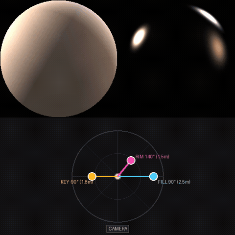
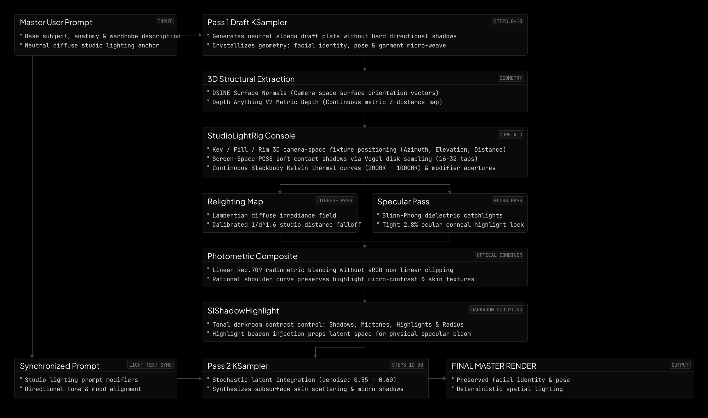

<div align="center">


<br>
<br>

**Stop prompt gambling. Design the light.**

Camera-space key, fill, and rim lights, photographic modifiers, and Kelvin control for FLUX in ComfyUI.

<sub>v0.9.0-rc &nbsp;·&nbsp; COMFYUI CUSTOM NODE &nbsp;·&nbsp; FLUX.1 DEV / KREA &nbsp;·&nbsp; 18/18 TESTS PASSING &nbsp;·&nbsp; MIT</sub>

<br>

<sub>
<a href="#interactive-camera-space-lighting-in-action">DEMO</a> &nbsp;·&nbsp;
<a href="#same-subject-same-prompt-different-light">SHOWCASE</a> &nbsp;·&nbsp;
<a href="#from-camera-space-lighting-pass-to-final-flux-render">THE PROOF</a> &nbsp;·&nbsp;
<a href="#what-makes-studiolight-different">DIFFERENTIATION</a> &nbsp;·&nbsp;
<a href="#core-production-suite--node-schemas">NODE SCHEMAS</a> &nbsp;·&nbsp;
<a href="#installation">INSTALL</a> &nbsp;·&nbsp;
<a href="#how-it-works">PIPELINE</a> &nbsp;·&nbsp;
<a href="#3d-camera-space-shadow-raymarching">3D SHADOWS</a> &nbsp;·&nbsp;
<a href="#optical-modifiers--physical-area-emitters">AREA EMITTERS</a> &nbsp;·&nbsp;
<a href="#known-limitations--engineering-scope">LIMITATIONS</a> &nbsp;·&nbsp;
<a href="#master-workflows">WORKFLOWS</a>
</sub>

</div>

<br>

---

## Interactive Camera-Space Lighting in Action

<div align="center">

<a href="assets/demo.mp4">
  
</a>

<br>
<sub><b>Live 3-Point Studio Console Manipulation & Dual-Sphere VFX Probes</b><br>
Real-time Stand Distance ($r$), Azimuth ($\theta$), Elevation ($\phi$), and Kelvin temperature response in 0.03s. Click preview to open raw MP4 (<a href="assets/demo.mp4"><code>assets/demo.mp4</code></a>).</sub>

</div>

---

## Same Subject. Same Prompt. Different Light.

> **Locked Seed:** `424242` | *Identical Base Prompt, Geometry, and Seed across FLUX.1 Krea Dev*

<table>
  <thead>
    <tr>
      <th width="25%" align="center">Direct Flash (90s Strobe)</th>
      <th width="25%" align="center">Hard Key (Fresnel)</th>
      <th width="25%" align="center">Sculpted (Beauty Dish)</th>
      <th width="25%" align="center">Soft Wrap (Octabox)</th>
    </tr>
  </thead>
  <tbody>
    <tr>
      <td align="center"></td>
      <td align="center"></td>
      <td align="center"></td>
      <td align="center"></td>
    </tr>
    <tr>
      <td align="center">
        <b>Direct On-Camera Flash</b><br>
        Key: 0° Azimuth / +5° Elevation<br>
        Hard drop shadow, raw patent spec
      </td>
      <td align="center">
        <b>Fresnel Spotlight (Hard Key)</b><br>
        Key: +30° Azimuth / +25° Elevation<br>
        Crisp penumbra, sharp dielectric glints
      </td>
      <td align="center">
        <b>Beauty Dish (Silver 55cm)</b><br>
        Key: +30° Azimuth / +25° Elevation<br>
        Carved cheekbones, crisp catchlights
      </td>
      <td align="center">
        <b>Diffused Octabox (140cm)</b><br>
        Key: +30° Azimuth / +25° Elevation<br>
        Soft continuous penumbra, coat wrap
      </td>
    </tr>
  </tbody>
</table>

---

## From Camera-Space Lighting Pass to Final FLUX Render

> **Identical Camera Intrinsics ($40^\circ$ Portrait FOV) & Studio Rig Coordinates.**  
> Left: Deferred lighting pass preview (computed in float32 PyTorch raymarcher). Right: Final FLUX.1 Krea Dev latent synthesis.

<table>
  <thead>
    <tr>
      <th width="50%" align="center">1. Deferred 3D Shading Pass (PyTorch Raymarcher)</th>
      <th width="50%" align="center">2. Final FLUX Synthesis (Generative Diffusion Interpretation)</th>
    </tr>
  </thead>
  <tbody>
    <tr>
      <td align="center"></td>
      <td align="center"></td>
    </tr>
    <tr>
      <td align="left">
        <b>Deterministic Physical Lighting Guidance:</b><br>
        • Canonical 3D camera-space raymarching through estimated depth field<br>
        • Optical contact-hardening under knuckles and coat collar<br>
        • Diverging physical penumbra cast across 2m background chasm
      </td>
      <td align="left">
        <b>Generative Material Synthesis:</b><br>
        • High-contrast dielectric specular catchlights on patent leather<br>
        • Preserves dark black wool texture without crushed blacks or self-shadow acne<br>
        • Fluted neoclassical stone grain and ambient occlusion interpretation
      </td>
    </tr>
  </tbody>
</table>

---

## What Makes StudioLight Different

ComfyUI-StudioLight integrates image-derived camera-space geometry, screen-space shadow raymarching, and sampled photographic area emitters into a controllable lighting workflow for generative image synthesis.

### Defining Capabilities:
* **Depth-Based Camera-Space Shadowing:** Reconstructs camera-space surface positions from image-derived depth and configured studio scale ($40^\circ$ FOV), evaluating visibility along projected 3D light rays rather than flat screen-space offsets.
* **Geometric Area-Emitter Sampling:** Models photographic studio modifier apertures (Octabox 1.4m, Stripbox 0.3×1.2m, Beauty Dish 55cm) through Quasi-Monte Carlo Hammersley sampling. Contact-hardening penumbras emerge naturally from sample integration without an artificial PCSS blur pass.
* **Integrated Photometric Lighting:** Combines directional diffuse shading, Blinn-Phong specular microfacets, distance-dependent $(r_{\text{ref}}/r)^2$ radiometric falloff, and shadow visibility within a unified PyTorch pipeline.
* **Diffusion-Integrated Results:** Uses the computed lighting plate as explicit physical guidance for Pass 2 FLUX.1 Krea Dev latent synthesis, marrying spatial lighting control with generative material synthesis.

> [!NOTE]
> **Scope & Engineering Limits:** StudioLight performs screen-space raymarching over an estimated single-view geometry field (Depth Anything V2 + DSINE calibrated to studio scale). Pretrained monocular depth models estimate relative depth, which StudioLight anchors to virtual camera space (defaulting the subject plane to $Z = -2.0\text{m}$). It is designed for fast, controllable image relighting—not unrestricted path tracing over a complete multi-view 3D scene.

### Context & Adjacent Prior Art

StudioLight builds on established computer-graphics principles and exists alongside valuable ComfyUI lighting tools:

| Approach / Tool | Documented Technique | StudioLight Distinction |
| :--- | :--- | :--- |
| **Learned Relighting**<br>([IC-Light](https://github.com/lllyasviel/ic-light)) | Text-conditioned and background-conditioned diffusion relighting models. | Provides explicit physical studio fixture parameters (stand distance in meters, elevation/azimuth in degrees, blackbody Kelvin, physical modifier geometry). |
| **Scene-Linear Point Lighting**<br>([FXTD Radiance](https://github.com/FXTD-Studios/radiance)) | Scene-linear math, camera-space calculations, and point lights; multipass node takes a shadow pass as input. | Provides an integrated geometric area-emitter shadow raymarcher and single-view depth reconstruction directly within the lighting rig node. |
| **Full 3D Environments**<br>([WAS Node Suite Three.js](https://github.com/WASasquatch/was-node-suite-comfyui)) | Three.js nodes for polygonal geometry, materials, lights, cameras, and path tracing. | Focuses specifically on single-view generative images where no 3D polygonal mesh exists. |
| **Screen-Space Mask Lighting**<br>([ComfyUI-ReLight](https://github.com/EnragedAntelope/comfyui-relight)) | Vectorized 2D screen-space raymarching over subject masks. | Extends raymarching into 3D camera space with depth-buffer occlusion testing and physical area-emitter apertures. |

---

## Core Production Suite & Node Schemas

*Extracted directly from node classes (`nodes/*.py`):*

| Node Name | Category | Inputs | Outputs | Core Purpose |
| :--- | :--- | :--- | :--- | :--- |
| **`StudioLightRig`** | `StudioLight/Rig` | **Required:** `preset`, `ambient_intensity`, `invert_normals_y`, Key light controls (`enabled`, `azimuth`, `elevation`, `distance`, `intensity`, `kelvin`, `modifier`), Fill controls, Rim controls, `normal_boost`, `ao_anchoring`<br>**Optional:** `scene_3d`, `normals_optional`, `depth_optional`, `invert_normals_x`, `target_engine`, `invert_depth` | `relighting_map` *(IMAGE)*<br>`probe_preview` *(IMAGE)*<br>`lighting_prompt` *(STRING)*<br>`specular_pass` *(IMAGE)* | Master 3-point photographic lighting console with 3D camera-space coordinates, physical modifier selection, Kelvin color temperature, and live dual-sphere VFX preview. |
| **`StudioPhotometricComposite`** | `StudioLight/Photometric` | **Required:** `image` *(IMAGE)*, `lighting_map` *(IMAGE)*, `lighting_strength`, `ambient_floor`, `specular_kick`, `chroma_bleed`, `filmic_white_point`<br>**Optional:** `specular_map` *(IMAGE, from Rig specular_pass)* | `lit_image` *(IMAGE)* | Linear Rec.709 photometric shading engine with rational shoulder tonemapping, lobe-accurate specular integration, and chromatic midtone bleed. |
| **`SIShadowHighlight`** | `StudioLight/Photometric` | **Required:** `image` *(IMAGE)*, `shadow_amount`, `highlight_amount`, `shadow_tonal_width`, `highlight_tonal_width`, `midtone_contrast` | `IMAGE` *(IMAGE)* | Latent preparation darkroom with bilateral Hermite tonal isolation (isolated shadows and highlights, zero midtone bleed) and bounded sigmoidal midtone contrast. |
| **`StudioPromptSanitizer`** | `StudioLight/Utility` | **Required:** `master_prompt` *(STRING)*<br>**Optional:** `albedo_suffix` *(STRING)* | `pass1_albedo_prompt` *(STRING)*<br>`pass2_lit_prompt` *(STRING)* | Albedo decoupling utility that strips specular and lighting keywords from Pass 1 draft latents while passing the complete prompt to Pass 2. |

---

## Installation

### 1. ComfyUI Manager (Recommended)
Search for `ComfyUI-StudioLight` in the ComfyUI Manager and install.

### 2. Manual Installation
```bash
cd ComfyUI/custom_nodes
git clone https://github.com/maciejtajber/ComfyUI-StudioLight.git
pip install -r ComfyUI-StudioLight/requirements.txt
```

### Dependencies & Models
* **Preprocessors:** Install `comfyui_controlnet_aux` for `DSINE-NormalMapPreprocessor` and `DepthAnythingV2Preprocessor`.
* **Models:** Standard `flux1-dev.safetensors` (or `flux1-krea-dev.safetensors`), CLIP text encoders, and VAE.
* **Licensing Note:** FLUX.1 [dev] weights are released under Black Forest Labs' Non-Commercial License. Verify licensing terms for commercial deployments.

### Automated Test Suite
Verify math, photometric color spaces, and shader engines (runs standalone without ComfyUI):
```bash
python test_studiolight.py
```

---

## The Problem: Prompt Lottery vs. Spatial Control

Text prompts cannot reliably execute 3D spatial vectors. Requesting a `"dramatic blue rim light on the left"` often triggers severe prompt bleed: facial features shift, clothing changes cut, and colors wash across the entire frame.

| Prompt-Based Lighting (Text Only) | StudioLight Spatial Control (VFX Engine) |
| :--- | :--- |
| **Subject Mutation:** Prompting for light changes anatomy, styling, and background geometry. | **Geometry Preservation:** Structure crystallizes in Pass 1; lighting is steered independently in Pass 2. |
| **Chromatic Bleed:** Color tokens tint skin, hair, and clothing indiscriminately. | **Directional Lobe Isolation in Plate:** Rim and key colors remain confined to illuminated surfaces ($N \cdot L > 0$) in the lighting plate, steering Pass 2 synthesis. |
| **Uncalibrated Falloff:** Lights fail to observe inverse-square distance or scene depth. | **Physical Geometric Inverse-Square:** Models true $(r_{\text{ref}}/r)^2$ radiometric distance falloff, normalized to studio reference stand distance ($r_{\text{ref}}=1.8\text{m}$). |
| **Pre-baked Specular Artifacts:** High-gloss words bake blown-out white patches into early draft latents. | **Albedo Decoupling:** Renders clean draft plates with reduced baked highlights; specular kicks align with fixture placement. |

---

## How It Works

StudioLight splits generation into a **two-stage geometry and relighting pipeline**:



1. **Geometry Crystallization (Steps 0–10):** Pass 1 generates an unlit albedo draft to define scene forms, anatomy, and clothing weave without baked directional shadows.
2. **Camera-Space 3D Projection:** Extracts surface normals (DSINE) and estimated depth (Depth Anything V2), back-projecting the 2D draft into virtual camera-space ($40^\circ$ portrait FOV calibrated to studio scale).
3. **Photometric Deferred Shading:** Computes diffuse irradiance, Blinn-Phong specular lobes, and 3D camera-space shadow raymarching from virtual C-stands.
4. **Stochastic Polish (Pass 2):** Composites the lit plate in linear Rec.709 space, preps tones in the `SIShadowHighlight` darkroom, and feeds it to Pass 2 (denoise `0.55 – 0.60` in Method A two-stage img2img, or midstream trajectory continuation in Method B) to synthesize subsurface skin scattering and photorealistic catchlights.

---

## 3D Camera-Space Shadow Raymarching

StudioLight replaces flat screen-space offsets with **canonical 3D camera-space raymarching through reconstructed depth fields**:

```
P_receiver ──► P_receiver + t · (P_light - P_receiver) ──► Perspective Projection ──► Bilinear Depth Lookup ──► P0 Occlusion Gate
```

* **P0 Front-of-Ray Occlusion Gate ($D_{\text{scene}} \le D_{\text{ray}} - \epsilon$):** Evaluates depth strictly in front of the ray sample, suppressing false shadows and receiver self-shadow acne on curved faces in automated tests while handling camera-side key lights and rear rim kickers symmetrically.
* **Unbounded 3D Depth Chasms:** Foreground subjects cast geometrically consistent shadows across expanding depth chasms (evaluated up to $24\text{m}$ in calibrated test geometry) onto distant architecture, deforming authentically across fluted columns and background masonry.
* **Single-Layer Physical Penumbra:** Soft shadows emerge naturally from multi-sample Quasi-Monte Carlo integration across the physical aperture face (Octabox 1.40m, Stripbox 0.30×1.20m, Beauty Dish 55cm) with **Interleaved Gradient Noise (IGN)** sub-step dither to smooth discrete step transitions—zero artificial PCSS post-blur required.

<div align="center">

<br>
<sub>Slit Aperture Penumbra Stress Test (Row 1: S=4 no dither, S=8 no dither, S=4 dither. Row 2: S=8 dither [Balanced Default], S=16 dither [High-End], S=64 Quasi-Monte Carlo Ground Truth).</sub>
</div>

### NVIDIA RTX 3090 Performance Benchmarks

*Measured via `tools/run_hardcore_stress_tests.py` on an NVIDIA GeForce RTX 3090 (PyTorch 2.13, CUDA 12.6, 5 warm runs averaged with `torch.cuda.synchronize()`):*

| Resolution | Preset | Samples ($S$) | Steps | Pass Latency (RTX 3090) | Peak VRAM | Ray-Sample Steps / sec |
| :--- | :--- | :---: | :---: | :---: | :---: | :---: |
| **$512 \times 512$** | Fast Preview | 4 | 12 | **12.0 ms** | 113 MB | **1,047 M/s** |
| | Balanced (Default) | 8 | 16 | **29.6 ms** | 118 MB | **1,135 M/s** |
| **$1024 \times 1024$** | Fast Preview | 4 | 12 | **32.0 ms** | 450 MB | **1,571 M/s** |
| | **Balanced (Default)** | **8** | **16** | **83.0 ms** | **469 MB** | **1,617 M/s** |
| | High-End Quality | 16 | 24 | **245.3 ms** | 469 MB | **1,642 M/s** |
| **$2048 \times 2048$** *(4.2 MP)* | Balanced (Default) | 8 | 16 | **311.5 ms** | 1.87 GB | **1,724 M/s** |

> [!NOTE]
> * **Pass Latency:** Complete shadow visibility pass execution time.
> * **Ray-Sample Steps / sec:** Calculated as $(W \times H \times S \times \text{steps}) / \text{latency}$. For example, $1,617\text{ M/s}$ represents $1.62\times 10^9$ discrete ray-sample evaluations per second. Complete pass latency is $29.6\text{ ms}$ ($512^2$) and $83.0\text{ ms}$ ($1024^2$).
> * Benchmarks can be directly verified locally by running `python tools/run_hardcore_stress_tests.py`.

> [!TIP]
> For the complete mathematical formulation, low-discrepancy sampling derivations, and shader implementation:
> * [Mathematical Derivation & Architecture: 3D Camera-Space Shadow Raymarching](docs/ARCHITECTURE_METRIC_3D_SHADOWS.md)
> * [Architecture Plan: StudioLight Geometric Area Emitters](docs/ARCHITECTURE_PHYSICAL_AREA_EMITTERS.md)
> * [Engine Walkthrough & Benchmarks](docs/ENGINE_WALKTHROUGH_AREA_EMITTERS.md)

---

## Optical Modifiers & Physical Area Emitters

StudioLight implements a **physically based geometric area-emitter architecture**. Every studio modifier is modeled as a defined 3D virtual emitter with metric dimensions ($W, H, R$), angular beam distributions, single-layer penumbra visibility, and an analytical aperture reflection in reflection space:

```
                                   EMITTER
        [Geometry: Dimensions in meters (W, H, R), Position, Aim Direction]
                                       │
            ┌─────────────────────────┼─────────────────────────┐
            ▼                         ▼                         ▼
   1. DIFFUSE EMISSION       2. SHADOW / VISIBILITY     3. SPECULAR REFLECTION
  Vectorized [S, H, W, 3]    Single-layer penumbra      Ray-plane intersection
  • S=16 sample points       • Binary blocker test      • Emitter 2D coordinate
  • Physical 1 / r_k²          per sample point         • Continuous aperture
  • cos θ_e × cos θ_p        • Average across S           profile & roughness
  • Radiometric area norm      yields natural penumbra    • True fixture catchlights
```

| Modifier | Metric Aperture | Beam Angle ($\theta_{\text{beam}}$) | Optical Approximation | Catchlight Profile |
| :--- | :---: | :---: | :--- | :--- |
| **Direct On-Camera Flash** | $0.08\text{m} \times 0.05\text{m}$ | $70^\circ$ | Near-point strobe emitter | Crisp micro-pinpoint |
| **Hard Snoot** | $R=0.05\text{m}$ (10cm) | $18^\circ$ | Collimated beam cone | Tight circular isolation |
| **Fresnel Spotlight** | $R=0.15\text{m}$ (30cm) | $35^\circ$ | Optical lens edge cutoff | Compact stepped lens disc |
| **Stripbox** | $0.30\text{m} \times 1.20\text{m}$ | $65^\circ$ | 1:4 Asymmetric rectangular emitter | Elongated vertical catchlight bar |
| **Beauty Dish (Silver)** | $R=0.275\text{m}$ (55cm) | $85^\circ$ | Parabolic dish + center deflector ($36\%$ radius ratio, $12\%$ center transmission) | Sculpted cheekbones, donut catchlight ring |
| **Octabox (Soft)** | $R=0.70\text{m}$ (140cm) | $130^\circ$ | Broad Lambertian octagonal emitter | Large wrap disc, soft continuous penumbra |

> [!NOTE]
> All studio modifiers represent photographic approximations and virtual emitter geometries calibrated for photographic lighting control, rather than full laboratory optical simulations.

---

## Empirical Discoveries & Working Rules

* **Rule 1: Pass 1 Functions Best as a Flat Albedo Carrier:** Prompting Pass 1 with directional sun bakes hard contours into base geometry. Use an albedo carrier suffix in Pass 1 (`", flat diffuse ambient lighting, shadowless, albedo"`) to give StudioLight clean geometric control.
* **Rule 2: Matte Fabrics Require Dedicated Specular Isolation:** Dark wool has albedo near 0.02. High specular kicks cause grazing Fresnel spikes, turning black wool into metallic foil. Wire `specular_pass` directly into `StudioPhotometricComposite`, keep `specular_kick` at `0.30–0.50`, and set `chroma_bleed = 0.00` on dark garments.
* **Rule 3: Radiometric Distance Falloff Replaces Artificial Depth Tapers:** Legacy screen-space shaders often clamp distant geometry (`d_norm < 0.20`) to suppress noise, which accidentally destroys shadows on distant walls. StudioLight evaluates unconstrained physical $(r_{\text{ref}}/r)^2$ radiometric falloff and directional beam profiles ($\cos\theta > 0$), allowing foreground subjects to naturally cast geometric shadows across architectural depth gaps.
* **Rule 4: Pass 2 Denoise Governs Illumination Integration:**
  * `0.35 – 0.45` (Feature Lock): Soft catalog fill.
  * `0.50 – 0.75` (Calibrated Range): Working zone for dramatic lighting. Synthesizes skin subsurface scattering, eye catchlights, and leather wrap while anchoring subject structure.
  * `0.75+` (Hallucination Boundary): May hallucinate physical softbox fixtures in the frame. Keep denoise $\le 0.75$.

---

## Production Recipes by Scenario

| Setup / Scenario | `specular_kick` | `chroma_bleed` | `filmic_white_point` | Pass 2 Denoise | Recommended Key Modifier |
| :--- | :---: | :---: | :---: | :---: | :--- |
| **High-Fashion Beauty (Skin & Soft Fill)** | `0.40 – 0.50` | `0.40 – 0.45` | `3.5` | `0.50 – 0.55` | `Beauty Dish (Silver)` or `Octabox` |
| **Commercial Catalog (Mixed Fabrics & Leather)** | `0.40 – 0.50` | `0.35` | `3.5` | `0.55 – 0.60` | `Beauty Dish` or `Stripbox` |
| **Dark Tailored Apparel (Matte Wool / Velvet)** | `0.00 – 0.20` | `0.00` | `2.5` | `0.55 – 0.60` | `Octabox (Soft)` |
| **Cinematic Film Noir (High Chiaroscuro)** | `0.50 – 0.60` | `0.50` | `2.0 – 2.5` | `0.60 – 0.65` | `Fresnel Spotlight` or `Hard Snoot` |
| **Isolated Metallic / Chrome Props (Macro)** | `1.00 – 1.50` | `0.10` | `5.0 – 6.0` | `0.60 – 0.65` | `Direct Flash` or `Hard Snoot` |

---

## Known Limitations & Engineering Scope

* **Relative Depth Scaling:** Operates on estimated monocular depth (Depth Anything V2), normalized and calibrated to a studio coordinate frame ($Z=-2.0\text{m}$). It does not represent physical millimeter-level LiDAR ground truth.
* **Single-View Frustum Bounds:** Screen-space raymarching is constrained to surfaces visible in the 2.5D camera buffer; occluded geometries cannot cast shadows onto other objects.
* **Pass 2 Latent Interpretation:** StudioLight produces deterministic photometric guidance plates; Pass 2 FLUX latent diffusion interprets these plates generatively. At high denoise ($\ge 0.70$), diffusion may soften shadow contrast or shift colors.
* **Model Weight Licensing:** FLUX.1 [dev] weights are provided under Black Forest Labs' Non-Commercial License. Verify licensing requirements for commercial deployments.

---

## Master Workflows

* [`workflows/StudioLight_Master.json`](workflows/StudioLight_Master.json): Complete 2-Stage FLUX.1 Krea Dev production pipeline with prompt decoupling and shadow raymarching.
* [`workflows/StudioLight_MethodA_Calibrated.json`](workflows/StudioLight_MethodA_Calibrated.json): Fast portrait studio relighting workflow with interactive console gizmo and live VFX sphere probes.
* [`workflows/StudioLight_MethodB_Trajectory.json`](workflows/StudioLight_MethodB_Trajectory.json): `[Experimental - Video/Latent Trajectory]` Camera-space lighting trajectory for animated sequences (experimental exploration; validation ongoing).

---

## Technical Documentation Index

| Document | Purpose |
| :--- | :--- |
| [`ARCHITECTURE_METRIC_3D_SHADOWS.md`](docs/ARCHITECTURE_METRIC_3D_SHADOWS.md) | Canonical raymarching formulation, P0 occlusion gate, IGN dither derivation, stress benchmarks |
| [`ARCHITECTURE_PHYSICAL_AREA_EMITTERS.md`](docs/ARCHITECTURE_PHYSICAL_AREA_EMITTERS.md) | Geometric area apertures, 2D Hammersley sampling, radiometric normalization |
| [`ENGINE_WALKTHROUGH_AREA_EMITTERS.md`](docs/ENGINE_WALKTHROUGH_AREA_EMITTERS.md) | Vectorized PyTorch shader implementation, memory chunking, profiling |
| [`DISCOVERY_3D_METRIC_SHADOW_RAYMARCHING.md`](docs/DISCOVERY_3D_METRIC_SHADOW_RAYMARCHING.md) | Empirical discovery notes: 2D screen-space limits vs 3D camera-space |

---

## License

MIT License. Created by [Maciej Tajber](https://github.com/maciejtajber) // **METAMATERIAL** Applied VFX Systems.
