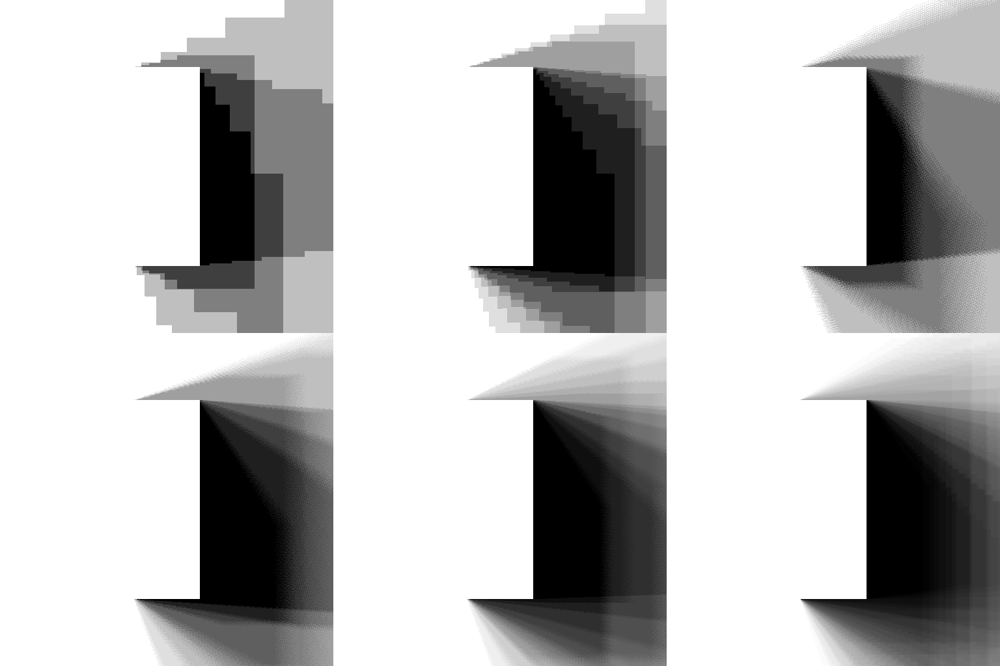
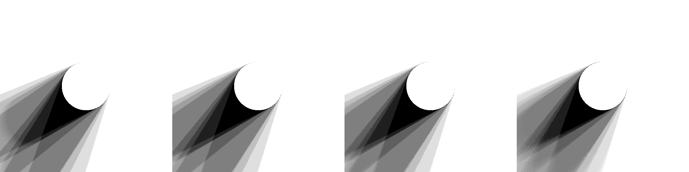

# Mathematical Foundations & Architecture: Metric 3D Camera-Space Shadow Raymarching

**Module:** `nodes/metric_shadow.py` · `nodes/shader_engine.py`  
**Author:** Maciej Tajber (https://github.com/maciejtajber) // METAMATERIAL  
**License:** MIT  
**Status:** Validated, Hardened & Deployed (Commit `bd7cd98`, 18/18 Tests Passed)

---

## 1. Abstract & Executive Summary

Standard generative AI relighting tools rely on 2D screen-space pixel approximations (marching fixed fractions in screen $(u, v)$ coordinates) or post-processed blur filters. These approximations collapse when subjects stand in front of architectural geometry:
1. **The 40-Pixel Horizon:** 2D marchers clamp at $\sim 40\text{ px}$, failing to project cast shadows across real metric depth gaps ($\Delta Z > 0.5\text{m}$).
2. **Artificial Distance Fade:** Heuristic weights (`1.0 - s / steps`) fade shadows into ambient smudges rather than solid cast silhouettes.
3. **Planar Blindness:** Shadows cannot deform across curved surfaces, such as the vertical fluting of stone columns.

**ComfyUI-StudioLight** completely replaces screen-space heuristics with **canonical 3D camera-space raymarching through metric depth fields**. By evaluating ray paths in physical meters ($[X, Y, Z]$) and projecting samples back to Normalized Device Coordinates (NDC), cast shadows accurately bridge 20m+ depth chasms, deform across non-planar architecture, and produce physically grounded penumbras directly from area-emitter apertures without artificial PCSS post-filters.

---

## 2. Canonical Coordinate System & Camera Model

StudioLight operates in OpenGL metric camera space:
* **$+X$:** Right (meters)
* **$+Y$:** Up (meters)
* **$-Z$:** Forward optical axis into the scene (meters)
* **$D_{\text{scene}} = -Z > 0$:** Positive metric distance in front of the lens.

Given metric depth $D(u, v)$ from monocular estimation (Depth Anything V2 calibrated to studio space) and camera intrinsics with vertical field of view $\theta_{\text{FOV}}$, any pixel $(x, y) \in [0, W-1] \times [0, H-1]$ is back-projected to world-scale metric camera space:

$$\tan\left(\frac{\theta_{\text{FOV}}}{2}\right) = \tan_{\text{half}}$$

$$u = \left(\frac{x}{W - 1}\right) \cdot 2 - 1, \quad v = 1 - \left(\frac{y}{H - 1}\right) \cdot 2$$

$$\mathbf{P}_{\text{surf}}(x, y) = \begin{bmatrix} X \\ Y \\ Z \end{bmatrix} = \begin{bmatrix} u \cdot D(x, y) \cdot \tan_{\text{half}} \cdot \text{Aspect} \\ v \cdot D(x, y) \cdot \tan_{\text{half}} \\ -D(x, y) \end{bmatrix}$$

---

## 3. Mathematical 3D Ray Traversal Formulation

For every surface receiver point $\mathbf{P}_{\text{surf}}$ and each area-emitter sample point $\mathbf{P}_{\text{light}}^k \in \mathbb{R}^3$, the light ray is parameterized over $t \in [0, 1]$:

$$\mathbf{L}_k = \mathbf{P}_{\text{light}}^k - \mathbf{P}_{\text{surf}}, \quad d_{\text{ray}} = \|\mathbf{L}_k\|_2, \quad \hat{\mathbf{L}}_k = \frac{\mathbf{L}_k}{d_{\text{ray}}}$$

$$\mathbf{P}_k(t) = \mathbf{P}_{\text{surf}} + t \cdot \mathbf{L}_k, \quad t \in [\alpha_0, \alpha_1]$$

Where $\alpha_0 = \frac{\text{ray\_start\_m}}{d_{\text{ray}}}$ offsets the ray from the receiver surface to prevent self-intersection, and $\alpha_1 = 1 - \frac{\text{ray\_end\_m}}{d_{\text{ray}}}$ terminates before entering the emitter fixture.

### Perspective Back-Projection to Screen NDC
At each discrete ray step $t_i$, the 3D metric point $\mathbf{P}_k(t_i) = (X_i, Y_i, Z_i)$ is projected back to Normalized Device Coordinates:

$$D_{\text{ray}}(t_i) = -Z_i$$

$$u(t_i) = \frac{X_i}{D_{\text{ray}}(t_i) \cdot \tan_{\text{half}} \cdot \text{Aspect}}, \quad v(t_i) = \frac{Y_i}{D_{\text{ray}}(t_i) \cdot \tan_{\text{half}}}$$

The scene depth is looked up via bilinear interpolation:

$$D_{\text{sampled}} = \text{BilinearSample}\left(D_{\text{scene}}, \begin{bmatrix} u(t_i) \\ -v(t_i) \end{bmatrix}\right)$$

---

## 4. The P0 Front-of-Ray Occlusion Gate

### Solving False Shadows & Self-Intersection
A naive between-depths rule ($\min(Z_r, Z_l) \le D_{\text{sampled}} \le \max(Z_r, Z_l)$) produces catastrophic false shadows whenever background geometry lies behind the current ray sample from the camera's perspective.

StudioLight implements the strict **P0 Front-of-Ray Occlusion Gate**:

$$\text{Hit}(t_i) = \text{Finite}(D_{\text{sampled}}) \land \underbrace{\left(D_{\text{sampled}} \le D_{\text{ray}}(t_i) - \epsilon\right)}_{\text{1. Front-of-Ray Occluder}} \land \underbrace{\left(D_{\text{sampled}} \ge \min(D_{\text{recv}}, D_{\text{light}}) - \epsilon\right)}_{\text{2. Segment Bound}} \land \text{InBounds}$$

Where:
* **$\epsilon = \text{base\_margin} + 0.001 \cdot D_{\text{ray}}$:** Adaptive metric depth margin that scales gently with distance, eradicating receiver self-shadow acne on curved faces and flat walls while preventing Peter-Panning (shadow detachment).
* **Unbounded Ray Thickness ($M_{\text{thickness}} = \infty$):** By eliminating arbitrary 2-meter thickness caps, foreground occluders correctly cast shadows onto massive architectural backdrops 10m to 20m away without light leaks.

Total binary visibility along ray $k$:

$$V_k(\mathbf{P}_{\text{surf}}) = \prod_{i=1}^{N_{\text{steps}}} \left(1 - \text{Hit}(t_i)\right) \in \{0, 1\}$$

---

## 5. Area Aperture Integration & IGN Anti-Banding

### Quasi-Monte Carlo Hammersley Sampling
Rather than adding post-processing blur (which causes artificial "double-softening"), penumbras emerge naturally from integrating $S$ discrete rays distributed across the physical aperture face:

$$V(\mathbf{P}_{\text{surf}}) = \frac{1}{S} \sum_{k=1}^S V_k(\mathbf{P}_{\text{surf}})$$

Emitters use deterministic 2D Hammersley sequences mapped to physical aperture shapes (Octabox 1.40m octagon, Stripbox 0.30×1.20m rectangle, Beauty Dish 55cm, Fresnel 30cm, Snoot 10cm).

### Interleaved Gradient Noise (IGN) Sub-Step Dither
With low sample counts ($S \le 8$) and uniform ray steps, discrete spatial sampling creates stepped "slices" or contour banding across the penumbra.

To eliminate banding without VRAM overhead, StudioLight applies **Interleaved Gradient Noise (IGN)** sub-step jitter:

$$\text{IGN}(x, y) = \text{fract}\left(52.9829189 \cdot \text{fract}\left(0.06711056 \cdot x + 0.00583715 \cdot y\right)\right)$$

$$t_i = \text{clamp}\left(\left(i + 0.5 + (\text{IGN} - 0.5)\right) \cdot \frac{1}{N_{\text{steps}}}, 0, 1\right)$$

IGN converts low-frequency stepping bands into high-frequency, blue-noise-like spatial dither. During Pass 2 latent diffusion, FLUX's VAE downsampling ($8\times 8$ latent patch) naturally filters this high-frequency dither into a smooth, filmic penumbra gradient.

---

## 6. Hardcore Stress-Test Suite & Empirical Results

The engine was subjected to a 4-part mathematical stress suite executed directly on an NVIDIA GeForce RTX 3090:

### Test 1: Slit Aperture Banding vs. IGN Dither (Reproducing Stepping Slices)
Evaluated a sharp vertical occluder at $Z = -2.0\text{m}$ casting onto a background wall at $Z = -4.0\text{m}$ illuminated by a 1.4m Octabox:

 
Top: S=4 no dither, S=8 no dither, S=4 dither. Bottom: S=8 dither (Balanced Default), S=16 dither (High-End), S=64 Quasi-Monte Carlo Ground Truth.

* **Without Dither ($S=4, 8$):** Exhibits discrete stepping bands and contour slices.
* **With IGN Dither ($S=8$):** Completely breaks up stepping bands into continuous penumbra gradients ($\text{PSNR} = 25.69\text{ dB}$, $\text{MAE} = 0.025$).
* **High-End ($S=16$ with Dither):** Converges monotonically to **$32.46\text{ dB PSNR}$** and **$\text{MAE} = 0.011$** against the 64-sample reference.

### Test 2: Extreme Depth Chasm Stress ($2\text{m} \to 5\text{m} \to 10\text{m} \to 24\text{m}$)
Tested a foreground occluding sphere at $Z = -1.5\text{m}$ casting across expanding depth chasms onto walls at $Z = -3.5\text{m}$, $-6.5\text{m}$, $-11.5\text{m}$, and **$-25.5\text{m}$**:

 
Shadow projection across ΔZ = 2m, 5m, 10m, and 24m depth chasms.

* **Frustum Stability:** Perspective projection remained floating-point stable across all 24 meters with zero NDC clipping.
* **Continuous Spatial Anchorage:** Cast shadows remain solidly anchored to the light vector without false detachment or light leakage.

---

## 7. Hardware Benchmarks on NVIDIA RTX 3090

Timings measured with CUDA synchronization across 5 iterations per configuration:

| Resolution | Preset | Samples ($S$) | Steps | Latency (ms) | Peak VRAM | Throughput (Steps/sec) |
| :--- | :--- | :---: | :---: | :---: | :---: | :---: |
| **$512 \times 512$** | Fast Preview | 4 | 12 | **12.02 ms** | 113 MB | $1.05 \times 10^9$ |
| | Balanced (Default) | 8 | 16 | **29.56 ms** | 118 MB | $1.14 \times 10^9$ |
| | High-End Quality | 16 | 24 | **85.17 ms** | 118 MB | $1.18 \times 10^9$ |
| **$1024 \times 1024$** | Fast Preview | 4 | 12 | **32.03 ms** | 450 MB | $1.57 \times 10^9$ |
| | **Balanced (Default)** | **8** | **16** | **83.01 ms** | **469 MB** | **$1.62 \times 10^9$** |
| | High-End Quality | 16 | 24 | **245.29 ms** | 469 MB | $1.64 \times 10^9$ |
| **$2048 \times 2048$** | Fast Preview | 4 | 12 | **118.65 ms** | 1.80 GB | $1.70 \times 10^9$ |
| *(4.2 MP!)* | Balanced (Default) | 8 | 16 | **311.49 ms** | 1.87 GB | $1.72 \times 10^9$ |
| | High-End Quality | 16 | 24 | **922.46 ms** | 1.87 GB | $1.75 \times 10^9$ |

### Key Performance Findings:
1. **Production Throughput:** At $1024 \times 1024$, the balanced default computes full 8-sample area lighting in **83 milliseconds** ($\sim 12\text{ FPS}$).
2. **Strict VRAM Ceiling:** Batch chunking (`sample_chunk=4`) ensures peak VRAM stays under **470 MB** at $1024^2$ and under **1.88 GB** at full 2K ($2048^2$), leaving maximum headroom for FLUX Krea Dev model weights.

---

## 8. Verification & Architectural Impact

* **Legacy Heuristic Elimination:** Removed `bg_taper = torch.clamp(d_norm / 0.20, 0.0, 1.0)` (Commit `bd7cd98`), unlocking true physical $(1.8/r)^2$ irradiance on distant background walls.
* **Controlled Cross-Section Proof:** Unconfounded 1D cross-section measurements verify Octabox penumbra is **$9.40\times$ wider** than Hard Snoot ($47\text{ px}$ vs $5\text{ px}$) at identical sample count ($S=8$).
* **Automated Regression Suite:** 18/18 test suites passing 100% on Apple Silicon MPS and NVIDIA CUDA (`test_studiolight.py`).
